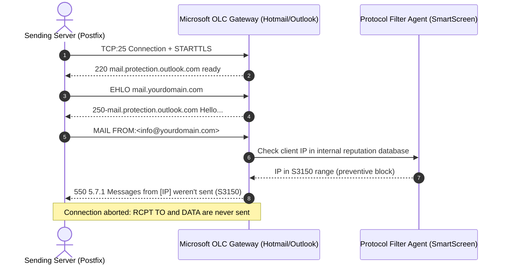

id: delisting-mail-server-hotmail-outlook-s3150
title: Delisting Your Mail Server from Hotmail and Outlook: Solving Error S3150
subtitle: Why pristine SPF, DKIM, and DMARC aren't always enough against Microsoft's SmartScreen filter, and how to request delisting step by step.
date: 2026-11-20
author: manuel
category: Email & DNS
tags: Email, Hotmail, Outlook, Deliverability, Postfix, Spam, DNS, SNDS
language: en
alternate: desbloquear-servidor-correo-hotmail-outlook-s3150
summary: Step-by-step technical guide to diagnose and solve Microsoft SmartScreen error S3150 on self-hosted mail servers (Postfix), fill out the Outlook Sender Support form, and successfully navigate automated support replies.

Setting up your own mail server or managing custom SMTP infrastructure is one of the most rewarding tasks in systems engineering... until you come face-to-face with major consumer email providers.

In our guide on [how to keep your email out of spam](/en/posts/how-to-keep-your-email-out-of-spam/), we explored the essential authentication triad: **SPF**, **DKIM**, and **DMARC**. You follow the RFC standards to the letter, test your server on tools like Mail-Tester, achieve a flawless 10/10 score, configure pristine reverse DNS (*rDNS / PTR*), and watch your emails land reliably in the inboxes of Gmail, Yahoo, Proton, and Apple.

And yet, the moment you send a message to an `@hotmail.com`, `@outlook.com`, or `@live.com` address, your queue bounces it within seconds with a bewildering error:

```text
550 5.7.1 Unfortunately, messages from [X.X.X.X] weren't sent.
Please contact your Internet service provider since part of their network
is on our block list (S3150).
```

What does this code actually mean? Why does Microsoft reject your server before even glancing at the email's subject line? And most importantly: **how do you resolve it permanently?**

In this article, we break down the technical anatomy of an S3150 block using real-world production logs from a Postfix server, explain how Microsoft's edge filtering mechanism works, and provide the exact roadmap to submit a delisting request and get a tier-2 deliverability engineer to mitigate your IP.

---

## 1. Anatomy of the Bounce: The Protocol Filter Agent (PFA)

When an MTA like Postfix attempts to deliver an email to Hotmail or Outlook, it looks up the MX records for the recipient domain (such as `hotmail-com.olc.protection.outlook.com`) and establishes an SMTP session on port 25 with TLS encryption.

In a recent production incident, here is what `/var/log/maillog` recorded:

```text
postfix/smtp[18420]: 4YzK8l1Zt9z3q4: to=<recipient@hotmail.com>,
  relay=hotmail-com.olc.protection.outlook.com[52.101.68.14]:25,
  delay=0.82, delays=0.04/0.02/0.74/0.02, dsn=5.7.1, status=bounced
  (host hotmail-com.olc.protection.outlook.com said:
  550 5.7.1 Unfortunately, messages from [5.9.22.14] weren't sent.
  Please contact your Internet service provider since part of their network
  is on our block list (S3150).
  You can also refer your provider to http://mail.live.com/mail/troubleshooting.aspx#errors.
  [Name=Protocol Filter Agent][AGT=PFA] (in reply to MAIL FROM command))
```

Let's dissect every component of this log:

1. **`dsn=5.7.1`**: Permanent delivery failure (*Permanent Failure*), indicating an access rejection dictated by recipient security policy.
2. **`[Name=Protocol Filter Agent][AGT=PFA]`**: The component executing the block is neither the content antispam engine nor the user's mailbox; it is the **Protocol Filter Agent** at Microsoft's edge gateway (OLC - *Outlook.com*).
3. **`(in reply to MAIL FROM command)`**: This is the crucial technical clue. The rejection happens **during the envelope handshake**, immediately after your server issues `MAIL FROM:<sender@yourdomain.com>`.

   This means Microsoft **never even accepted the recipient (`RCPT TO`) or the message payload (`DATA`)**. Your DKIM signature was never verified, your headers were never read, and your content was never scanned. The connection was terminated purely based on the **source IP address**.



---

## 2. What Does Code S3150 Mean, and How Does It Differ from S3140?

Microsoft SmartScreen relies on internal codes to classify reasons for edge rejections:

* **Error S3140**: The specific IP address has recently generated a substantial volume of flagged spam or triggered a spike in user complaints on Outlook.com.
* **Error S3150**: Part of the network or subnet where your server resides is on Microsoft's block list (*"part of their network is on our block list"*).

The **S3150** error is particularly frustrating for legitimate administrators because:

* **Neighborhood punishment:** If your server is hosted in a public data center or cloud provider (Hetzner, OVH, DigitalOcean, Linode, Scaleway, etc.), other servers in your `/24` or `/20` subnet may have abused sending privileges in the past. Microsoft often blocks entire CIDR blocks preventively.
* **Lack of historical reputation (Cold IP):** If you recently provisioned a new IP address or your sending volume to Microsoft domains is low, SmartScreen has no established reputation profile for your server. When in doubt, its default policy for certain hosting ranges is early rejection.
* **Immunity to public blacklists:** Your IP can be 100% clean on Spamhaus (ZEN/SBL/XBL), Barracuda, SORBS, and Invaluement, yet still trigger a block because Microsoft relies strictly on its proprietary intelligence lists.

---

## 3. Pre-Flight Checklist: Verify Your Server Before Requesting Delisting

Before filling out Microsoft's delisting form, you must verify that your server is technically pristine. When you submit a ticket, Microsoft's automated backend runs immediate checks against your IP. If basic DNS or security discrepancies are detected, your request will be discarded automatically.

### 1. Forward-Confirmed Reverse DNS (FCrDNS)

The PTR record of your sending IP must match your mail server's hostname, and that hostname must resolve back to the exact same IP:

```bash
# 1. Verify reverse resolution (IP -> Hostname)
dig -x 5.9.22.14 +short
# Must return: cedar.altenwald.com.

# 2. Verify forward resolution (Hostname -> IP)
dig cedar.altenwald.com +short
# Must return: 5.9.22.14
```

If the PTR is missing or returns your cloud provider's default generic string (e.g. `static-5-9-22-14.clients.your-server.de`), update it in your hosting provider's control panel before proceeding.

### 2. Unambiguous SPF, DKIM, and DMARC

Ensure that every sending domain publishes valid and strictly aligned DNS records:

* **SPF:** Must include your outbound IP explicitly (`ip4:5.9.22.14`) or via `include:` / `a`, terminating with `-all` (strict reject) or `~all` (softfail).
* **DKIM:** RSA key of at least 2048 bits without truncated or malformed records.
* **DMARC:** A valid `_dmarc.yourdomain.com` record with `p=quarantine` or `p=reject` (or at least `p=none` with an active reporting mailbox `rua=`).

### 3. Verify You Are Not an Open Relay

Confirm that Postfix only relays outbound mail for authenticated clients. Check your configuration (`/etc/postfix/main.cf`):

```text
smtpd_relay_restrictions =
    permit_mynetworks,
    permit_sasl_authenticated,
    defer_unauth_destination
```

You can test this externally by attempting to send to an off-site mailbox without authenticating: the server must reply with `554 5.7.1 Relay access denied`.

### 4. Query Public Blacklists (RBL / DNSBL)

Confirm that your IP is not listed on major industry reputation monitors:

```bash
dig +short 14.22.9.5.zen.spamhaus.org
dig +short 14.22.9.5.b.barracudacentral.org
```

If any lookup returns an address in the `127.0.0.X` range, your IP is actively listed and you must address that delisting first.

---

## 4. The Outlook.com Sender Support Delisting Form

Once your checklist is complete, the official portal to request mitigation for error S3150 is the **Sender Information for Outlook.com Delivery** form:

> **Direct Form Link:**  
> [https://support.microsoft.com/en-us/supportrequestform/8ad563e3-288e-2a61-8122-3ba03a6b9665](https://support.microsoft.com/en-us/supportrequestform/8ad563e3-288e-2a61-8122-3ba03a6b9665)

*(Note: Do not confuse this with `sender.office.com`, which is reserved exclusively for Microsoft 365 / Exchange Online Protection business tenants, not consumer Hotmail/Outlook/Live accounts).*

Here is how to complete each critical field:

| Form Field | What to Enter | Best Practice |
| --- | --- | --- |
| **Contact Name** | Your full name or lead engineer's name. | Keep it professional. |
| **Contact Email Address** | A working mailbox that can reliably receive mail from Microsoft. | **Caution!** Use an external email (such as Gmail or a known working address) to ensure you receive Microsoft's responses even if your server has delivery issues. |
| **Outbound IP addresses to delist** | Your server's static IP (e.g. `5.9.22.14`). | Enter single IPs or exact ranges without spaces. |
| **Domains sending email** | List of hosted domains (e.g. `altenwald.com, dymmer.com`). | Ensure these domains have active DNS and websites. |
| **Is the IP dedicated or shared?** | Select **Dedicated**. | Dedicated IPs receive human review and mitigation much faster. |
| **Reverse DNS (PTR) name** | Server FQDN (e.g. `cedar.altenwald.com`). | Must match the FCrDNS verified in your checklist. |
| **Exact error message / bounce headers** | Paste the exact log line from Postfix. | Include `550 5.7.1`, `(S3150)`, and `[Name=Protocol Filter Agent][AGT=PFA]`. |
| **Description of the issue** | Brief operational context. | Clearly state this is a private, dedicated server for transactional and direct administrative communications, with zero bulk marketing or spam. |

Upon submitting the form, Microsoft's support system will issue an immediate confirmation ticket (*Tracking ID* or ticket number like `SRX1234567890ID`).

---

## 5. The Critical Step: How to Handle the "Not Qualified for Mitigation" Automated Reply

This is the exact junction where most administrators give up.

Between 15 minutes and 2 hours after submitting the request, you will receive an automated response from Microsoft Outlook Deliverability Support. Very often, it contains the dreaded boilerplate sentence:

> *"We have investigated your IP(s)... Unfortunately, the IP(s) listed above do not qualify for mitigation at this time."*

**Do not panic, and do not close your ticket.** This first response is generated entirely by an automated script triggered by the lack of historical volume for your IP in their telemetry.

To break past this barrier, you must **reply directly to that exact email**. Replying reopens the ticket, kicks it out of the automated triage loop, and escalates it to **Tier 2 human support**.

### Technical Escalation Email Template

Maintain the original email subject line untouched (to preserve the case number) and reply with a crisp, technical justification:

```text
Hello Microsoft Deliverability Support Team,

Thank you for your response regarding Ticket #[YOUR_TICKET_NUMBER].

I kindly request a tier-2 human review for this mitigation request. Our mail server IP [YOUR_IP] is a strictly dedicated server used exclusively for transactional and legitimate administrative emails. We do NOT send newsletters, marketing campaigns, or bulk messages.

Please note the following technical verifications:
1. FCrDNS (Forward-Confirmed reverse DNS) is fully compliant:
   - IP [YOUR_IP] resolves to [YOUR_HOSTNAME].
   - [YOUR_HOSTNAME] resolves back to [YOUR_IP].
2. Clean reputation: The IP is not listed on any public DNSBL/RBL (Spamhaus ZEN, Barracuda, etc.).
3. Strict authentication: SPF, DKIM (2048-bit RSA), and DMARC policies are published and passing on all hosted domains.
4. Open Relay disabled: The server strictly requires SMTP AUTH and will never relay unauthorized messages.

The current bounce is triggered at the protocol level:
"550 5.7.1 ... part of their network is on our block list (S3150). [Name=Protocol Filter Agent][AGT=PFA]"

Because this is a clean, dedicated IP, the S3150 subnet block is preventing our users from delivering legitimate, solicited one-to-one communications to Outlook and Hotmail recipients.

Could you please apply a manual mitigation for IP [YOUR_IP]?

Thank you for your assistance.

Best regards,
[Your Name]
[Your Role / Company]
```

When a human deliverability engineer reviews the evidence, confirms that FCrDNS, SPF, and DMARC are properly configured, and verifies that the IP is not a rogue spam bot, you will typically receive a mitigation confirmation:

> *"We have implemented a mitigation for the IP(s) listed above. This process may take 24 - 48 hours to replicate throughout our systems."*

Shortly after this message, Microsoft's edge gateways will accept the `MAIL FROM` command and your emails will deliver smoothly.

---

## 6. Long-Term Health: Enrolling in SNDS and JMRP

To avoid flying blind in the future, Microsoft provides two essential free services for mail server operators:

### Microsoft SNDS (Smart Network Data Services)

**SNDS** ([https://sendersupport.olc.protection.outlook.com/snds/](https://sendersupport.olc.protection.outlook.com/snds/)) is Microsoft's reputation portal for IP owners. It allows you to:

* Monitor color-coded IP reputation across Outlook.com (Green = Good, Yellow = Degraded, Red = Blocked).
* Inspect daily sending volumes dispatched to Microsoft recipients.
* Detect if any message triggered a spam trap hit or if your user complaint rate exceeded the 0.3% threshold.

Adding an IP to SNDS requires verifying network ownership via WHOIS contact records or designated administrative mailboxes (`abuse@` or `postmaster@`).

### JMRP (Junk Mail Reporting Program)

The **JMRP** is Microsoft's Feedback Loop (FBL). Whenever an Outlook.com or Hotmail user clicks "Mark as Junk" on an email originating from your IP, Microsoft generates an ARF (*Abuse Reporting Format*) report and forwards it to your designated address.

This allows your application or mailing system to immediately suppress or unsubscribe that address, preventing recurring complaints that degrade sender reputation.

---

## 7. The Power of Automation with Dymmer

Modern email deliverability leaves zero margin for technical error: a missing SPF closure, a truncated DKIM record, or a DMARC alignment mismatch will trigger aggressive defense mechanisms from providers like Microsoft.

In **Dymmer**, our domain and email management platform is engineered to eliminate technical friction from day one:

1. **Synchronized DNS Records:** Whenever you configure a mailbox or an email identity, Dymmer automatically provisions and validates SPF, DKIM, and DMARC records with rigorous security policies.
2. **Real-Time Deliverability Auditing:** Our mail security dashboard continually verifies reverse DNS consistency, SPF lookup limits, and cryptographic key health.
3. **Built for Self-Hosters:** Whether you use managed mailboxes within Dymmer or operate dedicated servers connected via [dym-bridge](/en/posts/manage-a-host-and-connect-with-dym-bridge/), you maintain full governance over your brand's reputation and deliverability.

If you ever run into error S3150, don't despair: verify your technical hygiene, submit the sender support form, escalate past the automated reply with clear technical facts, and monitor your IP in SNDS to keep your emails landing where they belong.
