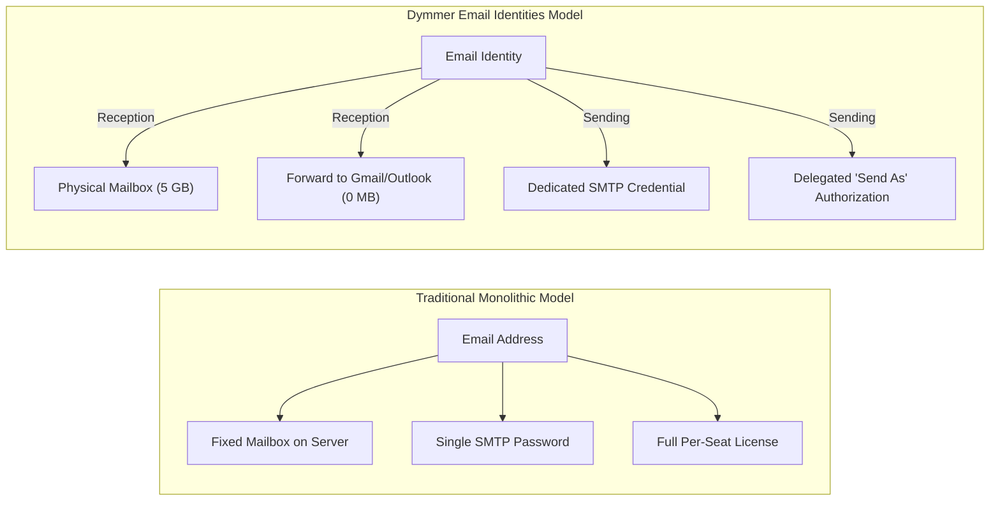
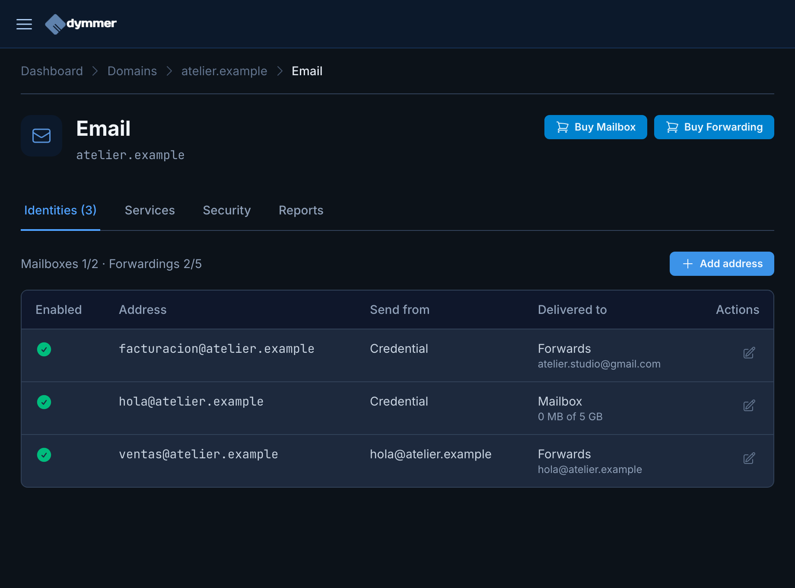
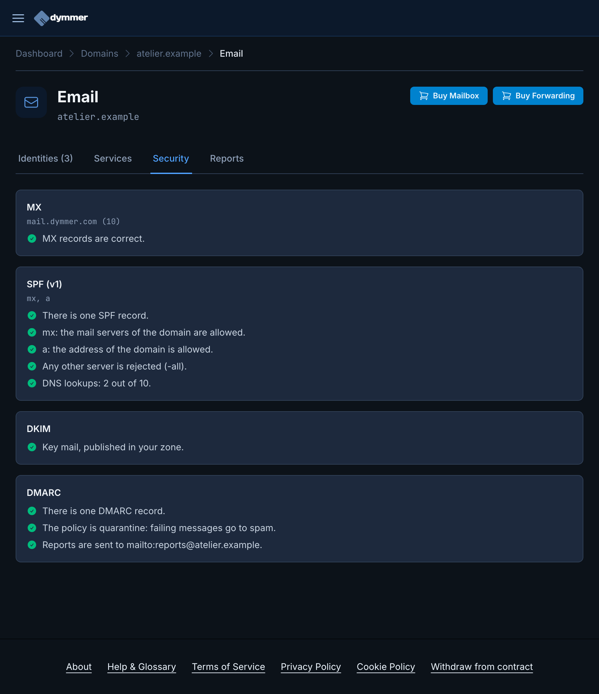

id: email-identities-vs-traditional-mailboxes
title: Email Identities vs Traditional Mailboxes: Comparing Dymmer, Google, Microsoft, Dinahosting, and Proton
subtitle: Why paying per-seat software licenses or locking into monolithic mailboxes is an outdated model for modern domains.
date: 2026-11-19
author: manuel
category: Email & DNS
tags: Email, Identities, Mailbox, Google Workspace, Microsoft 365, Dinahosting, Proton, Security, Self-hosting
language: en
alternate: identidades-de-correo-frente-a-buzones-tradicionales
summary: An in-depth comparison between Dymmer's modular email identities and traditional providers (Google Workspace, Microsoft 365, Dinahosting, and Proton Mail): volume pricing, security, sovereignty, and self-hosting.

For over two decades, managing custom domain email has followed a rigid playbook: for every professional email address your business requires, you either purchase a **monolithic mailbox** or commit to an ongoing **per-seat monthly software license**.

If your business employs three people but needs addresses for `contact@`, `support@`, `billing@`, and `hello@`, the traditional setup puts you in an uncomfortable bind: either you purchase additional full-priced seats on productivity suites that needlessly inflate your monthly recurring costs, or you resort to brittle alias workarounds and shared distribution groups that make replying with authentic sender headers difficult and complicate syncing with your desktop or mobile clients.

At **Dymmer**, we redesigned this foundation around the concept of **Email Identities (`MailIdentity`)**. An email address no longer needs to be a closed, indivisible package: you can independently configure how an address receives messages, how it sends them, and who is authorized to sign on its behalf—combining physical mailboxes with tracked storage, transparent external forwarders, and delegated cross-account sending (*Send As*).

Below, we examine how this modern architecture compares against four of the most widely used email providers on the market: **Dinahosting**, **Google Workspace**, **Microsoft 365**, and **Proton Mail**.

---

## 1. The Monolithic Mailbox Trap and the "Per-Seat Tax"

In most traditional providers, an email account is an indivisible bundle consisting of three locked components:

1. **A physical storage mailbox** (disk space on a server where messages accumulate via IMAP/POP3).
2. **An authentication credential** (a single username and SMTP password).
3. **An individual billing seat** (a fixed recurring charge per user or shared hosting package).

This architecture causes significant operational inefficiencies for real-world projects:

* **Paying for storage you never use:** An address like `legal@yourdomain.com` or `billing@yourdomain.com` might receive fewer than ten messages a month. Paying €7 to €14 each month for 30 GB or 50 GB of storage attached to that single address is a chronic waste of budget.
* **Inflexible sending delegation:** When your head of sales needs to reply from `sales@` as well as their personal address `alice@`, traditional dashboards require maintaining two separate accounts, constantly switching webmail sessions, or configuring complicated delegation rules in dense administrative consoles.
* **Strict linear pricing tiers:** With Google Workspace (~€7/month per user) or Microsoft 365 (~€4 to €7/month per user), scaling from 2 to 10 mailboxes increases your bill fivefold without any volume benefit.

---

## 2. The Architecture of Email Identities in Dymmer

An **Email Identity** in Dymmer represents an address on your domain while decoupling incoming message handling, storage, and outbound authentication.

### Modular Reception: Mailbox or Forwarder

When creating an identity, you decide exactly how inbound mail is processed:

* **Managed Mailbox (`Mailbox`):** Connected to dedicated storage (`mail_storages`) with a defined storage quota (e.g., 5 GB), accessible over standard TLS-encrypted IMAP and POP3 protocols.
* **Direct Forwarding (`Forwarding`):** Immediately routes incoming messages to one or more external destinations (such as your personal Gmail account, Apple Mail, or a team inbox) without consuming storage quota or requiring mailbox maintenance.

### Flexible Outbound Sending and Delegated "Send As"

For outbound sending, Dymmer introduces a crucial architectural feature: **cross-identity authorization**.

* An identity can have its **own dedicated SMTP password** for direct connection from any client.
* Or it can **authorize another verified identity** within your account to send on its behalf.

For example, if you manage `admin@yourdomain.com` alongside team addresses like `sales@` and `info@`, you do not need to configure three distinct email accounts or share credentials. You can grant `admin@` authorization to sign and send as `sales@yourdomain.com`. Dymmer's outbound SMTP relay verifies the authorization and applies the domain's cryptographic **DKIM signature**, ensuring maximum deliverability and strict DMARC alignment.

---

## 3. Quick Comparison: Dymmer vs Dinahosting, Google, Microsoft, and Proton

To help you evaluate your options objectively, we compared core identity capabilities, security parameters, sovereignty, and real-world costs across typical team sizes:

| Feature / Provider | **Dymmer** | **Dinahosting** | **Google Workspace** | **Microsoft 365** | **Proton Mail** |
| :--- | :---: | :---: | :---: | :---: | :---: |
| **Modular identity (independent mailbox vs forwarder)** | **✓** | ✗ *(1)* | ✗ *(1)* | ✗ *(1)* | ✗ *(1)* |
| **Delegated sending ("Send As") without extra seats** | **✓** | ✗ | ✗ *(2)* | ✗ *(2)* | ✗ |
| **External forwarding to Gmail/Outlook at zero storage cost** | **✓** | **✓** | ✗ *(3)* | ✗ *(3)* | ✗ |
| **Automated SPF, DKIM, and DMARC on Anycast DNS** | **✓** | ~ *(4)* | ✗ *(5)* | ✗ *(5)* | ✗ *(5)* |
| **Standard IMAP / POP3 / SMTP without local daemons** | **✓** | **✓** | **✓** | **✓** | ✗ *(6)* |
| **Self-hosting support (connect your own mail server)** | **✓** *(7)* | ✗ | ✗ | ✗ | ✗ |
| **Privacy: no ad profiling or AI telemetry scanning** | **✓** | **✓** | ✗ *(8)* | ✗ *(8)* | **✓** |
| **EU / Swiss data sovereignty (immune to US CLOUD Act)** | **✓** *(9)* | **✓** *(9)* | ✗ *(10)* | ✗ *(10)* | **✓** *(11)* |
| **Default zero-knowledge encrypted mailboxes** | ✗ | ✗ | ✗ | ✗ | **✓** *(12)* |

### Comparison Notes:
* *(1)* **Monolithic mailboxes:** Every address counts against a strict plan ceiling or requires an individual licensed user seat.
* *(2)* **Sending as aliases:** Google and Microsoft support receiving aliases, but outbound replies from department addresses often require dedicated licensed users or shared groups.
* *(3)* **External forwarding:** Requires keeping at least one active, paid user account within the suite.
* *(4)* **Dinahosting DNS:** Automated records apply only if using their authoritative nameservers; third-party DNS requires manual record updates.
* *(5)* **Manual DNS setup:** Requires manually generating cryptographic selectors and copying public TXT and CNAME records into your DNS provider.
* *(6)* **Proton Bridge:** Connecting standard desktop clients (such as Thunderbird, Apple Mail, or Outlook) requires running Proton's proprietary background daemon (*Bridge*).
* *(7)* **Self-hosting with Dymmer:** You can host mailboxes on Dymmer's managed infrastructure or pair your own servers via `dym daemon`, retaining unified DNS, DKIM, and identity orchestration.
* *(8)* **Data scanning & AI:** Google and Microsoft analyze user metadata and content under commercial privacy terms to power integrated AI assistants (Gemini and Copilot) and service telemetry.
* *(9)* **European data sovereignty:** Infrastructure hosted physically in the European Union under strict GDPR protection, outside US extraterritorial jurisdiction.
* *(10)* **US CLOUD Act:** US-headquartered entities remain subject to federal extraterritorial data access warrants regardless of physical server location.
* *(11)* **Swiss jurisdiction:** Proton operates exclusively under the Federal Data Protection Act of Switzerland.
* *(12)* **Zero-knowledge encryption:** Proton encrypts mailboxes at rest with user-held private keys, trading off standard IMAP compatibility in the process.

---

## 4. Volume Economics: 1, 5, and 10 Mailboxes

Examining total annual expenditures across different team sizes reveals why linear per-seat pricing models become economically burdensome for small-to-midsize teams:

* **For 1 mailbox:** Dinahosting (€30/year upon renewal) and Dymmer (€14.99/year) offer accessible entry points for launching a project, compared to over €80/year with Google Workspace or Proton.
* **For 5 mailboxes:** Google Workspace reaches **€408/year** and Proton reaches **€419/year**. On Dymmer, thanks to a progressively decreasing marginal pricing schedule (€14.99 for the 1st mailbox, €7.49 for the 2nd, €3.75 for the 3rd, €1.99 for the 4th, and €0.99 for the 5th), the total annual cost is just **€29.21/year** (~€2.43/month).
* **For 10 mailboxes:** The difference becomes dramatic. While 10 users on Google Workspace or Proton exceed **€800 annually** (~€68/month), 10 mailboxes on Dymmer total **€34.16 annually** (~€2.85/month in total).

### Annual Cost by Mailbox Volume Table

| Provider | 1 Mailbox / year | 5 Mailboxes / year | 10 Mailboxes / year | Monthly cost for 10 mailboxes |
| :--- | :---: | :---: | :---: | :---: |
| **Dymmer** | **€14.99** | **€29.21** | **€34.16** | **~€2.85 / mo** |
| **Dinahosting** *(1)* | €30.00 | €30.00 | €30.00 | ~€2.50 / mo |
| **Microsoft 365 (Exchange P1)** *(2)* | ~€44.40 | **€222.00** | **€444.00** | **~€37.00 / mo** |
| **Google Workspace (Starter)** | ~€81.60 | **€408.00** | **€816.00** | **~€68.00 / mo** |
| **Proton Mail (Essentials)** | ~€83.88 | **€419.40** | **€838.80** | **~€69.90 / mo** |

* *(1)* Dinahosting offers €15 for the first year, renewing at €30/year (includes up to 10 mailboxes sharing 50 GB).
* *(2)* Microsoft rate calculated with *Exchange Online Plan 1* (~€3.70/user/mo). Choosing *Business Basic* (including Teams, SharePoint, and OneDrive) brings the cost to €78/year per user (€780/year for 10 users).

Even more importantly: if your team only needs **2 actual storage mailboxes** alongside **8 forwarding identities** (`info@`, `press@`, `admin@`, etc.), your annual Dymmer investment drops to €22.48/year, whereas per-seat platforms charge full license fees for each account.

---

## 5. Automated DNS Cryptography: Friction-Free SPF, DKIM, and DMARC

Setting up custom email with Google Workspace, Microsoft 365, or Proton typically involves tedious manual DNS verification:

1. **SPF (`v=spf1`):** Specifying which mail transfer agents are permitted to dispatch mail on your domain's behalf.
2. **DKIM:** Generating asymmetric key pairs (typically 2048-bit RSA), publishing public keys within specific TXT or CNAME selector records, and aligning signing parameters.
3. **DMARC:** Specifying alignment enforcement (`p=none`, `p=quarantine`, or `p=reject`) to inform receiving servers how to handle authentication failures.

When email hosting and DNS are managed by disparate vendors, users must manually copy and paste lengthy cryptographic strings across disjointed dashboards. A single truncated character or misconfigured selector will cause legitimate business messages to be discarded or routed to the spam folder by Gmail, Yahoo, and Outlook.

In **Dymmer**, Anycast DNS management and email operations share an integrated control plane. When you register or delegate a domain and provision your email identities, **SPF, DKIM, and DMARC are automatically computed, cryptographically signed, and published** across global Anycast nameservers with zero manual copying.

---

## 6. Privacy, European Sovereignty, and the US CLOUD Act

Data protection extends beyond transport encryption (TLS) into the **legal jurisdiction** governing the servers hosting your message archives:

* **US-Headquartered Providers (Google Workspace & Microsoft 365):** Even when operating European data centers, US multinational corporations remain bound by the **US CLOUD Act** (*Clarifying Lawful Overseas Use of Data Act*). This statute allows US federal courts to compel access to customer data stored overseas without requiring a warrant issued by the sovereign state where servers are located. Furthermore, both providers ingest communication telemetry and content signals into internal operational and AI pipelines.
* **European Providers (Dymmer & Dinahosting):** Core infrastructure resides physically within the European Union, operating strictly under the **General Data Protection Regulation (GDPR)** and European privacy frameworks, ensuring immunity from extraterritorial disclosure orders. At Dymmer, your communications are never indexed, profiled, or repurposed for commercial AI model training.
* **Proton Mail:** Based in Switzerland, Proton operates under the Swiss Federal Data Protection Act and enforces **zero-knowledge mailbox encryption** by default (messages are stored encrypted with private keys controlled solely by the user). While offering exceptional privacy, this architecture introduces practical client friction: native desktop clients like Apple Mail, Thunderbird, or Microsoft Outlook cannot connect via direct standard IMAP and mandate running the local *Proton Mail Bridge* daemon on your workstation.

---

## 7. The Self-Hosting Advantage: Bring Your Own Servers

Another major differentiator rarely addressed in provider comparisons is **the option to self-host your mail backend**.

Google Workspace, Microsoft 365, Dinahosting, and Proton Mail operate purely as closed SaaS environments: you must use their shared storage clusters and proprietary transport infrastructure without any option to run your own backend services.

**Dymmer** is architected as an open hybrid control plane:

1. **Managed Mode (*Hosted*):** Dymmer hosts your mailboxes on high-availability European infrastructure tuned for maximum deliverability, IP reputation, and resilient NVMe storage.
2. **Self-Hosted Mode (*Bring Your Own Server*):** You can connect your own VPSs or bare-metal instances (using the lightweight open-source `dym daemon` or direct SSH) and operate them as dedicated mail nodes, while managing identities, DKIM keys, and Anycast DNS centrally from Dymmer.

This flexibility allows growing engineering teams and digital agencies to begin on managed infrastructure with zero operational overhead, and subsequently migrate high-volume storage onto dedicated hardware whenever their business requires it—without rebuilding DNS records or changing administrative workflows.

---

## 8. Summary: Choosing the Right Solution for Your Needs

* **Choose Google Workspace or Microsoft 365** if your organization fundamentally relies on their integrated productivity suites (Google Docs/Drive/Meet or Word/Excel/Teams) and your organization has the budget to allocate €400 to €800+ annually per 10 employees on office software seats.
* **Choose Proton Mail** if your absolute priority is end-to-end zero-knowledge encryption due to sensitive professional obligations (such as investigative journalism, legal counsel, or medical confidentiality), and your team is comfortable relying on proprietary mobile applications and running *Proton Bridge* on desktops.
* **Choose Dinahosting** if you need a traditional all-in-one shared hosting plan with bundled mailboxes and localized Spanish phone support for a small number of accounts.
* **Choose Dymmer** if you are a developer, founder, agency, or modern business seeking:
  * Modular identities that eliminate per-seat licensing fees for secondary, departmental, or forwarding addresses.
  * Cross-identity sending delegation (*Send As*) with automated, cryptographic DKIM signing.
  * Decreasing marginal pricing that scales 10 mailboxes for under €35/year.
  * 100% automated SPF, DKIM, and DMARC provisioning on global Anycast DNS.
  * Full compatibility with any standard email client (Gmail web, iOS Mail, Android, Apple Mail, Thunderbird, or Outlook) without background bridges or vendor lock-in.
  * The freedom to run on managed European infrastructure or bring your own self-hosted mail servers.
