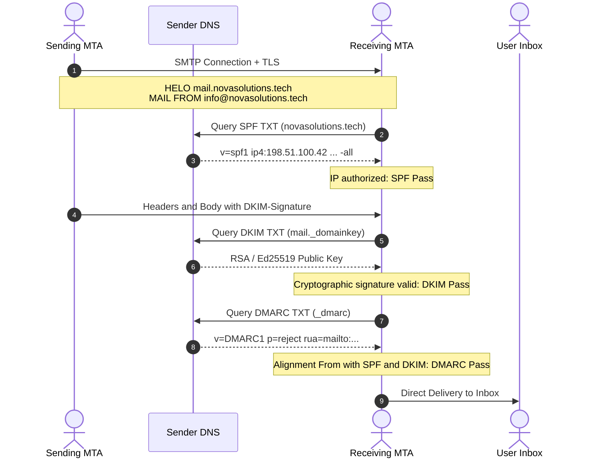
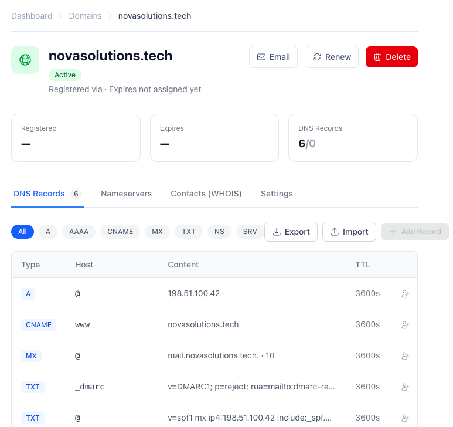
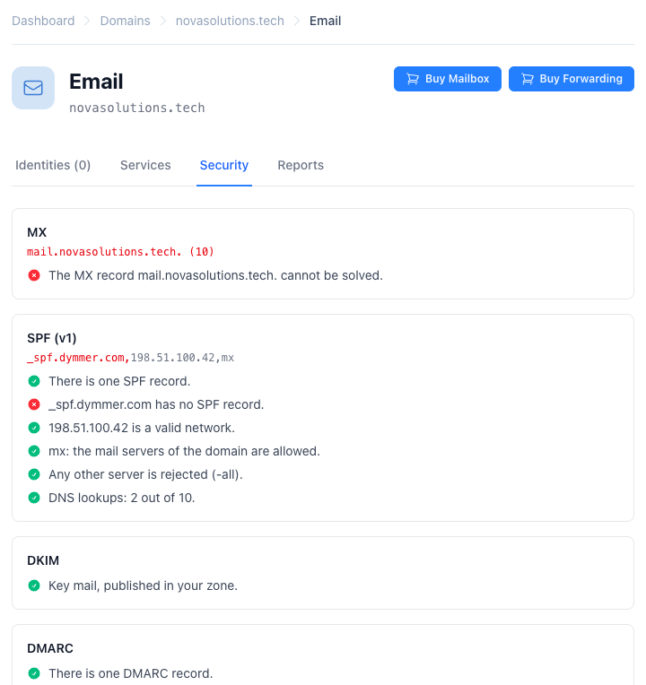
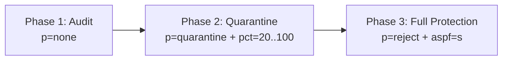

id: how-to-keep-your-email-out-of-spam
title: How to Keep Your Email Out of the Spam Folder
subtitle: A technical guide to the SPF, DKIM, and DMARC trinity: RFC standards, practical DNS configuration, and protecting your sending reputation.
date: 2026-11-06
author: manuel
category: Email & DNS
tags: Email, SPF, DKIM, DMARC, Deliverability, DNS
language: en
alternate: como-evitar-que-el-correo-caiga-en-spam
summary: Learn how to properly configure SPF, DKIM, and DMARC using RFC standards and real Dymmer screenshots to ensure your emails always hit the inbox and never the spam folder.

Sending an important email only to have it vanish into the recipient's spam folder is one of the most frustrating and costly challenges in modern communications. Major mailbox providers like Google, Yahoo, Microsoft, and Apple enforce strict authentication thresholds: **if your domain does not rigorously prove its identity, your messages will be demoted to spam or rejected outright at the SMTP boundary**.

The common belief that "adding an SPF record is enough" is a dangerous misconception. In contemporary email infrastructure, deliverability relies on an indivisible trinity: **SPF**, **DKIM**, and **DMARC**. None of them is sufficient on its own; each addresses the inherent vulnerabilities of the other two.

In this guide, we dive deep into the RFC standards governing each mechanism, examine frequent architectural pitfalls (such as the 10-DNS-lookup limit in SPF), and demonstrate how to configure and monitor your email security visually using **Dymmer**.

---

## The Authentication Trinity: Why You Need All Three

To understand why three independent protocols are indispensable, consider what each verifies during a standard SMTP transaction:

1. **SPF (Sender Policy Framework)**: Authorizes the sending server's **IP address** against a list published in DNS. It protects the envelope sender identity (`Return-Path` or `MAIL FROM`).
2. **DKIM (DomainKeys Identified Mail)**: Provides **cryptographic integrity** for message headers and body. It ensures the message was not modified in transit and was signed by an authorized private key matching a public key in your DNS.
3. **DMARC (Domain-based Message Authentication, Reporting, and Conformance)**: Acts as the **policy and alignment umbrella**. It ties the human-readable `From:` header to the identities verified by SPF and DKIM, instructing receivers on how to treat failures (ignore, quarantine, or reject).



If any link in this chain breaks, deliverability collapses:
- **SPF alone**: Forwarded emails inevitably fail SPF because the forwarding server's IP is not in your DNS record. Additionally, SPF does not validate the visible `From:` address, leaving your brand open to direct spoofing.
- **DKIM alone**: Proves that the message was signed without tampering, but provides no instruction to receivers on what to do when an unsigned email impersonates your domain.
- **Without DMARC**: Neither SPF nor DKIM enforces alignment with the visible `From:` address seen by the recipient, allowing malicious actors to exploit your reputation for phishing.

---

## 1. SPF: Authorizing Sending Servers Without Exceeding the 10-Lookup Limit

Defined in the **[RFC 7208](https://datatracker.ietf.org/doc/html/rfc7208)** standard, SPF allows domain owners to publish a list of authorized servers in a DNS `TXT` record.

A standard SPF record at the zone apex (`@`) looks like this:

```text
v=spf1 mx ip4:198.51.100.42 include:_spf.dymmer.com -all
```

Key components explained:
- `v=spf1`: Mandatory version tag that must appear at the beginning of the record.
- `mx`: Authorizes all servers published in the domain's MX records.
- `ip4:198.51.100.42` (or CIDR blocks like `ip4:198.51.100.0/24`): Authorizes explicit IP ranges directly without requiring any DNS queries.
- `include:_spf.dymmer.com`: Incorporates the SPF policy of an external provider (such as Dymmer's outbound mail cluster).
- `-all` (*Hard Fail*): Instructs receiving servers to reject any sender not matching the preceding mechanisms. Avoid leaving `~all` (*SoftFail*) or `?all` (*Neutral*) in place once your setup is verified.

### The 10-DNS-Lookup Limit ([RFC 7208 §4.6.4](https://datatracker.ietf.org/doc/html/rfc7208#section-4.6.4))

The most common operational failure in SPF configuration is exceeding the **[10-DNS-lookup limit](https://datatracker.ietf.org/doc/html/rfc7208#section-4.6.4)**. To protect receiving servers against amplification and denial-of-service (DoS) attacks, RFC 7208 limits the number of mechanisms that require DNS queries (`include`, `mx`, `a`, `ptr`, `redirect`, `exists`) to a maximum of 10 per verification.

When organizations integrate multiple third-party tools (such as Google Workspace, Mailchimp, Zendesk, and Salesforce), each nested `include` adds additional queries. On query number 11, receiving servers abort evaluation and declare a permanent error: **SPF PermError**.

> [!WARNING]
> An `SPF PermError` is treated by major mailbox providers as a total authentication failure, routing your messages directly to the spam folder or dropping them completely.

Best practices to stay well within limits:
1. Use direct `ip4:` or `ip6:` declarations for static infrastructure.
2. Eliminate deprecated mechanisms like `ptr` (prohibited by RFC 7208) or redundant `a` mechanisms when `mx` or explicit IPs already cover your hosts.
3. Never publish multiple SPF records in the same domain. The RFC mandates that if a receiver encounters two `v=spf1` records, it must discard both.

---

## 2. DKIM: Cryptographic Message Integrity

Specified in the **[RFC 6376](https://datatracker.ietf.org/doc/html/rfc6376)** standard, DKIM ensures that emails cannot be altered during transit and remains valid even after message forwarding. The sending server generates a digital signature (typically 2048-bit RSA or Ed25519) across crucial headers (`From`, `To`, `Subject`, `Date`, `Message-ID`) and a hash of the message body.

The signature is attached in the `DKIM-Signature` header:

```text
DKIM-Signature: v=1; a=rsa-sha256; c=relaxed/relaxed; d=novasolutions.tech;
  s=mail; t=1730894400;
  h=from:to:subject:date:message-id;
  bh=47DEQpj8HBSa+/TImW+5JCeuQeRkm5NMpJWZG3hSuFU=;
  b=dB7G...x89Q==
```

Receivers verify this signature by fetching your public key from DNS using the **selector** (`s=`) and **domain** (`d=`):

```text
Host: mail._domainkey.novasolutions.tech
Type: TXT
Value: v=DKIM1; k=rsa; p=MIIBIjANBgkqhkiG9w0BAQEFAAOCAQ8AMIIBCgKCAQEA0Y3yZ24D8...
```

### Essential Guidelines for DKIM
- **Key length**: Always use 2048-bit keys. Legacy 1024-bit keys are considered cryptographically weak and are penalized by modern spam filters.
- **Canonicalization (`c=relaxed/relaxed`)**: Allows for whitespace and formatting adjustments made by intermediary mail servers without invalidating the cryptographic hash.
- **Dedicated selectors**: Assign unique selectors for separate sending streams (e.g., `mail._domainkey` for user mailboxes and `app._domainkey` for automated notifications).

---

## 3. DMARC: Policy Enforcement and Domain Alignment

Defined in the **[RFC 7489](https://datatracker.ietf.org/doc/html/rfc7489)** standard, DMARC serves as the cornerstone of email authentication. It performs three critical functions:

1. **Identifier Alignment**: Requires the domain shown in the visible `From:` header to match the domain validated by SPF (`Return-Path`) or DKIM (`d=novasolutions.tech`). You can specify relaxed alignment (`aspf=r`, organizational domain match) or strict alignment (`aspf=s`, exact subdomain match).
2. **Policy Enforcement (`p=`)**: Instructs the receiving MTA how to handle messages that fail both SPF and DKIM alignment:
   - `p=none`: Monitoring mode. Collects reports without affecting message delivery.
   - `p=quarantine`: Delivers failing messages to the spam/junk folder.
   - `p=reject`: Refuses failing messages at the SMTP connection with a `5xx` error code.
3. **Aggregate Reporting (`rua=`)**: Directs mailbox providers to send daily XML feedback reports detailing who is sending email on behalf of your domain and whether each message passed or failed authentication checks.

A complete DMARC record published at the `_dmarc` subdomain:

```text
Host: _dmarc.novasolutions.tech
Type: TXT
Value: v=DMARC1; p=reject; rua=mailto:dmarc-reports@novasolutions.tech; aspf=s; adkim=s
```

---

## Practical Implementation in Dymmer

Manual DNS configuration in traditional control panels often results in formatting errors, escaped quotes, or truncated base64 DKIM keys.

**Dymmer** provides a unified, structured DNS management environment that guarantees technical precision.

### The DNS Zone Management View

In Dymmer's DNS management interface for our sample domain (`novasolutions.tech`), all four essential records are organized with clear type, host, and value mappings:



The interface highlights the required configurations:
- **MX**: Configured with priority `10` pointing to `mail.novasolutions.tech.` for inbound routing.
- **TXT at `@` (SPF)**: Declaring authorized sending servers with the `-all` hard fail qualifier.
- **TXT at `mail._domainkey` (DKIM)**: Storing the RSA public key without truncation or character encoding corruption.
- **TXT at `_dmarc` (DMARC)**: Enforcing `p=reject` policy and specifying the aggregate report destination.

---

## Real-Time Mail Security Diagnostics

What sets Dymmer apart is its built-in **Mail Security** engine. Rather than requiring external command-line tools (*dig*, *delv*) or third-party check services, Dymmer continuously evaluates your zone against RFC specifications:



Key diagnostic capabilities shown above:
- **MX Resolution**: Confirms that designated mail servers resolve to valid IP addresses.
- **SPF Verification**:
  - Confirms a single valid SPF record exists.
  - Verifies presence of the mandatory `-all` enforcement rule.
  - Validates network blocks and IP addresses (`198.51.100.42`).
  - **DNS Lookup Counter**: Calculates lookup costs (e.g., `2 out of 10 lookups used`), providing proactive warnings before you approach the 10-query ceiling.
- **DKIM Validation**: Verifies that your selector keys are correctly published and syntactically sound.
- **DMARC Inspection**: Confirms that your domain is actively protected under an enforcement policy (`reject`) and validates that your report recipient address (`rua=`) is operational.

---

## Recommended 3-Stage Rollout (Zero Downtime)

When configuring authentication for an active production domain, never enforce `p=reject` on day one. Adopt a phased rollout:



1. **Phase 1: Passive Monitoring (`p=none`)**  
   Deploy SPF and DKIM. Set DMARC to `p=none; rua=mailto:dmarc-reports@yourdomain.com`. Review aggregate reports over 2 to 4 weeks to identify legitimate outgoing services that may need SPF authorization or dedicated DKIM keys.
2. **Phase 2: Gradual Quarantine (`p=quarantine`)**  
   Once all legitimate sources align, update your policy to `p=quarantine; pct=20`. Gradually scale `pct` to `50` and `100`. Unauthorized messages will now be diverted to the spam folder.
3. **Phase 3: Strict Rejection (`p=reject`)**  
   Lock down your domain: `v=DMARC1; p=reject; aspf=s; adkim=s`. Any spoofed email impersonating your organization will be blocked at the SMTP gate.

---

## Conclusion

Securing inbox placement is no longer about subject-line tricks or keyword optimization. It is fundamentally an engineering discipline built upon **cryptographic trust and network standards**.

By implementing **SPF** ([RFC 7208](https://datatracker.ietf.org/doc/html/rfc7208)), **DKIM** ([RFC 6376](https://datatracker.ietf.org/doc/html/rfc6376)), and **DMARC** ([RFC 7489](https://datatracker.ietf.org/doc/html/rfc7489)) together, you guarantee:
- Zero tolerance for spoofing and brand impersonation.
- Peak sender reputation across Gmail, Yahoo, and Microsoft 365 algorithms.
- Full transparency into your outbound email ecosystem through automated DMARC telemetry.

With **Dymmer's** automated DNS and mail security inspection tools, implementing and maintaining this infrastructure is seamless, reliable, and continuously verified.
