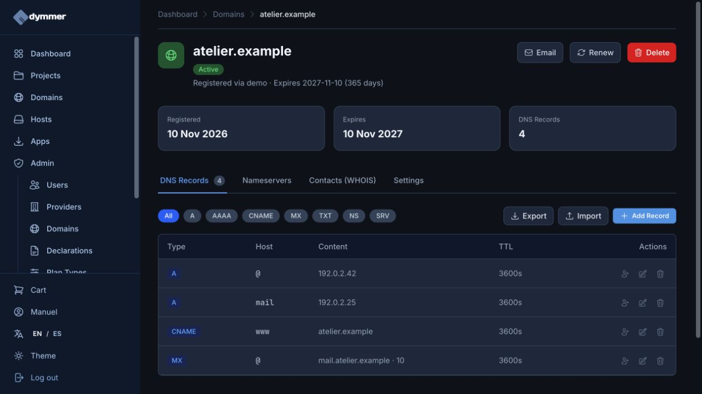
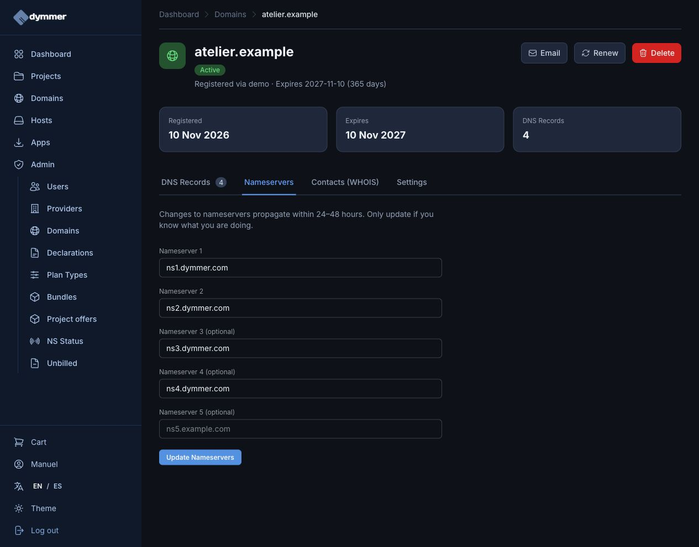
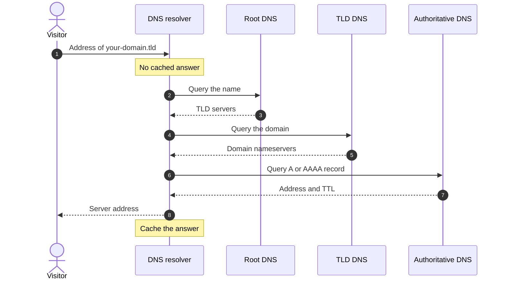
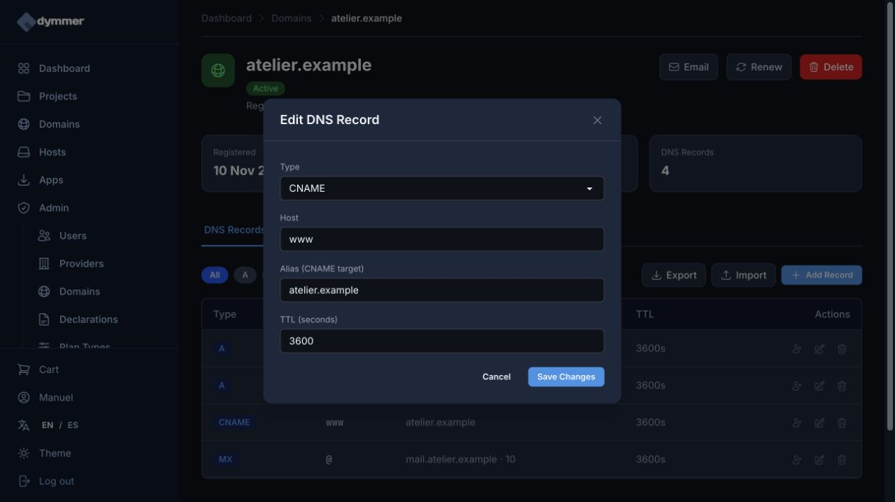
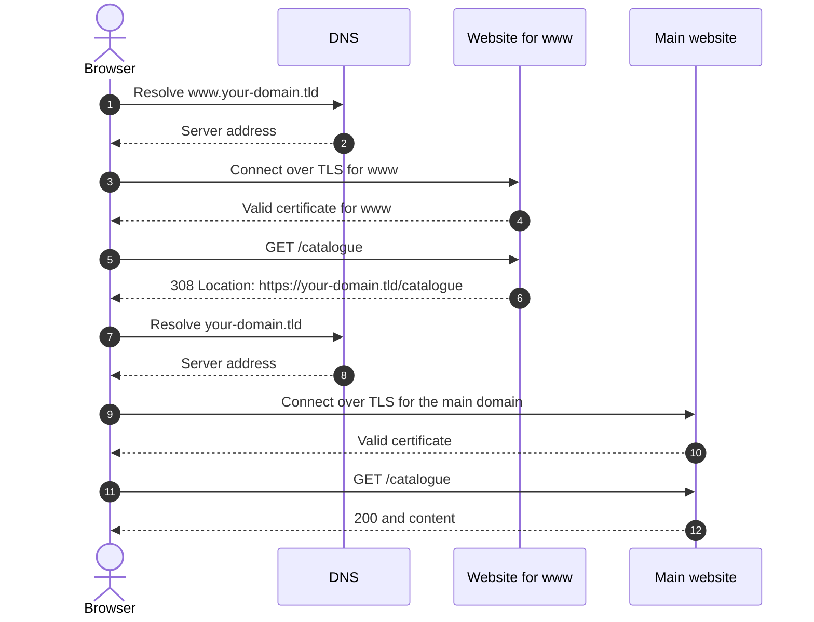

id: i-bought-a-domain-now-what
title: I bought a domain. Now what?
subtitle: Connect your website and email step by step: DNS, hosting and the checks that matter.
date: 2026-11-10
author: manuel
category: Domains & DNS
tags: Domains, DNS, Hosting, HTTPS, Email
language: en
alternate: he-comprado-un-dominio-y-ahora-que
summary: Turn a newly registered domain into a working website: configure DNS, www and email in Dymmer with real screenshots and sequence diagrams.

You have the name for your project. You open a browser, type the domain and… your website is not there yet. That is normal: registering a domain is the first step. Now you need to tell visitors where your website and email services are, and prepare those services to answer using your name.

In this guide, we will connect the website of a fictional small studio, **Atelier**, and explain what to configure in Dymmer and what to ask your hosting provider. We will start with names and finish by checking the result.

The screenshots come from a real Dymmer development instance with demonstration data. `atelier.example` uses a suffix reserved for examples, and `192.0.2.42` and `192.0.2.25` belong to a documentation address range. **Do not copy these destinations into your domain**: replace them with the values supplied for your service. [Reserved names, RFC 2606](https://www.rfc-editor.org/rfc/rfc2606), [documentation addresses, RFC 5737](https://www.rfc-editor.org/rfc/rfc5737).

## 1. Separate the name, the directions and the content

Buying a domain does not necessarily include a website or a mailbox. Check what your package provides:

| Part | What needs to be ready |
| --- | --- |
| Domain registration | The name is active, its details are correct and you know when to renew it. |
| DNS | The authoritative servers publish the records your domain will use. |
| Web hosting | A service stores or runs your website and accepts your domain. |
| Email | A provider receives or sends mail for the addresses you have configured. |

You can obtain these services together or from different providers. For example, you might manage your domain and DNS in Dymmer, host your website elsewhere and use another provider for email.

Under **Domains**, open your domain's details. Check its status and expiry date before editing anything. If it is still pending, resolve the registration first. Review **Contacts (WHOIS)** and **Settings** as well, to keep your contact information and renewal arrangements up to date.



*The demonstration zone already contains the records we will explain below. “Registered via demo” identifies the fictional data used in this environment.*

## 2. Find out who answers for your DNS

Open the **Nameservers** tab. Nameservers identify where the DNS zone used by the Internet is served. This screenshot shows Dymmer's servers.



If you plan to use Dymmer's DNS, check that your domain's delegation matches the servers Dymmer specifies. If you use external DNS, edit your records there. Dymmer preserves its records but displays them as read-only when external nameservers are active and no change is pending.

**Moving your website does not require changing nameservers.** You can keep DNS where it is and update only the website records. If you also want to move DNS, prepare the new zone first: use **Export** to keep a copy and review the **Import** preview before accepting its records. Include email records and verification records for other services.

Here is a simplified lookup without a cached answer. To represent a public delegation, we use `your-domain.tld` as a placeholder for your actual registered domain; `.example` is not delegated to serve our fictional website.



A valid cached answer saves part of that journey. Delegation and recursive resolution are separate from hosting a web page. [DNS resolution model, RFC 1034](https://www.rfc-editor.org/rfc/rfc1034).

## 3. Connect the main domain and `www`

Before adding records, ask your hosting provider for its **custom domain** instructions. It may supply an IPv4 address, an IPv6 address, a target hostname and a TXT verification record. Do not turn a supplied CNAME destination into a fixed IP on your own: the provider may change that address.

For our example, the hosting service has supplied an IPv4 address. Under **DNS Records → Add Record**, the fields would be:

| Name | Record configuration |
| --- | --- |
| Main domain | Type `A`; Host `@`; hosting IPv4 address (`192.0.2.42` in the demo); TTL `3600` seconds. |
| With `www` | Type `CNAME`; Host `www`; Alias `atelier.example`; TTL `3600` seconds. |

`@` represents the zone's domain. `www` represents `www.atelier.example`. Enter the CNAME destination as a hostname, **without `https://`, ports or paths**.

If a record already exists for that name and type, review and edit it instead of adding another by habit. Here, we open the pencil button on the CNAME row to check its destination:



These distinctions help you choose the right record:

- **A** associates a name with an IPv4 address.
- **AAAA** associates a name with an IPv6 address. Add it only if your hosting provider supplies working IPv6 for that website.
- **CNAME** makes one name an alias of another. It must not coexist with other records at the same name; in this example we use it at `www`, not `@`.
- **MX** identifies the servers receiving email for a domain.
- **TXT** publishes text used for verification and policies, among other purposes.

These types are also explained in the [DNS record reference](https://developers.cloudflare.com/dns/manage-dns-records/reference/dns-record-types/). Some platforms provide special handling for the root domain. Follow instructions compatible with your DNS provider rather than assuming a CNAME at `@` works everywhere.

## 4. Prepare the website and its HTTPS certificate

DNS tells a client where to connect, but your hosting service must still recognize the requested name. Add **both names**, `atelier.example` and `www.atelier.example`, to your website's custom domain configuration, following the service's instructions.

Then check that your content is published and that the HTTPS certificate covers the names you will use. If your hosting provider verifies domain ownership through DNS, complete that verification and wait for confirmation that the certificate has been issued.

If you use your own server, configure its website or proxy for those names too. Our [host management and Dym Bridge guide](/en/posts/manage-a-host-and-connect-with-dym-bridge/) explains access to files; uploading files over SFTP and configuring what the web server serves are separate tasks.

### A CNAME does not change the browser's address

Choose your primary address. In this example, we choose `https://atelier.example` and configure a redirect from `www` at the hosting service, preserving paths and query parameters:

```text
https://www.atelier.example/catalogue?language=en
                         ↓
https://atelier.example/catalogue?language=en
```

A redirect is an HTTP response from the server. Permanent redirects commonly use 301 or 308; temporary redirects use 302 or 307. Status 308 preserves the HTTP method, which matters if you redirect more than GET visits. [HTTP redirects on MDN](https://developer.mozilla.org/en-US/docs/Web/HTTP/Guides/Redirections).



The `www` server needs a valid certificate **before** returning an HTTPS redirect. Both names may reach the same server; the diagram separates their roles. [Server authentication with TLS](https://developer.mozilla.org/en-US/docs/Web/Security/Defenses/Transport_Layer_Security).

## 5. Configure email as a separate service

Having a working website does not automatically create `hello@atelier.example`. First configure the address or mailbox with your email provider, then use exactly the records it supplies.

The demonstration includes an MX at `@`, with priority `10` and target `mail.atelier.example`, plus an A record for `mail` pointing to the fictional IP `192.0.2.25`. This illustrates the relationship between those records; it is not a universal Dymmer email configuration. A provider may supply several MX records and hostnames under its own domain, in which case you do not need local A records for them.

From the domain details, **Email** opens email management in Dymmer. Mailboxes and other capabilities depend on your subscribed service. Prepare outgoing mail as well as incoming mail: SPF, DKIM and DMARC are covered in our [guide to improving email delivery](/en/posts/how-to-keep-your-email-out-of-spam/).

If you are only changing web hosting, keep your email MX and TXT records unless you are also migrating mail. A previous zone export helps you identify what changed.

## 6. Check each layer instead of waiting blindly

Start with the visitor's experience: open the main domain and `www`, check the certificate and visit an inner page. Send a test message from an external account and reply if you have configured email.

If something fails, a terminal helps separate DNS from web hosting. These commands are templates for **your actual domain**; `atelier.example` will not resolve publicly. On macOS and Linux you can use `dig`; in PowerShell, use `Resolve-DnsName`.

```bash
# Replace your-domain.tld with your registered domain
dig NS your-domain.tld +short
dig A your-domain.tld +short
dig AAAA your-domain.tld +short
dig CNAME www.your-domain.tld +short
dig MX your-domain.tld +short
```

```powershell
Resolve-DnsName your-domain.tld -Type NS
Resolve-DnsName your-domain.tld -Type A
Resolve-DnsName www.your-domain.tld -Type CNAME
Resolve-DnsName your-domain.tld -Type MX
```

To query the authoritative server directly, also replace `authoritative-ns.tld` with one of the domain's actual nameservers:

```bash
dig @authoritative-ns.tld your-domain.tld A +noall +answer
curl -I https://www.your-domain.tld/
curl -I https://your-domain.tld/
```

`curl -I` requests headers: you can inspect the HTTP status and a redirect's `Location` destination. It does not verify the whole page, so finish the check in your browser.

| Result | Where to look first |
| --- | --- |
| NS records are not what you expected | Registrar delegation and the status of a nameserver change. |
| No address appears, or the address differs | A/AAAA records, the zone you are editing and caches. |
| The address is correct but another website appears | Custom domain or website configuration at the hosting service. |
| The certificate fails | Covered names, validation and certificate issuance. |
| The main domain works but `www` does not | DNS, website configuration and certificate coverage for `www`. |
| Redirects loop | Hosting and application rules; check that they do not contradict each other. |
| The website works but email does not | MX records, address configuration and the email provider. |

## 7. Understand TTL and stop resetting the clock

A TTL of `3600` allows a DNS answer to remain cached for one hour. It does not mean every visitor receives a change exactly one hour after you click Save. Different resolvers may have queried the record at different times. [TTL and DNS caching](https://developers.cloudflare.com/dns/manage-dns-records/reference/ttl/).

For a planned migration, lower the TTL **beforehand**, allowing answers with the previous value to expire. Lowering it afterwards does not change copies already cached. “Does not exist” answers can also be cached: creating a record does not immediately remove that negative cache. [Negative caching, RFC 2308](https://www.rfc-editor.org/rfc/rfc2308).

The nameserver screen provides a 24–48 hour guideline for nameserver changes. Do not treat it as a mandatory wait for every DNS edit. First check what the authoritative server answers, then your usual resolver. Repeatedly changing values without recording the results makes diagnosis harder.

## Your domain now has a destination

Before sharing the address, check that the domain is active, DNS answers come from the correct provider, the website loads over HTTPS and `www` reaches your chosen address without losing paths. If you have email service, test both incoming and outgoing messages. Keep a zone export and plan for renewal.

The name you bought now has a practical purpose: bringing visitors to your project and, if you need it, giving your conversations an address of their own.
