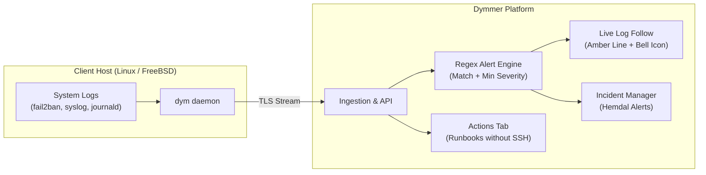

id: live-server-observability-and-operations
title: Real-Time Server Observability and Operations: System Logs, Regex Alerts, and Actions Without SSH
subtitle: How to monitor fail2ban, systemd journal, or package management in real time, catch anomalies with regex alerts, and trigger operational runbooks directly from Dymmer.
date: 2026-11-28
author: manuel
category: Hosts & SSH
tags: Hosts, Logs, Observability, Alerts, Regex, Server Management, dym, DevOps
language: en
alternate: observabilidad-y-operaciones-de-servidor-en-vivo
summary: Discover how Dymmer transforms server operations with host-level observability: live streaming of system logs (fail2ban, syslog, dpkg), regex-powered alerts with in-line amber highlights, and declarative action runbooks via dym daemon without opening interactive SSH sessions.

Managing a fleet of servers — whether virtual cloud instances, bare-metal servers, or dedicated hardware — frequently confronts engineering teams with a difficult operational trade-off:

1. **The overhead of centralized log stacks:** Deploying and maintaining clusters like Elasticsearch/Logstash/Kibana (ELK) or Grafana Loki/Prometheus for a modest server footprint introduces substantial RAM consumption, maintenance burden, and licensing or infrastructure costs that often outstrip the actual value of what you want to monitor.
2. **The friction and risk of "manual SSH":** The traditional alternative is opening terminal sessions, running ad-hoc `tail -f /var/log/syslog` or `journalctl -u nginx -f`, and relying on human memory to recall sensitive credentials, exact service paths, and restart command syntax.

In recent updates to **Dymmer**, we have delivered a major architectural milestone in infrastructure management: **the Host is now a first-class citizen with its own native observability and operations panel**.

You no longer need to bind a log stream or an action to a specific software project line to monitor it. You can now ingest system-level logs (`fail2ban`, `dpkg`, `auth.log`, `journald`), define **alerts based on regular expressions and minimum severity levels**, watch critical log lines **highlighted in amber in a live stream**, and execute **safe operational runbooks** powered by the lightweight `dym` daemon.

---

## 1. The Host as an Autonomous Entity: Decoupling System Logs

In traditional PaaS architectures, all operational telemetry is tied strictly to the "application codebase." However, the most destructive production incidents rarely originate within user-facing application code:

* A sudden SSH brute-force assault saturating sockets before the firewall reacts.
* A runaway process consuming available memory and triggering the Linux kernel *OOM Killer* (*Out Of Memory*).
* A partition filling up unexpectedly due to failed log rotations or abandoned temp files.
* Security daemons like `fail2ban` or `crowdsec` dropping rules or losing synchronization.

With Dymmer's new host-level **Logs** tab, any system log file or journald unit can be tracked directly from the host. The local `dym` daemon transmits updates securely over encrypted connections to Dymmer.



---

## 2. Intelligent Alerts: Regular Expressions and Severity Thresholds

A log stream without filters is just noise. If a server produces 5,000 lines per minute, nobody can read it in a terminal. Conversely, if you receive a notification for every single event, alert fatigue ensures that genuine threats are missed.

Dymmer introduces a clean two-stage evaluation pipeline:

1. **The log baseline filter:** Strips out unneeded background noise before ingestion.
2. **The alert match pattern (`match`):** A case-insensitive regular expression applied against incoming line text.
3. **Minimum severity threshold (for Systemd Journal):** In journald sources, require that an incident is only raised if the system event matches or exceeds a specific severity level (e.g. `WARN`, `ERROR`, or `CRIT`).

### Practical Regex Patterns for System Monitoring:

| Event to Monitor | Regular Expression (`match`) | Typical Log Target | Recommended Action |
| --- | --- | --- | --- |
| **Active Fail2ban Bans** | `Ban \d+\.\d+\.\d+\.\d+` | `/var/log/fail2ban.log` | Notify security team of targeted brute-force activity. |
| **Kernel OOM Killer** | `Out of memory: Kill process` | `/var/log/kern.log` or journal | Investigate memory leaks or scale up RAM resources. |
| **SSH Authentication Failures** | `Failed password for (invalid user )?\w+` | `/var/log/auth.log` | Audit client origins and monitor attack patterns. |
| **Service Crashes or Failures** | `service.*(failed\|crashed\|exited)` | `journalctl` | Trigger automated service restart or dump diagnostics. |
| **Corrupted Package Upgrades** | `status (half-installed\|failed)` | `/var/log/dpkg.log` | Prevent package manager state corruption. |

---

## 3. Real-Time Streaming (*Live Log Follow*) with Amber Highlighting

One of the most satisfying workflows in Dymmer is the **Log Follow** view. When you open a live follow on a host log, Dymmer establishes an interactive WebSocket connection via LiveView.

Whenever an incoming line matches one of your active regex alerts:

1. **Instant visual highlight:** The line is rendered with an amber background and a high-contrast border (`bg-amber-500/15 border-l-2 border-amber-400`).
2. **Direct incident link:** An alert bell icon (`hero-bell-alert`) appears on the left margin, linking directly to the alert's management page (`/alerts/:id`).
3. **Complete chronological context:** You can immediately see the events preceding and following the incident without jumping between disconnected log viewers.

```text
[14:22:05] INFO  fail2ban.filter : [sshd] Found 198.51.100.24 - 2026-11-28 14:22:05
[14:22:08] INFO  fail2ban.filter : [sshd] Found 198.51.100.24 - 2026-11-28 14:22:08
🔔 [14:22:10] NOTICE fail2ban.actions: [sshd] Ban 198.51.100.24   <-- Highlighted in amber
[14:22:12] INFO  fail2ban.actions: [sshd] 198.51.100.24 ban synced to nftables
```

---

## 4. Host Actions: Operational Runbooks Without Interactive SSH

Catching an issue in a log is only half the battle; the other half is resolving it quickly.

Traditionally, an engineer receives an alert, looks up VPN credentials, establishes an SSH session, and manually types commands. If the on-call responder is away from their workstation or lacks root access, recovery is delayed.

With **Host Actions** in Dymmer, you can declare verified operational runbooks in the `dym` configuration file on the server:

```toml
# Host configuration (/etc/dym/dym.toml)
[actions.restart_firewall]
command = "systemctl restart nftables"
description = "Reload firewall rules and purge temporary state tables"

[actions.check_disk_usage]
command = "df -h && du -sh /var/log/* | sort -hr | head -n 5"
description = "Inspect partition consumption and find oversized log files"

[actions.unban_ip]
command = "fail2ban-client unban --all"
description = "Temporarily unban all currently blocked IPs in fail2ban jails"
```

### Why This Model Outperforms Traditional SSH

1. **Principle of Least Privilege:** Dymmer **never sends arbitrary shell scripts** over the wire. The web interface merely sends the registered action name (`"restart_firewall"`). The local `dym` daemon executes only the pre-approved shell command defined on the host itself.
2. **Role-Based Access Control (RBAC):** You can grant operators or junior teammates permission to trigger an action button in Dymmer without sharing SSH private keys, passwords, or root `sudo` access.
3. **Traceability and Streaming Output:** When an action executes, its exit status, elapsed time, and standard streams (`stdout` and `stderr`) stream live to the browser on `host_actions:<id>` and remain archived for auditing.

---

## 5. A Unified Infrastructure Management Platform

By unifying **Live Logs**, **Regex-Based Alerts**, **Host Runbooks**, and zero-trust access with [Dym Bridge](/en/posts/manage-a-host-and-connect-with-dym-bridge/), Dymmer offers a streamlined operational experience:

* **For rapid incident response:** Open the live log follow, spot the amber highlighted line with its bell icon, and trigger the recovery action with one click.
* **For deep maintenance:** Edit config files over isolated SFTP via Dym Bridge without circulating SSH keys.
* **For continuous peace of mind:** Let Hemdal alert checkers monitor your system 24/7, notifying you only when actionable patterns appear.

Managing production servers doesn't require choosing between heavy enterprise software suites or fragile terminal sessions. With Dymmer, your infrastructure remains observable, secure, and ready for action from a single dashboard.
