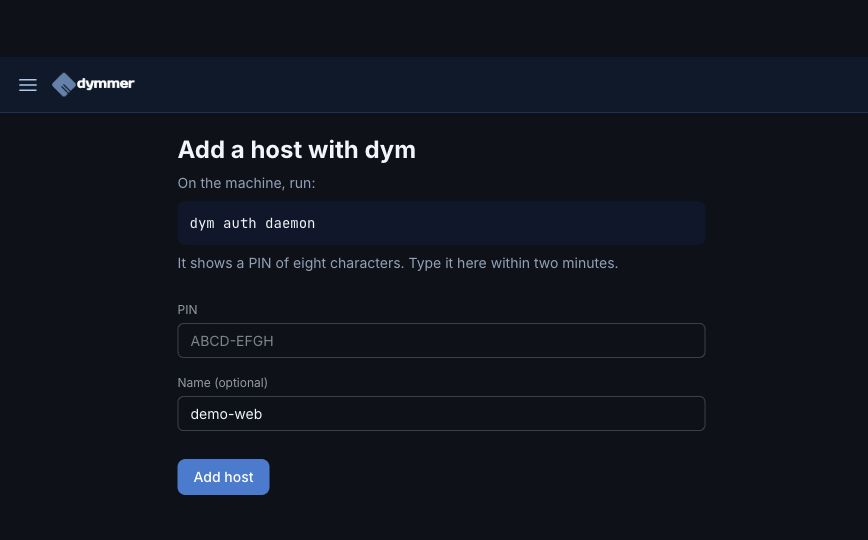
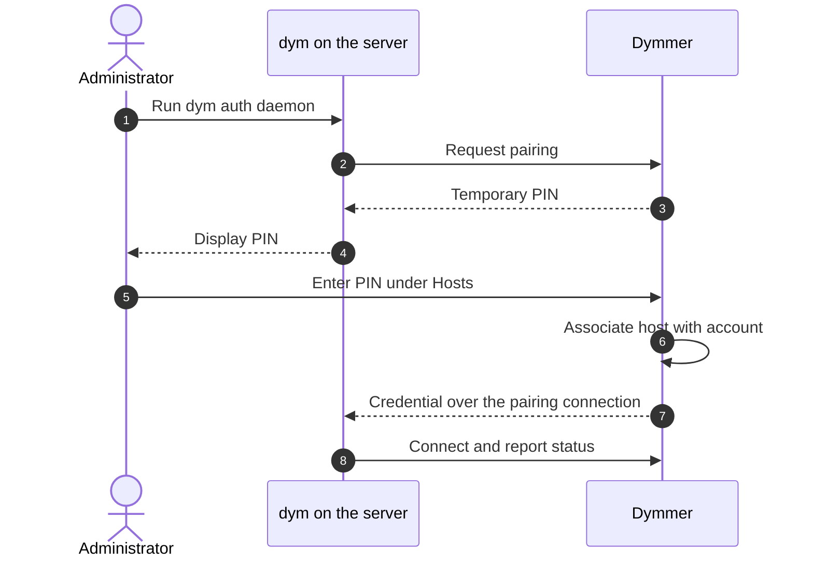
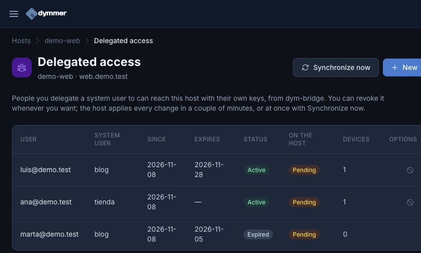
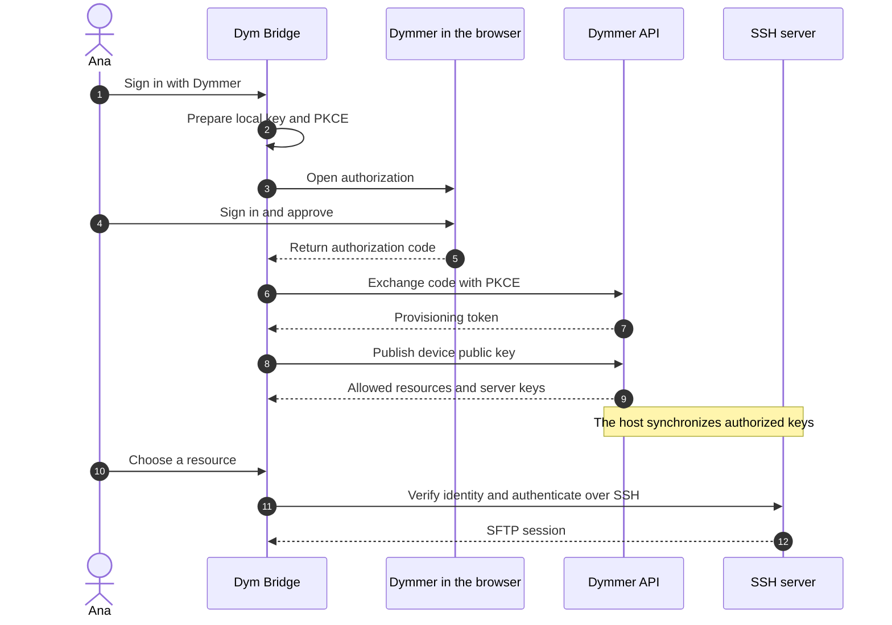
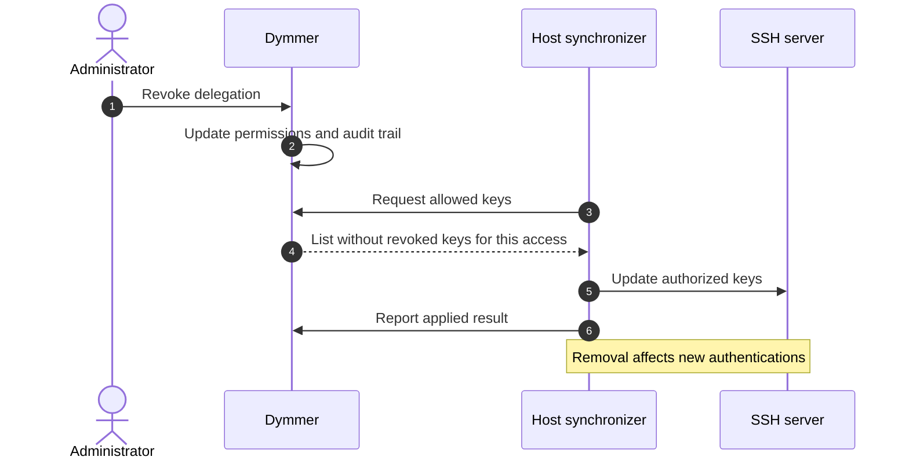

id: manage-a-host-and-connect-with-dym-bridge
title: From your server to your files with Dymmer and Dym Bridge
subtitle: Link a host, grant access to a user and connect from your desktop without sharing private keys or editing configuration files by hand.
date: 2026-11-09
author: manuel
category: Hosts & SSH
tags: Hosts, SSH, SFTP, Dym Bridge, Access control
language: en
alternate: gestionar-un-host-y-acceder-con-dym-bridge
summary: Learn to link a host in Dymmer, delegate permissions and connect over SFTP with Dym Bridge, using real screenshots and sequence diagrams.

You have a website on a server and someone needs to upload an image, update a theme or download a copy of their files. That everyday task should not start with sending an administrator password over chat.

With **Dymmer**, you manage the host and decide who may access each system user. With **Dym Bridge**, that person signs in with their own account and opens the files in a desktop application. Each computer has its own SSH key; you do not need to distribute your private key.

We will follow the process using a fictional server, `demo-web`, and two system users, `tienda` and `blog`. Ana will work on the shop and Luis on the blog. The screenshots come from a real Dymmer development instance containing fictional data. Their states are returned by that instance, not drawn to resemble an interface.

## What you need before starting

You need a Dymmer account, permission to administer the host and a server prepared for client access. If you are linking it through the daemon, `dym` must be installed on the server; after pairing, its daemon must remain running.

You also need **Dym Bridge 0.2.0 or later** on the computer you will use. Packages for macOS, Windows and Linux are available from the [official Dym Bridge releases](https://github.com/dymmer-code/dym-bridge/releases).

There are three parts to keep in mind:

| Part | What it does |
| --- | --- |
| Host in Dymmer | Identifies the server and exposes its connection, available metrics and permissions. |
| Client access | Authorizes a Dymmer account to use a particular system user. |
| Dym Bridge | Authenticates from your computer and connects to the authorized resource over SSH/SFTP. |

**Linking a host does not, by itself, enable SFTP for clients.** The server must publish its allowed user catalog, synchronize authorized keys and expose an SSH endpoint reachable from the client's computer. The daemon's connection to Dymmer and Bridge's connection to the server serve different purposes.

## 1. Link the server to your account

Under **Hosts**, choose **Add with dym**. Run this on the server:

```bash
dym auth daemon
```

The command displays an eight-character PIN. Enter it in Dymmer within two minutes, optionally add a recognizable name and click **Add host**. If the PIN expires, start again to obtain another one.



*The PIN shown in the empty field is the form's example. Use the one generated by your server.*

Pairing associates the host with your account and gives the daemon the credential it needs to communicate with Dymmer. This is separate from the private key your laptop will use later.



After pairing, the service must keep `dym daemon` running. If you have not installed it as a service, you can start it with that command to check the connection; do not launch a second instance if the service is already active.

If you already manage the host over SSH, Dymmer also provides **New Host** and SSH access configuration. You do not need to register the server again to use Bridge: check its details to confirm that client access is ready.

## 2. Check the host before granting access

Open the server from **Hosts**. Check its name, address, operating system and connection method. CPU, memory and disk metrics appear when data has been received; a newly added host may not have any statistics yet.

The **Client SSH access** section shows the synchronization status, the number of system users declared by the host and the time of its last report. From here, open **Manage delegated access**.

In our example, the catalog contains `tienda` and `blog`. If no users have been declared, the server needs to be prepared first: the delegation form does not create Linux accounts or guess their directories. An old status is not evidence that the host is still connected either; check the last report time.

## 3. Give each person the access they need

Inside **Manage delegated access**, click **New** and enter:

1. The email address of the Dymmer account receiving access.
2. The system user, such as `tienda` for Ana.
3. An expiry date if the work is temporary.

Save the delegation. For Luis, repeat the process with `blog`, without giving him access to the shop. This limits which system identity each person can use; allowed directories and operations also depend on the permissions and isolation configured on the server.



*This demonstration instance has active permissions and an expired one, but the “On the host” column is still pending. The server has not yet confirmed that it applied these changes.*

The two columns answer different questions: **Status** describes the permission recorded in Dymmer; **On the host** indicates whether it has been applied. For a host running a compatible daemon, you can request **Synchronize now**. If it is offline or does not respond, you must wait for it to synchronize again. Check the audit trail before considering the operation complete.

## 4. Sign in from Dym Bridge

It is now Ana's turn, on her computer:

1. Open Dym Bridge and choose **Sign in with Dymmer**.
2. Decide whether to protect the local private key with **Master password (optional)**. If you enter one, repeat it; leaving both fields empty stores the new key unencrypted on that computer.
3. Click **Continue in browser**. Sign in to `https://dymmer.com` with your account and approve the requested access.
4. Allow the browser to reopen Dym Bridge.
5. Under **Connection**, select the available resource in **Saved resources**.

The master password protects your local SSH key. It is not your Dymmer password or a server password, and it is not sent to Dymmer. If you already have an encrypted key, its password is required to use it; leaving the field empty does not remove existing encryption.

Under the hood, the application creates an Ed25519 key for the computer and publishes **only the public part**. Dymmer returns the authorized resources and the server's identity keys. Sign-in uses OAuth with PKCE to bind the authorization code to the application that requested it.



The provisioning token is not retained as a permanent session. If the available resources change, sign in again to refresh the list. If a server's key changes, check the reason with its administrator before refreshing the configuration and reconnecting.

## 5. Work with your files

Once connected, Bridge displays local and remote files in two panels. Double-click folders to open them, mark files using **checkboxes**, then use the upload or download action in the appropriate panel. Buttons have icons and tooltips, and transfers display their progress.

You can create folders, download files and upload files or folders, including by dragging them from your operating system's file manager. For your first test, upload a small demonstration text file into a directory where you have permission and check that it appears in the remote panel. Then download it and verify its contents.

The **Sites** menu opens web interfaces advertised by the connection through local tunnels. Availability depends on the catalog and on the server allowing those tunnels: connecting over SFTP does not mean phpMyAdmin or WordPress Admin will automatically appear. You do not need to configure Sites to transfer files.

On macOS, closing the window can leave Bridge running in the tray with the connection active. Use **Quit** when you want to exit the application.

## 6. Remove access when the work ends

When Ana stops maintaining the shop, revoke her delegation from the host. If you have lost a laptop instead, review and revoke that device in the **dym-bridge** tab of Dymmer's **API Keys** page. These are different decisions: removing permission for a resource, or no longer trusting a computer's key.



**Revoking access does not instantly terminate an existing SSH session.** The server must apply the removal, and an established connection may remain active. If someone must be disconnected immediately, revoke their permission and terminate their sessions on the server as well.

## When something does not match expectations

| What you see | What to check |
| --- | --- |
| Invalid PIN | Use the current PIN within its two-minute window. |
| No users to delegate | Check that the host publishes its client access catalog. |
| Permission is active but still pending | Check the last report and host synchronization; saving the permission alone is not enough. |
| Bridge shows no resources | Check the account and its permissions, then sign in again to refresh the catalog. |
| The browser does not return to Bridge | Check that the application is installed with the `dym-bridge://` protocol registered. |
| SSH rejects the connection | Check the address, port, connectivity and public key synchronization. |
| The server presents another key | Investigate the identity change before updating your configuration. |

The result is practical: Ana can work with `tienda` files from her own computer, Luis can work with `blog`, and you can see who has access and when the server applied it. The next person starts with an account and a permission, without another round of shared secrets.
