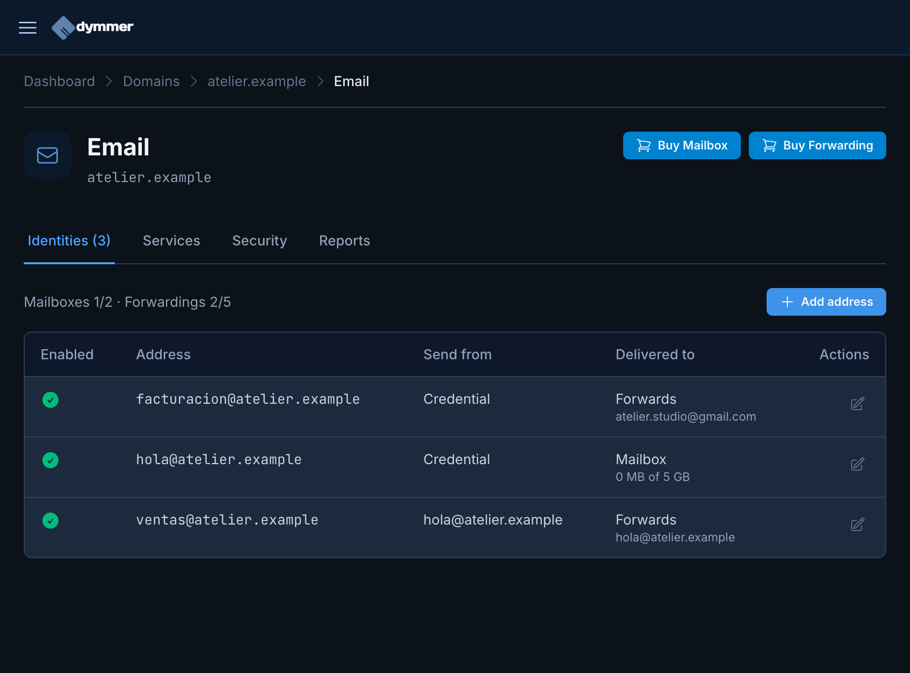
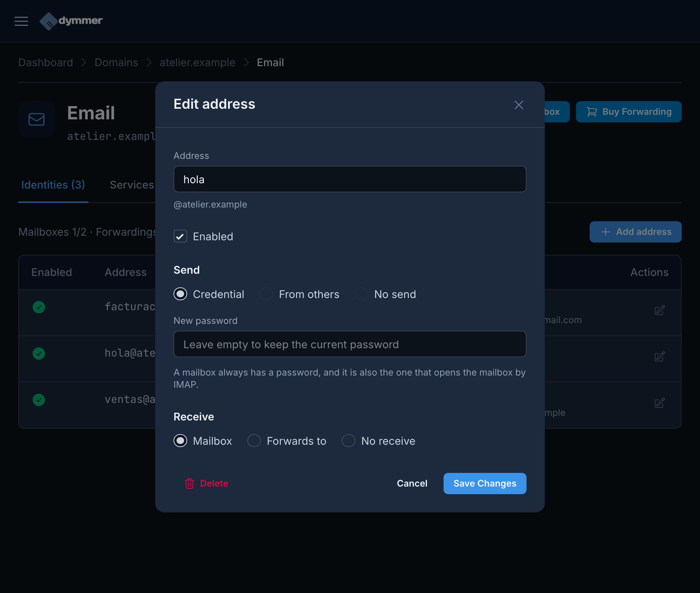
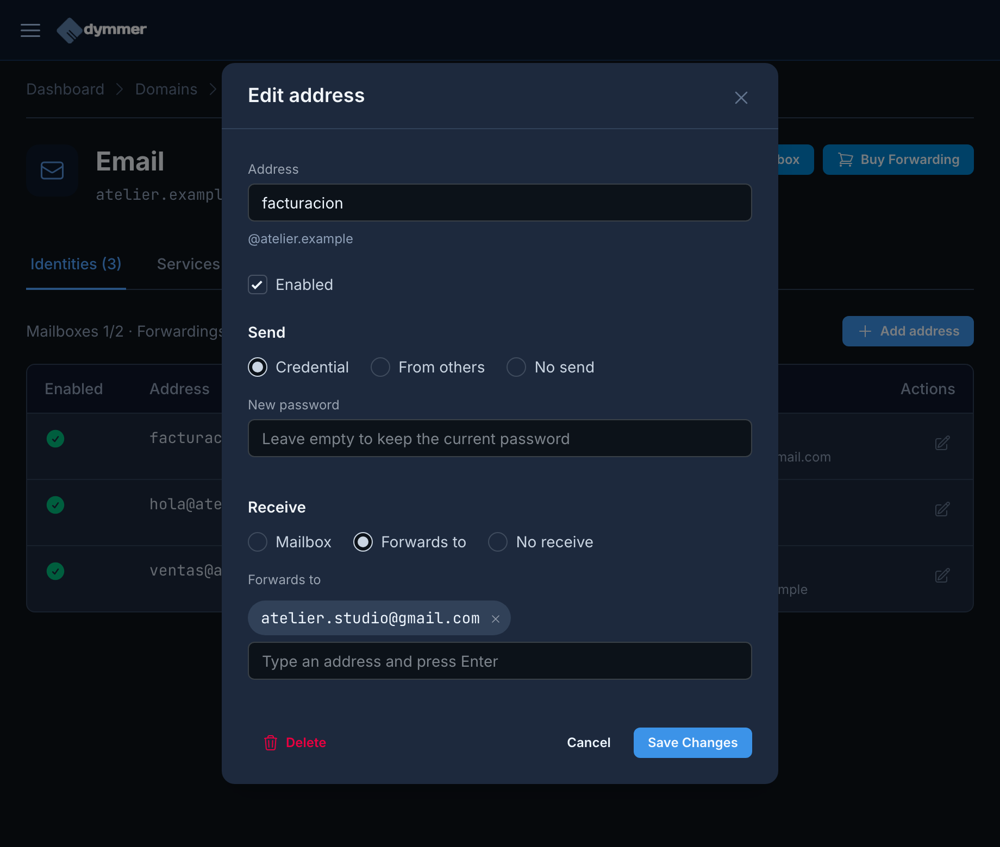
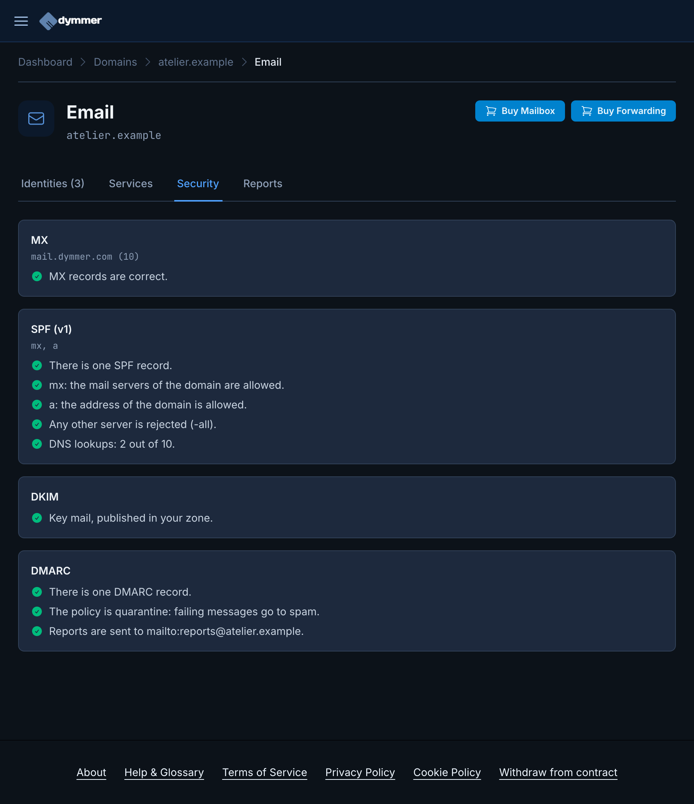
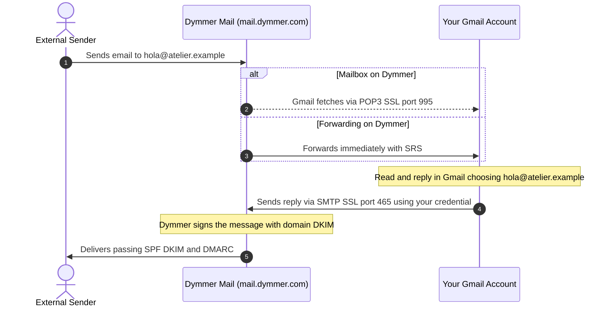
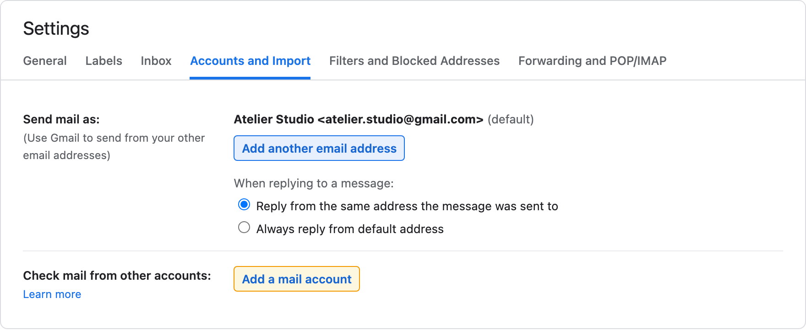
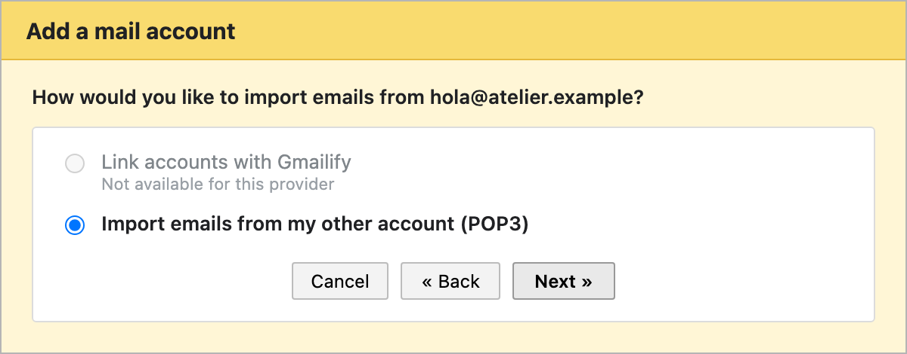
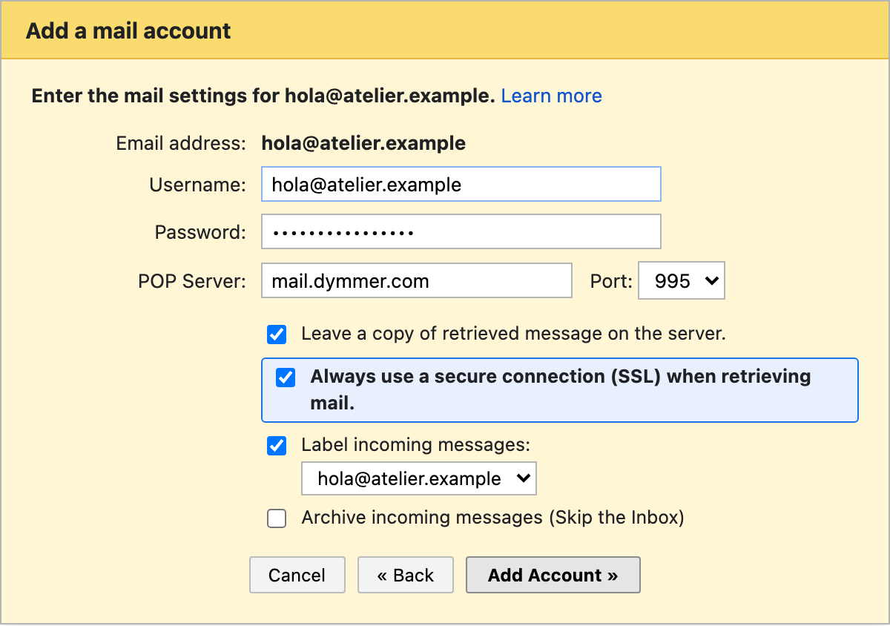
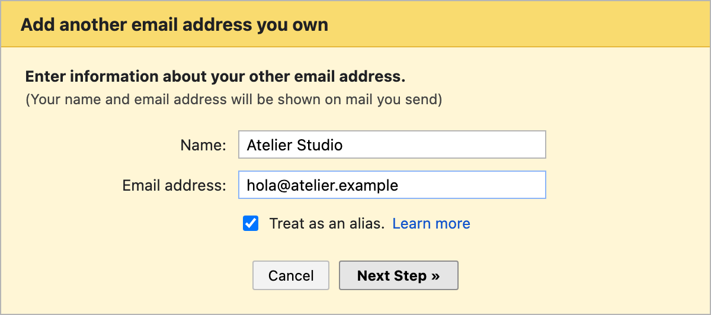
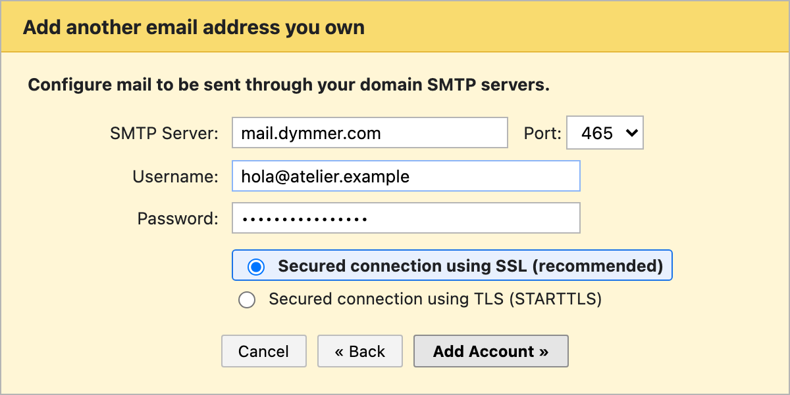

id: use-gmail-as-email-client
title: Use Gmail as the email client for your custom domain
subtitle: Receive and send mail as @yourdomain.com inside Gmail using POP3 over SSL, forwarding, and SMTP.
date: 2026-11-11
author: manuel
category: Email & DNS
tags: Email, Gmail, POP3, SMTP, Custom Domain, Dymmer
language: en
alternate: usa-gmail-como-cliente-de-correo
summary: Learn how to connect your custom domain email from Dymmer to Gmail so you can read and reply as @yourdomain.com from a single inbox using POP3 over SSL or forwarding + SMTP.

Having a professional address such as `hello@yourdomain.com` builds far more trust than writing from a generic free webmail address. Even so, changing your daily workflow to check a separate webmail interface or multiple inboxes often leads to missed messages and slower replies.

The good news is that **you do not need to leave Gmail** to use email on your own domain. You can route all incoming mail into your personal Gmail inbox and reply directly from your custom address while keeping your domain's **DKIM**, **SPF**, and **DMARC** signatures intact.

In this guide we walk through preparing your addresses in **Dymmer** (using our fictional demonstration domain `atelier.example`) and then connecting **Gmail** step by step for both receiving and sending messages.

*(Screenshots come from a real Dymmer development instance with fictional demo data under the reserved `.example` suffix per [RFC 2606](https://www.rfc-editor.org/rfc/rfc2606); replace `atelier.example` and `atelier.studio@gmail.com` with your real domain and Gmail address).*

---

## 1. Choose how to receive mail: full mailbox or forwarding

Before changing settings in Gmail, decide how messages should be handled on Dymmer's side. Both approaches let you read and reply from Gmail:

| Setup | What you create in Dymmer | Key advantages | When to choose it |
| --- | --- | --- | --- |
| **Mailbox + POP3 in Gmail** | Address set to **Mailbox** reception and **Credential** sending | Keeps a copy on Dymmer's server if you also want webmail or IMAP access on mobile or Thunderbird. | When you need server-side storage or multi-device IMAP access alongside Gmail. |
| **Forwarding + SMTP in Gmail** | Address set to **Forwards to** your `@gmail.com` and **Credential** (or **From others**) sending | Incoming mail arrives instantly without waiting for Gmail's POP3 polling cycle, and uses no mailbox quota. | When Gmail is your only inbox and archive. |

In **Dymmer**, outgoing SMTP credentials (**Send**) are configured independently from incoming delivery (**Receive**). That means you can create a forwarding address pointing to your `@gmail.com` and still assign an SMTP password so you can reply from Gmail as `facturacion@atelier.example`.

---

## 2. Configure your addresses in Dymmer

If you just registered or moved your domain, make sure its DNS zone and mail service are active first (you can review the initial checks in our [first-steps domain guide](/en/posts/i-bought-a-domain-now-what/)).

Inside your **Dymmer** dashboard, open **Domains**, select your domain, and click **Email** in the top-right action bar. This opens the addresses view, showing your mailbox and forwarding counters alongside **Add address**:

For our `atelier.example` demo we set up the three most common patterns:

1. **`hola@atelier.example`**: a full mailbox with its own password (ready for **POP3 + SMTP** in Gmail or IMAP in any mail client).
2. **`facturacion@atelier.example`**: forwards directly to `atelier.studio@gmail.com` while keeping its own SMTP credential (arrives immediately in Gmail and lets you reply as `facturacion@atelier.example`).
3. **`ventas@atelier.example`**: forwards to `hola@atelier.example` with **Send from** delegated via **From others** (`hola@atelier.example`), letting you manage team aliases without extra passwords.

### Step A: Create a mailbox with credentials (for POP3 and SMTP)

Click **Add address** (or the pencil icon to edit an existing entry) and fill in the three sections:

- **Address:** the local part before `@` (for instance, `hola`).
- **Send:** select **Credential** and set a strong, unique password. This same password authenticates both incoming POP3/IMAP fetching and outgoing SMTP sending from Gmail.
- **Receive:** select **Mailbox**.

Click **Save Changes**. The mail servers usually pick up the change within a few minutes (at most around 5 minutes).

### Step B: Lightweight alternative with forwarding and SMTP sending

If you want instant delivery into Gmail without keeping a separate server mailbox, switch **Receive** to **Forwards to**, type your `@gmail.com` address, and press **Enter** to add it. Keep **Send → Credential** enabled with a password if you also plan to reply from Gmail using that address:

### Step C: Verify SPF, DKIM, and DMARC status

Before moving over to Gmail, switch to the **Security** tab under **Email** and confirm that all three authentication checks show green:

Without **DKIM** and **SPF**, or with a misaligned **DMARC** policy, messages you send from Gmail could be flagged by recipient providers. If anything needs attention here, follow our [SPF, DKIM, and DMARC guide](/en/posts/how-to-keep-your-email-out-of-spam/).

---

## 3. Dymmer mail server connection settings

Keep these settings handy when walking through Gmail's setup wizard. For Dymmer hosted email, the server hostname is **`mail.dymmer.com`** (or the server hostname shown in your domain's `MX` record if your account uses another authorized mail server, such as `cedar.altenwald.com`):

| Service | Protocol | Server | Port | Encryption | Username |
| --- | --- | --- | --- | --- | --- |
| **Incoming mail (Gmail)** | **POP3** | `mail.dymmer.com` | **`995`** | **SSL required** | Full address (`hola@atelier.example`) |
| **Outgoing mail (Gmail)** | **SMTP** | `mail.dymmer.com` | **`465`** *(or `587`)* | **SSL** (`465`) / **TLS** (`587`) | Full address with credential |
| **Other apps (mobile/desktop)** | **IMAP** | `mail.dymmer.com` | `993` | SSL/TLS | Full address (`hola@atelier.example`) |

**Two details that prevent most connection issues:**
1. Always enter the **full email address** (`hola@atelier.example`) as the username, never just `hola`.
2. Always select **port 995** and check **Always use a secure connection (SSL)** for POP3. Although older tutorials sometimes show port `110` unchecked, Dymmer enforces encrypted connections and rejects plaintext authentication.

---

## 4. How the full Gmail + Dymmer flow works

Once both sides—receiving and **Send mail as**—are connected, your mail flows like this:

Notice the last step: because Gmail authenticates against **Dymmer's SMTP server**, your replies actually leave from your domain's authorized mail server with a valid **DKIM** signature—just as if you had sent them from a desktop mail app.

---

## 5. Add your external account in Gmail (POP3 receiving)

*(If you chose **Forwards to** instead of **Mailbox** in Dymmer, skip this section and jump straight to Step 6 to configure sending).*

1. Open **Gmail** in a desktop browser *(the web settings screen is required to add external accounts; synced messages will then appear in the Gmail mobile app too)*.
2. Click the **gear icon (Settings)** in the top right corner and choose **See all settings**.
3. Open the **Accounts and Import** tab.
4. Scroll to **Check mail from other accounts** and click **Add a mail account**:

5. Enter your full email address (e.g. `hola@atelier.example`) and click **Next**.
6. Choose **Import emails from my other account (POP3)** and click **Next**:

7. Fill in your server details:
   - **Username:** `hola@atelier.example`
   - **Password:** the password you set in Dymmer
   - **POP Server:** `mail.dymmer.com`
   - **Port:** **`995`**
8. Review the four checkboxes carefully before saving:
   - **Always use a secure connection (SSL) when retrieving mail:** **Always check this**. Required for port `995`.
   - **Leave a copy of retrieved message on the server:** **Check this** if you still want messages stored in Dymmer (so you can view them via webmail or an IMAP phone/desktop client). Leaving it unchecked tells Gmail to remove each downloaded message from the server.
   - **Label incoming messages:** recommended (e.g. `hola@atelier.example`) so you can spot custom-domain mail immediately in your inbox.
   - **Archive incoming messages (Skip the Inbox):** leave unchecked if you want new emails to land directly in your main Inbox.

9. Click **Add Account**.

Once Gmail verifies the POP3 credentials, it starts importing existing mail and will poll for new messages periodically.

---

## 6. Configure Send mail as in Gmail (SMTP sending)

Without this step, replies you send from Gmail will still show your `@gmail.com` address. Setting it up takes under two minutes:

1. If you just completed the POP3 wizard, Gmail asks directly: *"Would you also like to be able to send mail as hola@atelier.example?"*. Select **Yes** and click **Next**.
   - *If you used forwarding on Dymmer or skipped the prompt:* open **Settings → See all settings → Accounts and Import**, find **Send mail as**, and click **Add another email address**.
2. Enter the **Name** your recipients should see (such as `Atelier Studio` or your name) and verify the email address (`hola@atelier.example`).
3. Regarding **Treat as an alias**:
   - Keep it checked if you want sent and received messages grouped seamlessly in the same inbox and want Gmail to reply with your domain address automatically.
   - Uncheck it if you prefer strict separation. In either case, under **Send mail as**, consider selecting **Reply from the same address the message was sent to**.

4. Click **Next Step** and fill in the SMTP details:
   - **SMTP Server:** `mail.dymmer.com`
   - **Port:** **`465`** with **Secured connection using SSL (recommended)** *(or `587` with **TLS**)*
   - **Username:** `hola@atelier.example` *(if you are adding a delegated alias set to **From others**, enter the authorized credential address such as `hola@atelier.example` and its password)*
   - **Password:** the credential password configured in Dymmer.

5. Click **Add Account**.
6. Gmail will send a **confirmation code** to `hola@atelier.example`. Because forwarding or POP3 is already active, that email arrives right in your Gmail inbox—enter the code (or click the confirmation link) to finish.

From now on, composing a message in Gmail gives you a **From** dropdown to choose `@yourdomain.com`, and replies to incoming domain mail will automatically use your custom address.

---

## 7. Practical tips and common pitfalls

If something does not connect right away, check these frequent issues:

- **POP3 or SMTP authentication error:** double-check that the username includes the full `@yourdomain.com` domain and no extra whitespace in the password. Remember that newly created or updated addresses can take up to **5 minutes** to propagate to the mail servers.
- **Connection or TLS error in POP3:** verify that the port is **`995`** (not `110`) and **Always use a secure connection (SSL)** is checked.
- **POP3 feels slow to pick up new mail:** Gmail fetches external POP3 accounts on an automatic polling schedule based on mail volume. If you want instant arrival, switch Dymmer's **Receive** mode to **Forwards to** your `@gmail.com` while keeping your SMTP credential for sending—or click **Check mail now** under *Accounts and Import*.
- **Extra team aliases (`sales@`, `support@`):** if you want to send from secondary aliases without juggling more passwords, configure **Send → From others** in Dymmer pointing to your main credential (`hola@atelier.example`), then repeat Step 6 in Gmail for the alias using your main SMTP credential.
- **Sent mail landing in spam:** inspect the **Security** tab under **Email** in Dymmer to make sure `SPF`, `DKIM`, and `DMARC` pass cleanly, and follow the checklist in our [SPF, DKIM, and DMARC guide](/en/posts/how-to-keep-your-email-out-of-spam/).
