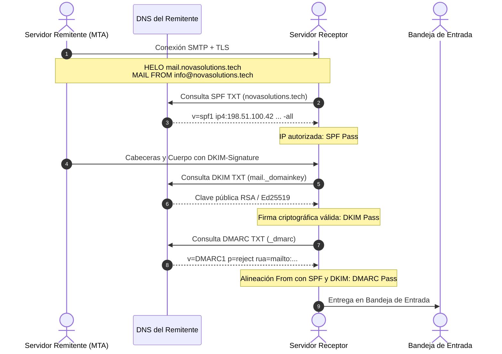
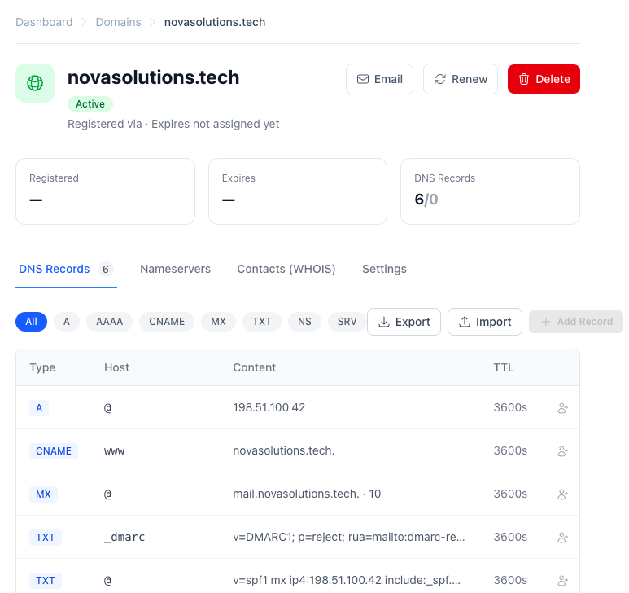
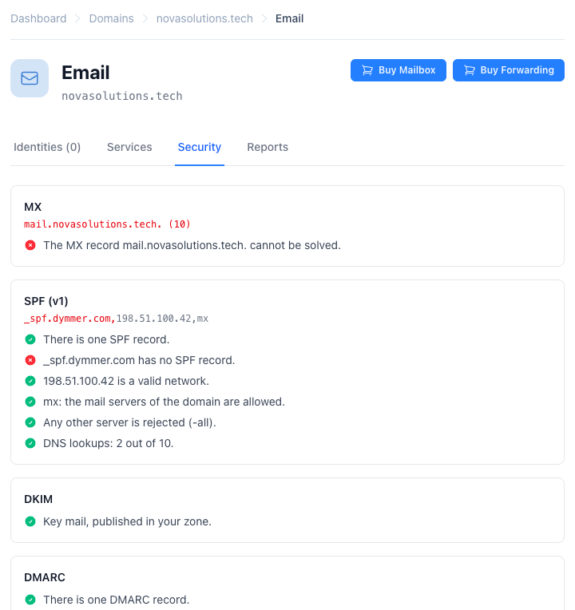
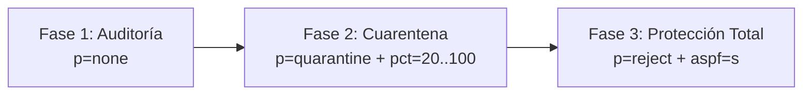

id: como-evitar-que-el-correo-caiga-en-spam
title: ¿Cómo conseguir que tu sistema de correo no caiga en spam?
subtitle: Guía técnica sobre la tríada SPF, DKIM y DMARC: estándares RFC, configuración DNS real y cómo proteger tu reputación de entrega.
date: 2026-11-06
author: manuel
category: Email & DNS
tags: Email, SPF, DKIM, DMARC, Deliverability, DNS
language: es
alternate: how-to-keep-your-email-out-of-spam
summary: Descubre cómo configurar correctamente SPF, DKIM y DMARC con estándares RFC y capturas reales de Dymmer para garantizar que tus correos lleguen a la bandeja de entrada y nunca al buzón de spam.

Enviar un correo electrónico y que termine enterrado en la carpeta de correo no deseado (spam) es una de las frustraciones más comunes y costosas para cualquier empresa u organización. Desde 2024, proveedores como Google, Yahoo, Microsoft y Apple han endurecido radicalmente sus políticas de recepción: **si tu dominio no autentica rigurosamente su identidad, tus mensajes serán degradados a spam o directamente rechazados en la conexión SMTP**.

La creencia popular de que "basta con poner un registro SPF" es un mito peligroso. En el correo moderno, la entregabilidad descansa sobre una tríada indivisible: **SPF**, **DKIM** y **DMARC**. Ninguno de ellos es suficiente por sí solo; cada uno cubre las deficiencias de los otros dos.

En este artículo analizaremos en profundidad los estándares RFC que rigen cada mecanismo, los errores arquitectónicos más frecuentes (como el límite de 10 consultas DNS en SPF) y cómo configurar y monitorizar todo el ecosistema de forma visual e intuitiva utilizando las herramientas de gestión de **Dymmer**.

---

## La Tríada de la Autenticación: ¿Por qué necesitas los tres?

Para entender por qué se necesitan tres protocolos independientes, observemos qué valida cada uno en una transacción SMTP típica:

1. **SPF (Sender Policy Framework)**: Valida la **dirección IP** del servidor remitente contra la lista autorizada en el DNS. Protege la identidad de la cabecera técnica del sobre (*Envelope Sender* o `Return-Path`).
2. **DKIM (DomainKeys Identified Mail)**: Valida la **integridad criptográfica** del contenido y cabeceras del correo. Asegura que nadie alteró el mensaje en tránsito y que fue firmado por una clave privada asociada a tu dominio.
3. **DMARC (Domain-based Message Authentication, Reporting, and Conformance)**: Es la **política de gobierno y alineación**. Vincula la dirección visible para el usuario (`From:`) con las identidades validadas por SPF y DKIM, e indica al receptor qué hacer si la validación falla (ignorar, cuarentena o rechazar).



Si falta cualquiera de las tres piezas, la cadena de confianza se quiebra:
- **Solo con SPF**: Cualquier servidor intermediario que reenvíe legítimamente tu correo romperá SPF (porque la IP del intermediario no está en tu registro). Además, un atacante puede falsear el `From:` visible en el cliente de correo sin que SPF lo impida.
- **Solo con DKIM**: Sabes que el mensaje no ha sido alterado, pero el receptor no tiene ninguna instrucción sobre qué hacer con mensajes no firmados que afirmen venir de tu dominio.
- **Sin DMARC**: Ni SPF ni DKIM protegen el campo `From:` que lee el destinatario, permitiendo suplantaciones (*spoofing*) en ataques de *phishing*.

---

## 1. SPF: Autorizando Servidores sin Caer en la Trampa de los 10 Lookups

El estándar **[RFC 7208](https://datatracker.ietf.org/doc/html/rfc7208)** define cómo un dominio publica en un registro DNS de tipo `TXT` la relación de máquinas y redes autorizadas para enviar correo en su nombre.

Un ejemplo típico de registro SPF en la raíz del dominio (`@`) es:

```text
v=spf1 mx ip4:198.51.100.42 include:_spf.dymmer.com -all
```

Analicemos sus componentes:
- `v=spf1`: Identificador obligatorio de la versión. Debe estar al inicio del registro.
- `mx`: Autoriza a cualquier servidor que esté listado en los registros MX del propio dominio.
- `ip4:198.51.100.42` (o rangos CIDR como `ip4:198.51.100.0/24`): Autoriza direcciones IP explícitas sin necesidad de consultas DNS adicionales.
- `include:_spf.dymmer.com`: Incorpora la política SPF de un proveedor externo (en este caso, los servidores de correo saliente de Dymmer).
- `-all` (*Fail estricto*): Ordena rechazar categóricamente cualquier servidor que no coincida con los mecanismos anteriores. Evita usar `~all` (*SoftFail*) o `?all` (*Neutral*) en producción una vez estabilizado el servicio.

### El Límite de 10 Consultas DNS ([RFC 7208 §4.6.4](https://datatracker.ietf.org/doc/html/rfc7208#section-4.6.4))

El error fatal más frecuente en configuraciones SPF es superar el **[límite de 10 consultas DNS](https://datatracker.ietf.org/doc/html/rfc7208#section-4.6.4)**. Para prevenir ataques de denegación de servicio (DoS) por amplificación, el estándar establece que los mecanismos que requieren resolución DNS (`include`, `mx`, `a`, `ptr`, `redirect`, `exists`) no pueden acumular más de 10 peticiones por verificación.

Si incluyes varios servicios de marketing (por ejemplo Google Workspace, Mailchimp, Zendesk y Salesforce), cada `include` a su vez puede anidar otros `include`. Al llegar a la consulta número 11, los servidores receptores arrojan de inmediato un error permanente: **SPF PermError**.

> [!WARNING]
> Un `SPF PermError` es tratado por la mayoría de proveedores como un fallo total de autenticación, enviando tus correos inmediatamente a la carpeta de spam o descartándolos.

Para evitar este problema:
1. Prefiere siempre rangos directos `ip4:` o `ip6:` cuando conozcas las IPs estáticas de tus servidores.
2. Evita mecanismos obsoletos como `ptr` (prohibido por el RFC) o `a` si ya usas `mx` o `ip4:`.
3. Nunca publiques más de un registro SPF en el mismo dominio. Si tienes dos registros `v=spf1`, el RFC exige que el receptor invalide ambos.

---

## 2. DKIM: La Firma Criptográfica Inalterable

Definido en el estándar **[RFC 6376](https://datatracker.ietf.org/doc/html/rfc6376)**, DKIM resuelve el problema de los reenvíos de correo. El servidor remitente calcula una firma criptográfica (generalmente RSA de 2048 bits o Ed25519) sobre las cabeceras principales (`From`, `To`, `Subject`, `Date`, `Message-ID`) y el hash del cuerpo del mensaje.

Esta firma se adjunta en la cabecera `DKIM-Signature`:

```text
DKIM-Signature: v=1; a=rsa-sha256; c=relaxed/relaxed; d=novasolutions.tech;
  s=mail; t=1730894400;
  h=from:to:subject:date:message-id;
  bh=47DEQpj8HBSa+/TImW+5JCeuQeRkm5NMpJWZG3hSuFU=;
  b=dB7G...x89Q==
```

Para verificarla, el receptor busca la clave pública en el DNS utilizando el **selector** (`s=`) y el **dominio** (`d=`):

```text
Host: mail._domainkey.novasolutions.tech
Tipo: TXT
Valor: v=DKIM1; k=rsa; p=MIIBIjANBgkqhkiG9w0BAQEFAAOCAQ8AMIIBCgKCAQEA0Y3yZ24D8...
```

### Claves para una configuración DKIM impecable
- **Longitud de clave**: Utiliza claves de 2048 bits. Las claves antiguas de 1024 bits ya se consideran vulnerables y son penalizadas por algunos filtros antispam.
- **Canonicalización (`c=relaxed/relaxed`)**: Permite tolerar modificaciones triviales de espacios en blanco introducidas por servidores intermedios de retransmisión sin romper la firma.
- **Selectores independientes**: Si utilizas varios sistemas (ej. tus buzones corporativos en Dymmer y un sistema transaccional para tu aplicación), asigna un selector diferente a cada uno (`mail._domainkey`, `app._domainkey`).

---

## 3. DMARC: La Política que Protege tu Reputación

El estándar **[RFC 7489](https://datatracker.ietf.org/doc/html/rfc7489)** es la clave de bóveda de la seguridad en el correo. DMARC cumple tres funciones críticas:

1. **Alineación de Identidad (*Identifier Alignment*)**: Exige que el dominio visible en la cabecera `From:` coincida con el dominio validado por SPF (`Return-Path`) o por DKIM (`d=novasolutions.tech`). Puedes elegir alineación relajada (`aspf=r`, coincidencia de dominio organizativo) o estricta (`aspf=s`, coincidencia exacta de subdominio).
2. **Definición de Política (`p=`)**: Indica al receptor cómo actuar si el mensaje no aprueba la alineación DMARC:
   - `p=none`: Modo solo monitorización. No bloquea mensajes, solo genera informes.
   - `p=quarantine`: Los mensajes sospechosos se envían a la carpeta de spam o se retienen en cuarentena.
   - `p=reject`: Los mensajes no autorizados son rechazados directamente en la sesión SMTP con un código de error `5xx`.
3. **Informes Agregados (`rua=`)**: Los receptores envían reportes XML diarios a tu dirección designada, indicando qué IPs están enviando correo con tu nombre y qué porcentaje aprueba o suspende las pruebas.

Un registro DMARC robusto en el subdominio especial `_dmarc` se define así:

```text
Host: _dmarc.novasolutions.tech
Tipo: TXT
Valor: v=DMARC1; p=reject; rua=mailto:dmarc-reports@novasolutions.tech; aspf=s; adkim=s
```

---

## Configuración Práctica en Dymmer

Configurar manualmente estos registros en zonas DNS convencionales suele ser propenso a errores tipográficos, comillas escapadas de forma incorrecta o claves DKIM truncadas.

En **Dymmer**, la gestión DNS está diseñada para garantizar precisión técnica y visibilidad inmediata de cada registro.

### El Editor de Zona DNS

En la interfaz de gestión de zona de Dymmer para nuestro dominio de ejemplo (`novasolutions.tech`), los registros necesarios para la tríada de correo conviven de forma organizada y verificable:



Aquí se aprecian claramente los cuatro registros esenciales:
- **MX**: Apuntando con prioridad `10` a `mail.novasolutions.tech.` para el enrutamiento entrante.
- **TXT en `@` (SPF)**: Declarando los servidores autorizados y la regla de cierre estricta `-all`.
- **TXT en `mail._domainkey` (DKIM)**: Publicando la clave pública RSA sin cortes ni corrupciones de codificación.
- **TXT en `_dmarc` (DMARC)**: Fijando la política en `p=reject` y designando la dirección de reporte agregada.

---

## Auditoría y Diagnóstico en Tiempo Real

El gran diferenciador de Dymmer es su módulo de **Seguridad de Correo**. En lugar de requerir herramientas externas de validación (*dig*, *nslookup* o verificadores de terceros), Dymmer analiza la zona en tiempo real y ejecuta comprobaciones sintácticas y operativas automáticas:



Como se observa en la captura:
- **Resolución de MX**: Valida que los servidores de correo resuelvan correctamente sus IPs.
- **Análisis SPF**:
  - Confirma la existencia de un único registro SPF válido.
  - Verifica la presencia del calificador de cierre `-all`.
  - Comprueba la validez de las redes y rangos IP declarados (`198.51.100.42`).
  - **Contador de Lookups DNS**: Dymmer evalúa la cadena de resolución (por ejemplo, `2 de 10 consultas utilizadas`), alertándote mucho antes de alcanzar el fatídico límite de 10.
- **Estado de DKIM**: Identifica de inmediato si las claves públicas asociadas a tus selectores están correctamente publicadas en la zona.
- **Inspección DMARC**: Comprueba que la política activa (`reject`) esté protegiendo activamente tu dominio y valida que la dirección del buzón de informes (`rua=`) esté lista para recibir los reportes XML.

---

## Estrategia de Despliegue en 3 Fases (Cero Interrupciones)

Si estás configurando la autenticación en un dominio corporativo activo, nunca apliques `p=reject` el primer día. Sigue esta hoja de ruta recomendada:



1. **Fase 1: Auditoría silenciosa (`p=none`)**  
   Publica tu registro SPF y genera tus claves DKIM. Configura DMARC con `p=none; rua=mailto:dmarc-reports@tudominio.com`. Analiza los informes durante dos o tres semanas para descubrir servicios legítimos que quizás envían correos en tu nombre y olvidaste autorizar.
2. **Fase 2: Cuarentena progresiva (`p=quarantine`)**  
   Una vez que todos los envíos legítimos pasan SPF y DKIM, cambia a `p=quarantine; pct=20`. Incrementa gradualmente el porcentaje (`pct=50`, `pct=100`). Los mensajes de fuentes no autorizadas comenzarán a ir a spam.
3. **Fase 3: Rechazo estricto (`p=reject`)**  
   Aplica la política de máxima seguridad: `v=DMARC1; p=reject; aspf=s; adkim=s`. Cualquier intento de suplantar la identidad de tu empresa será bloqueado en el acto en los servidores de destino.

---

## Conclusión

Conseguir que tu correo llegue de forma consistente a la bandeja de entrada ya no es una cuestión de suerte ni de "trucos" en el asunto del mensaje. Es una cuestión puramente de **arquitectura de confianza y estándares de red**.

Configurando correctamente la tríada **SPF** ([RFC 7208](https://datatracker.ietf.org/doc/html/rfc7208)), **DKIM** ([RFC 6376](https://datatracker.ietf.org/doc/html/rfc6376)) y **DMARC** ([RFC 7489](https://datatracker.ietf.org/doc/html/rfc7489)) garantizas:
- Cero tolerancia a la suplantación de identidad de tu marca.
- Máxima reputación en los algoritmos antispam de Gmail, Yahoo y Microsoft 365.
- Visibilidad total sobre los flujos de correo de tu organización mediante reportes DMARC.

Con las herramientas de DNS y seguridad de **Dymmer**, implementar y mantener esta infraestructura está al alcance de cualquier equipo técnico, con validación continua para que nunca tengas que preocuparte por caer en la carpeta de spam.
