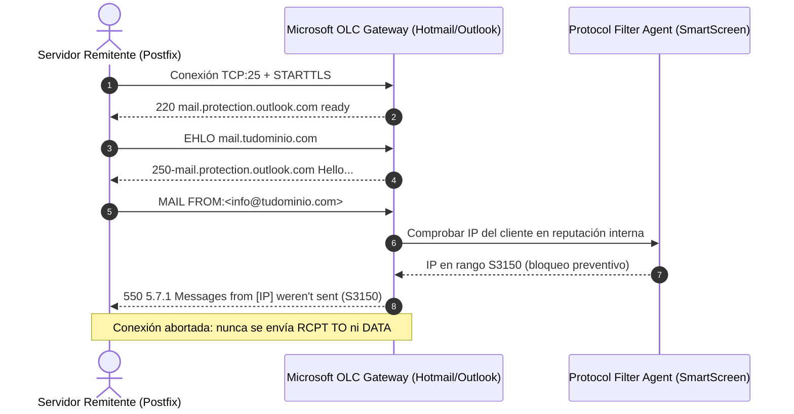

id: desbloquear-servidor-correo-hotmail-outlook-s3150
title: Desbloquear tu servidor de correo en Hotmail y Outlook: cómo resolver el error S3150
subtitle: Por qué tener SPF, DKIM y DMARC impecables no basta frente al filtro SmartScreen de Microsoft, y cómo solicitar el desbloqueo paso a paso.
date: 2026-11-20
author: manuel
category: Email & DNS
tags: Email, Hotmail, Outlook, Deliverability, Postfix, Spam, DNS, SNDS
language: es
alternate: delisting-mail-server-hotmail-outlook-s3150
summary: Guía técnica paso a paso para diagnosticar y solucionar el bloqueo S3150 de Microsoft SmartScreen en servidores de correo propios (Postfix), rellenar el formulario de soporte de remitentes de Outlook y superar la respuesta automática de soporte.

Configurar un servidor de correo propio o gestionar tu propia infraestructura SMTP puede ser una de las tareas más gratificantes en administración de sistemas... hasta que te enfrentas a los grandes proveedores de correo de consumo.

En nuestro artículo sobre [cómo evitar que el correo caiga en spam](/es/posts/como-evitar-que-el-correo-caiga-en-spam/), explicamos detalladamente la tríada obligatoria: **SPF**, **DKIM** y **DMARC**. Sigues el estándar al pie de la letra, pruebas el servidor en herramientas como Mail-Tester, obtienes una puntuación perfecta de 10/10, configuras tu resolución inversa (*rDNS / PTR*) impecable, y tus mensajes entran directos a la bandeja de entrada en Gmail, Yahoo, Proton y Apple.

Sin embargo, envías un mensaje a una dirección `@hotmail.com`, `@outlook.com` o `@live.com`, y en cuestión de segundos recibes un rebote con un error desconcertante:

```text
550 5.7.1 Unfortunately, messages from [X.X.X.X] weren't sent.
Please contact your Internet service provider since part of their network
is on our block list (S3150).
```

¿Qué significa realmente este código? ¿Por qué Microsoft rechaza tu servidor antes de leer siquiera el asunto del correo? Y lo más importante: **¿cómo se soluciona de forma definitiva?**

En este artículo desgranamos la anatomía técnica del bloqueo S3150 a partir de un caso real en un servidor Postfix en producción, explicamos cómo funciona el filtro perimetral de Microsoft y te mostramos la ruta exacta para rellenar la solicitud de desbloqueo y lograr que un ingeniero de soporte mitigue la IP.

---

## 1. Anatomía del rebote: el Protocol Filter Agent (PFA)

Cuando un servidor de correo como Postfix intenta entregar un mensaje a Hotmail u Outlook, consulta los registros MX del dominio de destino (por ejemplo, `hotmail-com.olc.protection.outlook.com`) y establece una sesión SMTP en el puerto 25 con cifrado TLS.

En una incidencia real reciente, esto es exactamente lo que registró `/var/log/maillog`:

```text
postfix/smtp[18420]: 4YzK8l1Zt9z3q4: to=<usuario@hotmail.com>,
  relay=hotmail-com.olc.protection.outlook.com[52.101.68.14]:25,
  delay=0.82, delays=0.04/0.02/0.74/0.02, dsn=5.7.1, status=bounced
  (host hotmail-com.olc.protection.outlook.com said:
  550 5.7.1 Unfortunately, messages from [5.9.22.14] weren't sent.
  Please contact your Internet service provider since part of their network
  is on our block list (S3150).
  You can also refer your provider to http://mail.live.com/mail/troubleshooting.aspx#errors.
  [Name=Protocol Filter Agent][AGT=PFA] (in reply to MAIL FROM command))
```

Analicemos minuciosamente cada elemento de este log:

1. **`dsn=5.7.1`**: Código de estado de entrega permanente (*Permanent Failure*). Indica una denegación de acceso debida a políticas de seguridad del receptor.
2. **`[Name=Protocol Filter Agent][AGT=PFA]`**: El agente que emite el bloqueo no es el motor antispam de contenido ni el buzón del usuario; es el **Protocol Filter Agent** de la pasarela perimetral de Microsoft (OLC - *Outlook.com*).
3. **`(in reply to MAIL FROM command)`**: Este es el dato técnico crucial. El rechazo se produce **durante el saludo del sobre**, inmediatamente después de que tu servidor anuncia `MAIL FROM:<remitente@tudominio.com>`. 
   
   Esto significa que Microsoft **ni siquiera llegó a recibir el destinatario (`RCPT TO`) ni el cuerpo del mensaje (`DATA`)**. Tu firma DKIM no fue evaluada, tus cabeceras no fueron leídas y tu contenido no fue analizado. La conexión fue abortada únicamente en función de la **dirección IP de origen**.



---

## 2. ¿Qué significa el código S3150 y en qué se diferencia de S3140?

Microsoft utiliza códigos internos en SmartScreen para categorizar las razones del rechazo perimetral:

* **Error S3140**: La IP específica ha emitido recientemente un volumen sustancial de tráfico catalogado como correo no deseado o ha recibido un pico elevado de quejas (*complaints*) de usuarios de Outlook.
* **Error S3150**: Parte de la red o subred donde se aloja tu servidor está en la lista de bloqueo de Microsoft (*"part of their network is on our block list"*).

El error **S3150** es el más frustrante para administradores legítimos por varias razones:

* **Castigo por vecindario:** Si tu servidor está en un centro de datos o proveedor en la nube conocido (Hetzner, OVH, DigitalOcean, Linode, Scaleway, etc.), es muy probable que otros usuarios en la misma subred `/24` o `/20` hayan enviado spam en el pasado. Microsoft suele bloquear rangos CIDR completos de forma preventiva.
* **Ausencia de historial (Cold IP):** Si has contratado una dirección IP nueva o tu volumen de envío hacia dominios de Microsoft es bajo, SmartScreen no tiene un perfil de reputación establecido. Ante la duda, su política por defecto para ciertos rangos de hosting es el rechazo temprano.
* **Inmunidad a las listas públicas:** Puedes estar 100% limpio en Spamhaus (ZEN/SBL/XBL), Barracuda, SORBS e Invaluement, pero el filtro interno de Microsoft se rige por sus propias listas propietarias.

---

## 3. Checklist previo: comprueba tu servidor antes de solicitar el desbloqueo

Antes de recurrir al formulario de soporte de Microsoft, es imperativo asegurarte de que tu servidor no tenga ninguna anomalía técnica. Cuando envías la solicitud, los sistemas automatizados de Microsoft auditan de inmediato tu IP. Si detectan fallos básicos de DNS o seguridad, tu petición será descartada al instante.

### 1. DNS inverso con coincidencia directa (FCrDNS)

El registro PTR de la IP debe resolver exactamente al nombre de tu servidor (*hostname*), y ese nombre debe a su vez resolver a la IP:

```bash
# 1. Comprobar resolución inversa (IP -> Hostname)
dig -x 5.9.22.14 +short
# Debe devolver: cedar.altenwald.com.

# 2. Comprobar resolución directa (Hostname -> IP)
dig cedar.altenwald.com +short
# Debe devolver: 5.9.22.14
```

Si el PTR no coincide o devuelve el genérico de tu proveedor de hosting (por ejemplo, `static-5-9-22-14.clients.your-server.de`), configúralo en el panel de tu proveedor antes de continuar.

### 2. SPF, DKIM y DMARC sin ambigüedades

Verifica que tu dominio publique registros válidos y alineados:

* **SPF:** Debe incluir la IP de salida explícitamente (`ip4:5.9.22.14`) o mediante una directiva `include:` / `a`, terminando en `-all` (rechazo estricto) o `~all` (*softfail*).
* **DKIM:** Clave RSA de al menos 2048 bits sin caracteres truncados.
* **DMARC:** Registro `_dmarc.tudominio.com` con `p=quarantine` o `p=reject` (o al menos `p=none` con buzón de reportes `rua=`).

### 3. Verificar que no eres un Open Relay

Asegúrate de que Postfix únicamente acepte correos salientes de clientes autenticados. En tu configuración de Postfix (`/etc/postfix/main.cf`):

```text
smtpd_relay_restrictions =
    permit_mynetworks,
    permit_sasl_authenticated,
    defer_unauth_destination
```

Puedes probarlo desde fuera intentando enviar a una dirección externa sin autenticarte: el servidor debe responder siempre con `554 5.7.1 Relay access denied`.

### 4. Consultar reputación en listas negras públicas (RBL / DNSBL)

Comprueba que la IP esté completamente limpia en las principales listas del sector:

```bash
dig +short 14.22.9.5.zen.spamhaus.org
dig +short 14.22.9.5.b.barracudacentral.org
```

Si alguna de estas consultas devuelve una IP del tipo `127.0.0.X`, estás listado en esa RBL y debes resolver ese bloqueo en primer lugar.

---

## 4. El Formulario de Soporte de Remitentes de Outlook.com

Una vez superado el checklist, el paso oficial para solicitar la mitigación del error S3150 es el formulario de **Información del remitente para entregas a Outlook.com**:

> **Enlace directo al formulario:**  
> [https://support.microsoft.com/en-us/supportrequestform/8ad563e3-288e-2a61-8122-3ba03a6b9665](https://support.microsoft.com/en-us/supportrequestform/8ad563e3-288e-2a61-8122-3ba03a6b9665)

*(Nota: no lo confundas con `sender.office.com`, que está destinado exclusivamente a organizaciones de Microsoft 365 / Exchange Online Protection corporativo, no al servicio de correo de consumo Hotmail/Outlook/Live).*

A continuación detallamos cómo rellenar los campos más críticos:

| Campo del formulario | Qué debes introducir | Consejo clave |
| --- | --- | --- |
| **Nombre del contacto** | Tu nombre o el del responsable técnico. | Sé profesional. |
| **Dirección de correo electrónico de contacto** | Una dirección que funcione y pueda recibir correo de Microsoft. | **¡Cuidado!** Usa una dirección externa (por ejemplo en Gmail u otro buzón activo) para garantizar que recibes las respuestas del soporte aunque tu servidor tenga incidencias. |
| **Dirección IP o rango que deseas desbloquear** | La IP fija de tu servidor (ej. `5.9.22.14`). | Pon una única IP o el rango exacto, sin añadir espacios extra. |
| **Dominios que envían correo** | La lista de dominios legítimos alojados (ej. `altenwald.com, dymmer.com`). | Dominios que tengan DNS y web activa. |
| **¿La IP es dedicada o compartida?** | Marca **Dedicada** (*Dedicated*). | Las IPs dedicadas reciben mitigación con mucha más rapidez. |
| **Nombre DNS inverso (PTR)** | El FQDN del servidor (ej. `cedar.altenwald.com`). | Debe coincidir exactamente con el valor verificado en el checklist. |
| **Mensaje de error exacto / cabeceras de rebote** | Pega el fragmento íntegro del log de Postfix. | Incluye `550 5.7.1`, `(S3150)` y `[Name=Protocol Filter Agent][AGT=PFA]`. |
| **Descripción de la incidencia** | Explica brevemente el propósito del servidor. | Especifica que se trata de un servidor privado para correos transaccionales y operativos legítimos, sin envío de publicidad ni listas masivas. |

Al enviar el formulario, el sistema generará de inmediato un número de caso (*Tracking ID* o número de ticket del tipo `SRX1234567890ID`).

---

## 5. El paso decisivo: qué hacer cuando el robot de soporte responde «Not qualified for mitigation»

Aquí es donde la inmensa mayoría de los administradores tiran la toalla.

Aproximadamente entre 15 minutos y 2 horas después de enviar la solicitud, recibirás un correo automático del equipo de soporte de Microsoft Outlook Deliverability. Con frecuencia, el mensaje contiene la temida respuesta estándar:

> *"We have investigated your IP(s)... Unfortunately, the IP(s) listed above do not qualify for mitigation at this time."*

**No te alarmes ni cierres el ticket.** Esta primera respuesta es generada automáticamente por un algoritmo basado en la falta de volumen histórico de tu IP en sus sistemas.

Para desbloquear la situación, debes **responder directamente a ese mismo correo electrónico**. Al contestar, el caso sale del flujo automatizado y se escala al **Nivel 2 (soporte humano)**.

### Plantilla de respuesta técnica (en inglés)

Microsoft gestiona su soporte global de entregabilidad en inglés. Responde al correo manteniendo el asunto original intacto (para no perder el número de ticket) con una estructura clara y técnica:

```text
Hello Microsoft Deliverability Support Team,

Thank you for your response regarding Ticket #[TU_NUMERO_DE_CASO].

I kindly request a tier-2 human review for this mitigation request. Our mail server IP [TU_IP] is a strictly dedicated server used exclusively for transactional and legitimate administrative emails. We do NOT send newsletters, marketing campaigns, or bulk messages.

Please note the following technical verifications:
1. FCrDNS (Forward-Confirmed reverse DNS) is fully compliant:
   - IP [TU_IP] resolves to [TU_HOSTNAME].
   - [TU_HOSTNAME] resolves back to [TU_IP].
2. Clean reputation: The IP is not listed on any public DNSBL/RBL (Spamhaus ZEN, Barracuda, etc.).
3. Strict authentication: SPF, DKIM (2048-bit RSA), and DMARC policies are published and passing on all hosted domains.
4. Open Relay disabled: The server strictly requires SMTP AUTH and will never relay unauthorized messages.

The current bounce is triggered at the protocol level:
"550 5.7.1 ... part of their network is on our block list (S3150). [Name=Protocol Filter Agent][AGT=PFA]"

Because this is a clean, dedicated IP, the S3150 subnet block is preventing our users from delivering legitimate, solicited one-to-one communications to Outlook and Hotmail recipients.

Could you please apply a manual mitigation for IP [TU_IP]?

Thank you for your assistance.

Best regards,
[Tu Nombre]
[Tu Cargo / Organización]
```

En la práctica, cuando un técnico humano revisa los registros y comprueba que el PTR, SPF y DMARC son reales y que no hay historial de spam malicioso, el resultado habitual es una nueva respuesta favorable:

> *"We have implemented a mitigation for the IP(s) listed above. This process may take 24 - 48 hours to replicate throughout our systems."*

Una vez recibida la confirmación, las conexiones SMTP a Hotmail comenzarán a aceptar el `MAIL FROM` y tus mensajes se entregarán con normalidad.

---

## 6. Prevención a largo plazo: date de alta en SNDS y JMRP

Para no esperar a que ocurra otro bloqueo a ciegas, Microsoft ofrece dos herramientas gratuitas imprescindibles para operadores de servidores de correo:

### Microsoft SNDS (Smart Network Data Services)

**SNDS** ([https://sendersupport.olc.protection.outlook.com/snds/](https://sendersupport.olc.protection.outlook.com/snds/)) es el panel de control de reputación de Microsoft. Te permite:

* Ver la reputación por colores de tus IPs en la red de Outlook (Verde = Buena, Amarillo = Dudosa, Rojo = Bloqueada).
* Consultar el volumen diario de correos enviados hacia cuentas de Microsoft.
* Detectar si algún mensaje ha caído en una trampa de spam (*Spam Trap*) o si la tasa de quejas (*complaint rate*) ha superado el umbral del 0.3%.

Para añadir tu IP a SNDS, necesitarás validar la propiedad de la red mediante una consulta WHOIS o mediante una dirección de abuso autorizada (`abuse@` o `postmaster@`).

### JMRP (Junk Mail Reporting Program)

El **JMRP** es el programa de bucle de retroalimentación (*Feedback Loop - FBL*) de Microsoft. Cada vez que un usuario de Hotmail o Outlook marca uno de tus correos como "Correo no deseado" o "Spam", Microsoft envía una copia del mensaje en formato ARF (*Abuse Reporting Format*) a la dirección que configures.

Esto te permite automatizar la baja inmediata de ese destinatario de tus sistemas para proteger la reputación de tu dominio.

---

## 7. El valor de la automatización en Dymmer

El ecosistema del correo electrónico moderno no tolera errores de configuración: un registro SPF mal cerrado, un selector DKIM con una comilla de más o una falta de alineación DMARC bastan para que los algoritmos de proveedores como Microsoft degraden la reputación de tu red.

En **Dymmer**, la gestión de dominios y correo está pensada para que estos fundamentos técnicos estén blindados desde el primer segundo:

1. **Gestión DNS sincronizada:** Cuando configuras un buzón o una identidad de correo, Dymmer publica y valida automáticamente los registros SPF, DKIM y DMARC con directivas estrictas.
2. **Auditoría en tiempo real:** Nuestro módulo de seguridad de correo comprueba constantemente la consistencia del DNS inverso, los límites de consultas en SPF y la salud de tus firmas criptográficas.
3. **Flexibilidad para infraestructuras propias (*Self-Hosting*):** Tanto si utilizas buzones alojados en Dymmer como si administras tus propios servidores dedicados mediante herramientas como [dym-bridge](/es/posts/gestionar-un-host-y-acceder-con-dym-bridge/), mantienes el control total sobre la gobernanza y la reputación de tu correo.

Si alguna vez te encuentras con el error S3150, no desesperes: verifica tus registros, envía el formulario con datos precisos, escala la respuesta técnica ante el equipo humano y registra tus rangos en SNDS para mantener tus entregas siempre a salvo.
