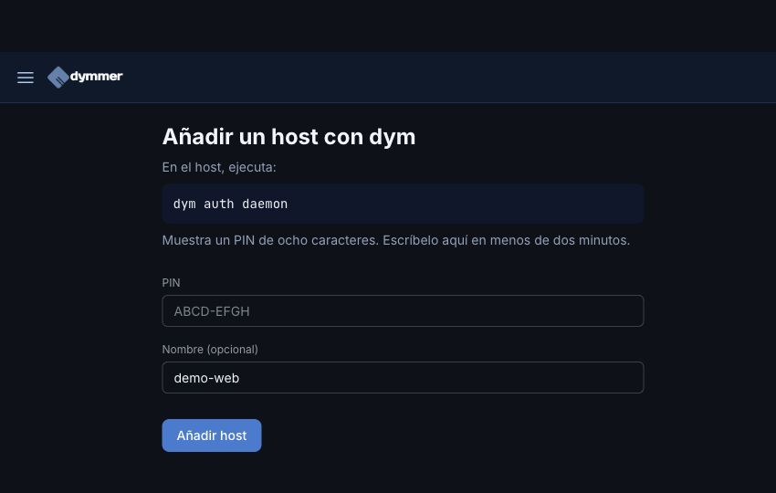
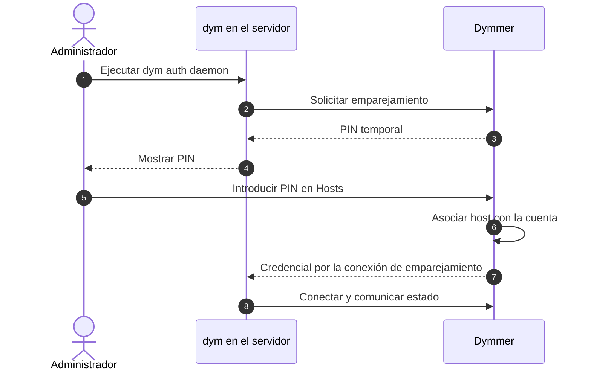
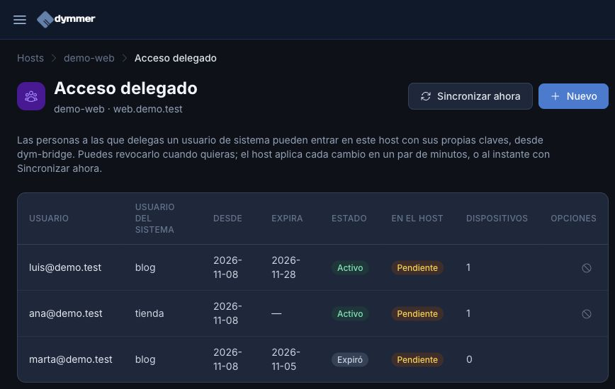
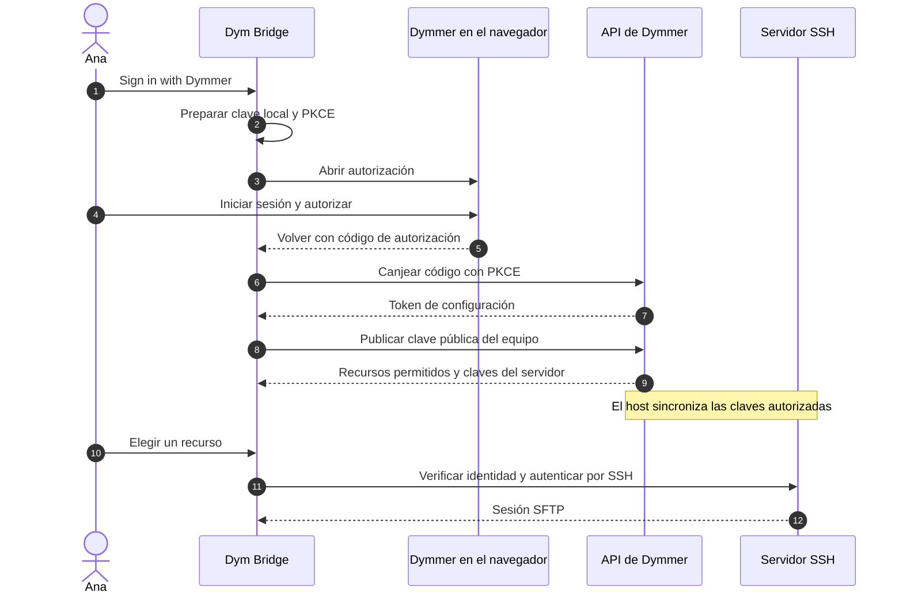
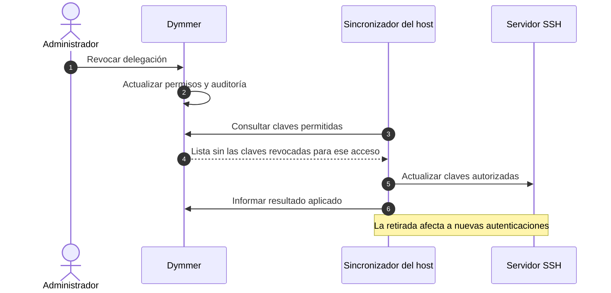

id: gestionar-un-host-y-acceder-con-dym-bridge
title: Del servidor a tus archivos con Dymmer y Dym Bridge
subtitle: Vincula un host, concede acceso a un usuario y conecta desde el escritorio sin repartir claves privadas ni editar configuraciones a mano.
date: 2026-11-09
author: manuel
category: Hosts & SSH
tags: Hosts, SSH, SFTP, Dym Bridge, Access control
language: es
alternate: manage-a-host-and-connect-with-dym-bridge
summary: Aprende a vincular un host en Dymmer, delegar permisos y acceder por SFTP con Dym Bridge, con capturas reales y diagramas de secuencia.

Tienes una web en un servidor y alguien necesita subir una imagen, actualizar un tema o descargar una copia de sus archivos. Ese trabajo cotidiano no debería empezar enviando una contraseña de administrador por chat.

Con **Dymmer** puedes gestionar el host y decidir quién accede a cada usuario del sistema. Con **Dym Bridge**, esa persona inicia sesión con su propia cuenta y abre los archivos desde una aplicación de escritorio. Cada equipo tiene su clave SSH; no hace falta distribuir tu clave privada.

Vamos a recorrer el proceso con un servidor ficticio, `demo-web`, y dos usuarios de sistema, `tienda` y `blog`. Ana trabajará en la tienda y Luis en el blog. Las capturas proceden de una instancia real de desarrollo de Dymmer con datos inventados; los estados que aparecen son los que devuelve esa instancia, no una recreación gráfica.

## Qué necesitas antes de empezar

Para seguir el recorrido necesitas una cuenta de Dymmer, permisos para administrar el host y un servidor preparado para el acceso de clientes. Si vas a vincularlo mediante el daemon, `dym` debe estar instalado en el servidor; después del emparejamiento, su daemon debe quedar ejecutándose.

También necesitas **Dym Bridge 0.2.0 o posterior** en el ordenador desde el que trabajarás. Puedes descargar los paquetes para macOS, Windows y Linux en la [página de Dym Bridge en Dymmer](https://dymmer.com/apps/dym-bridge).

Conviene separar tres piezas:

| Pieza | Para qué sirve |
| --- | --- |
| Host en Dymmer | Identifica el servidor y permite consultar su conexión, métricas disponibles y permisos. |
| Acceso de cliente | Autoriza a una cuenta de Dymmer a utilizar un usuario de sistema concreto. |
| Dym Bridge | Se autentica desde tu equipo y conecta por SSH/SFTP al recurso autorizado. |

**Vincular un host no habilita por sí solo SFTP para los clientes.** El servidor tiene que publicar su catálogo de usuarios permitidos, sincronizar sus claves autorizadas y ofrecer un endpoint SSH accesible desde el ordenador del cliente. La conexión del daemon con Dymmer y la conexión de Bridge al servidor cumplen funciones diferentes.

## 1. Vincula el servidor a tu cuenta

En **Hosts**, elige **Añadir con dym**. En el servidor ejecuta:

```bash
dym auth daemon
```

El comando muestra un PIN de ocho caracteres. Introdúcelo en Dymmer dentro de los dos minutos siguientes, añade un nombre reconocible si quieres y pulsa **Añadir host**. Si caduca, empieza de nuevo para obtener otro PIN.



*El PIN visible en el campo vacío es el ejemplo del formulario; debes utilizar el que genere tu servidor.*

El emparejamiento asocia el host con tu cuenta y entrega al daemon la credencial que necesita para comunicarse con Dymmer. No es la clave privada que utilizará después tu portátil.



Tras completar el emparejamiento, el servicio debe mantener `dym daemon` en ejecución. Si no lo tienes instalado como servicio, puedes iniciarlo con ese comando para comprobar la conexión; no ejecutes una segunda instancia si el servicio ya está activo.

Si ya gestionas el host mediante SSH, Dymmer también ofrece **Nuevo host** y la configuración de accesos SSH. No necesitas volver a registrarlo para usar Bridge: comprueba en su ficha que el acceso de clientes esté preparado.

## 2. Revisa el host antes de dar acceso

Abre la ficha del servidor desde **Hosts**. Comprueba su nombre, dirección, sistema operativo y método de conexión. Las métricas de CPU, memoria y disco aparecen cuando se han recibido datos; un host recién añadido puede no tener todavía estadísticas.

La sección **Acceso SSH de clientes** muestra el estado de sincronización, cuántos usuarios de sistema ha declarado el host y cuándo llegó el último informe. Es el punto de entrada a **Gestionar acceso delegado**.

En nuestro ejemplo, el catálogo contiene `tienda` y `blog`. Si no hay usuarios declarados, primero hay que preparar el servidor: el formulario de delegación no crea cuentas Linux ni adivina sus directorios. Tampoco debes interpretar un estado antiguo como prueba de que el host sigue conectado; mira la fecha del último informe.

## 3. Da a cada persona el acceso que necesita

Dentro de **Gestionar acceso delegado**, pulsa **Nuevo** e indica:

1. El correo de la cuenta de Dymmer que recibirá el acceso.
2. El usuario de sistema, por ejemplo `tienda` para Ana.
3. Una fecha de caducidad si el trabajo es temporal.

Guarda la delegación. Para Luis repetimos el proceso con `blog`, sin darle acceso a la tienda. Esto limita la identidad de sistema que puede usar cada persona; los directorios y las operaciones permitidas dependen también de los permisos y del aislamiento configurados en el servidor.



*En esta instancia de demostración hay permisos activos y uno caducado, pero la columna «En el host» sigue pendiente. Todavía no hay confirmación del servidor de que haya aplicado esos cambios.*

Las dos columnas responden a preguntas distintas: **Estado** expresa el permiso registrado en Dymmer; **En el host** indica si se ha aplicado. En un host con daemon compatible puedes solicitar **Sincronizar ahora**. Si está desconectado o no responde, habrá que esperar a que vuelva a sincronizar. Revisa también la auditoría antes de dar por terminada la operación.

## 4. Inicia sesión desde Dym Bridge

Ahora le toca a Ana, en su ordenador:

1. Abre Dym Bridge y elige **Sign in with Dymmer**.
2. Decide si quiere proteger la clave privada local mediante **Master password (optional)**. Si la introduce, debe repetirla; si deja ambos campos vacíos, la nueva clave se guardará sin cifrar en ese equipo.
3. Pulsa **Continue in browser**. En el navegador inicia sesión en `https://dymmer.com` con su cuenta y autoriza el acceso solicitado.
4. Permite que el navegador vuelva a abrir Dym Bridge.
5. En **Connection**, selecciona el recurso disponible bajo **Saved resources**.

Los nombres de estos botones están en inglés porque esa es la interfaz de Bridge. La contraseña maestra protege la clave SSH local: no es la contraseña de Dymmer ni la del servidor, y no se envía a Dymmer. Si ya existe una clave cifrada, necesitarás su contraseña para utilizarla; dejar el campo vacío no elimina ese cifrado.

Por debajo, la aplicación crea una clave Ed25519 para el equipo y publica **solo su parte pública**. Dymmer devuelve los recursos autorizados y las claves de identidad del servidor. El inicio de sesión utiliza OAuth con PKCE para vincular el código de autorización a la aplicación que lo solicitó.



El token de configuración no se conserva como una sesión permanente. Si cambian los recursos disponibles, vuelve a iniciar sesión para actualizar la lista. Y si el servidor cambia de clave, comprueba primero el motivo con su administrador antes de refrescar la configuración y reconectar.

## 5. Trabaja con los archivos

Una vez conectado, Bridge muestra los archivos locales y remotos en dos paneles. Abre las carpetas con doble clic, marca archivos con los **checkboxes** y utiliza las acciones de subida o descarga del panel correspondiente. Los botones tienen iconos y tooltips; las transferencias muestran su progreso.

Puedes crear carpetas, descargar archivos y subir archivos o carpetas, también arrastrándolos desde el explorador del sistema. Para la primera prueba, sube un pequeño archivo de texto de demostración a un directorio donde tengas permiso y comprueba que aparece en el panel remoto. Después descárgalo y verifica su contenido.

El menú **Sites** sirve para abrir interfaces web anunciadas por la conexión a través de túneles locales. Su disponibilidad depende del catálogo y de que el servidor permita esos túneles: conectar por SFTP no implica que vaya a aparecer automáticamente phpMyAdmin o el panel de WordPress. No necesitas configurar Sites para transferir archivos.

En macOS, cerrar la ventana puede dejar Bridge en la bandeja y mantener la conexión. Utiliza **Quit** cuando quieras salir de la aplicación.

## 6. Retira el acceso cuando termine el trabajo

Cuando Ana deje de mantener la tienda, revoca su delegación desde el host. Si lo que has perdido es un portátil, revisa y revoca ese dispositivo en la pestaña **dym-bridge** de **Claves API** de Dymmer. Son decisiones distintas: retirar un permiso sobre un recurso o dejar de confiar en la clave de un equipo.



**Revocar no equivale a cortar instantáneamente una sesión SSH ya abierta.** El servidor debe aplicar la retirada, y una conexión existente puede seguir viva. Si necesitas expulsar a alguien de inmediato, además de revocar el permiso tendrás que cerrar sus sesiones en el servidor.

## Si algo no encaja

| Lo que ves | Qué comprobar |
| --- | --- |
| PIN no válido | Que sea el PIN actual y no hayan pasado los dos minutos. |
| No hay usuarios para delegar | Que el host publique el catálogo de acceso de clientes. |
| El permiso está activo, pero sigue pendiente | El último informe y la sincronización del host; no basta con guardar el permiso. |
| Bridge no muestra recursos | La cuenta utilizada, sus permisos y un nuevo inicio de sesión para refrescar el catálogo. |
| El navegador no vuelve a Bridge | Que la aplicación esté instalada con el protocolo `dym-bridge://` registrado. |
| SSH rechaza la conexión | Dirección, puerto, conectividad y sincronización de la clave pública. |
| El servidor presenta otra clave | Investiga el cambio de identidad antes de actualizar la configuración. |

El resultado que buscamos es concreto: Ana puede trabajar con los archivos de `tienda` desde su equipo, Luis con los de `blog`, y tú puedes consultar quién tiene acceso y cuándo lo aplicó el servidor. La próxima incorporación empieza con una cuenta y un permiso, sin volver a repartir secretos.
