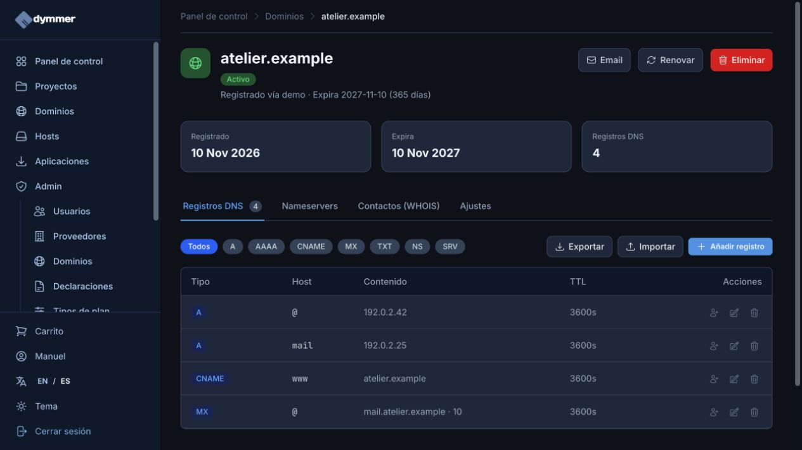
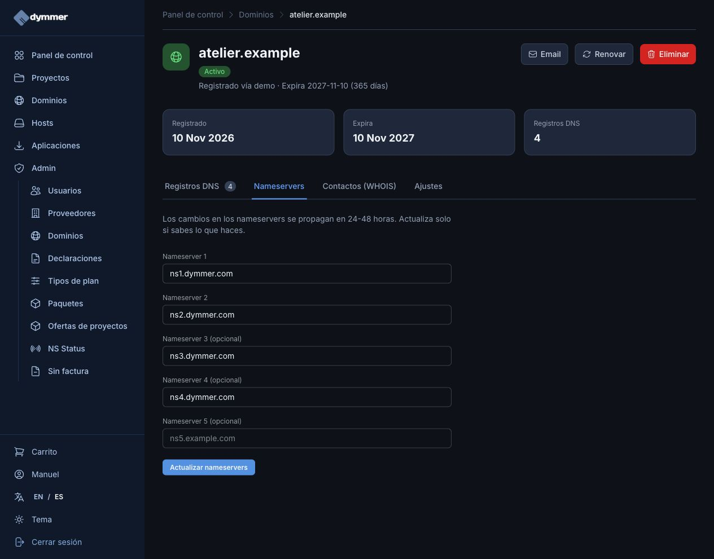
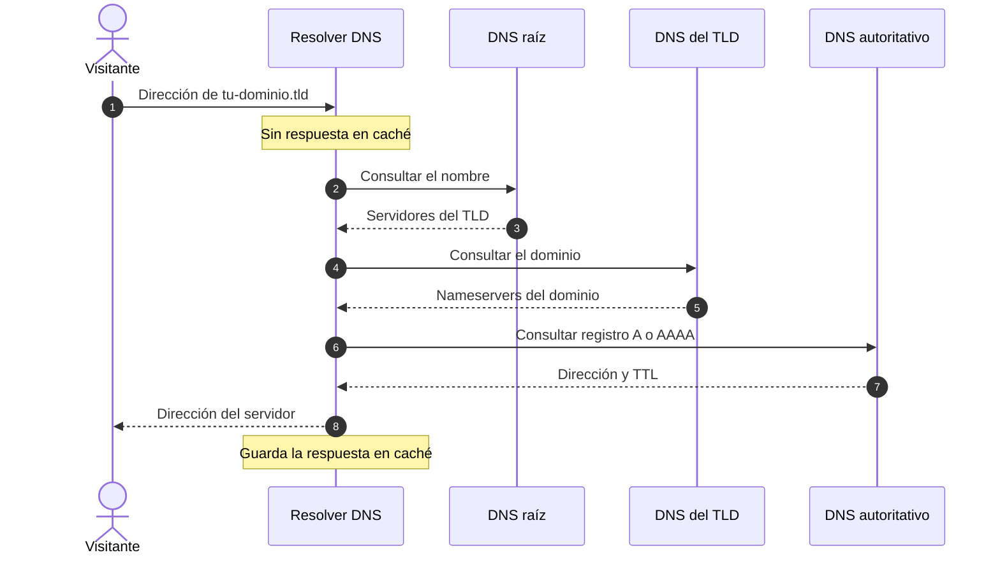
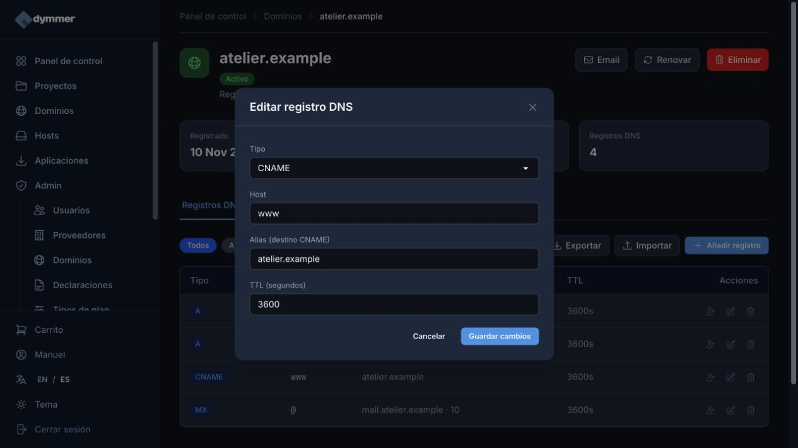
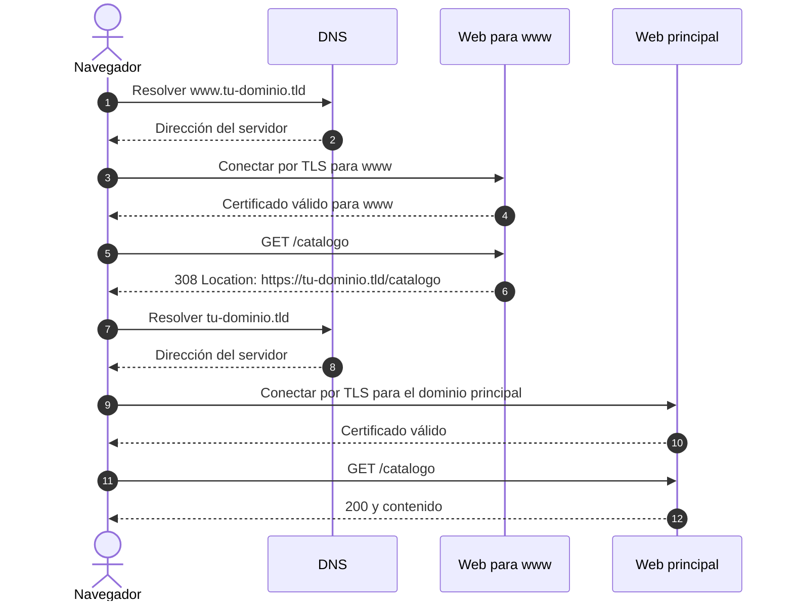

id: he-comprado-un-dominio-y-ahora-que
title: He comprado un dominio, ¿y ahora qué?
subtitle: Conecta tu web y tu correo paso a paso: DNS, alojamiento y las comprobaciones que importan.
date: 2026-11-10
author: manuel
category: Domains & DNS
tags: Domains, DNS, Hosting, HTTPS, Email
language: es
alternate: i-bought-a-domain-now-what
summary: Del dominio recién comprado a una web accesible: configura DNS, www y correo en Dymmer con capturas reales y diagramas de secuencia.

Ya tienes el nombre de tu proyecto. Abres el navegador, escribes el dominio y… todavía no aparece tu web. Es normal: registrar un dominio es el primer paso. Ahora hay que indicar dónde están la página y el correo, y preparar esos servicios para responder con tu nombre.

En esta guía vamos a conectar la web de un pequeño estudio ficticio, **Atelier**, y dejar claro qué configurar en Dymmer y qué pedir al proveedor de alojamiento. Empezaremos por los nombres y terminaremos comprobando el resultado.

Las capturas son de una instancia real de desarrollo de Dymmer, con datos de demostración. `atelier.example` utiliza un sufijo reservado para ejemplos y las IP `192.0.2.42` y `192.0.2.25` pertenecen a un rango de documentación. **No son destinos que debas copiar a tu dominio**: sustitúyelos por los datos de tu servicio. [Nombres reservados, RFC 2606](https://www.rfc-editor.org/rfc/rfc2606), [direcciones de documentación, RFC 5737](https://www.rfc-editor.org/rfc/rfc5737).

## 1. Separa el nombre, las indicaciones y el contenido

Comprar un dominio no significa necesariamente haber contratado una web o un buzón. Revisa qué incluye tu paquete:

| Pieza | Qué debes tener resuelto |
| --- | --- |
| Registro del dominio | El nombre está activo, sus datos son correctos y sabes cuándo renovarlo. |
| DNS | Los servidores autoritativos publican los registros que utilizará tu dominio. |
| Alojamiento web | Un servicio guarda o ejecuta tu web y acepta tu dominio. |
| Correo | Un proveedor recibe o envía correo para las direcciones que has configurado. |

Puedes contratar estas piezas juntas o con proveedores distintos. Por ejemplo, gestionar el dominio y su DNS en Dymmer, alojar la web en un servicio externo y utilizar otro proveedor para el correo.

En **Dominios**, abre la ficha de tu dominio. Comprueba el estado y la fecha de caducidad antes de editar nada. Si aún figura como pendiente, resuelve primero el alta. Revisa también **Contactos (WHOIS)** y **Ajustes** para mantener los datos de contacto y la renovación bajo control.



*La zona de demostración ya contiene los registros que explicaremos a continuación. «Registrado vía demo» identifica los datos ficticios del entorno.*

## 2. Averigua quién responde por tu DNS

Abre la pestaña **Nameservers**. Los servidores de nombres indican dónde se encuentra la zona DNS que debe utilizar Internet. En la captura aparecen los de Dymmer.



Si vas a usar el DNS de Dymmer, comprueba que la delegación del dominio corresponda a los servidores que te indica Dymmer. Si utilizas DNS externo, modifica los registros allí. La interfaz de Dymmer conserva sus registros pero los muestra en modo de solo lectura cuando los nameservers externos están activos y no hay un cambio pendiente.

**Cambiar de alojamiento no exige cambiar de nameservers.** Puedes mantener el DNS donde está y actualizar solo los registros de la web. Si vas a trasladar también el DNS, prepara primero la nueva zona: utiliza **Exportar** para conservar una copia y revisa la vista previa de **Importar** antes de aceptar los registros. No olvides los del correo y las verificaciones de otros servicios.

Este es el recorrido simplificado de una consulta que aún no está en caché. Para representar una delegación pública usamos `tu-dominio.tld`, como marcador del dominio real que hayas registrado; `.example` no se delega para servir nuestra web ficticia.



Cuando hay una respuesta válida en caché, parte de ese recorrido se ahorra. La delegación y la resolución recursiva son conceptos diferentes de alojar una página web. [Modelo de resolución DNS, RFC 1034](https://www.rfc-editor.org/rfc/rfc1034).

## 3. Conecta el dominio principal y `www`

Antes de añadir registros, pide al alojamiento sus instrucciones para un **dominio personalizado**. Puede darte una IPv4, una IPv6, un nombre de destino y algún TXT de verificación. No conviertas por tu cuenta un destino CNAME en una IP fija: el proveedor podría cambiarla.

Para nuestro ejemplo, el alojamiento ha facilitado una IPv4. En **Registros DNS → Añadir registro**, los campos serían:

| Nombre | Configuración del registro |
| --- | --- |
| Dominio principal | Tipo `A`; Host `@`; dirección IPv4 del alojamiento (`192.0.2.42` en la demo); TTL `3600` segundos. |
| Con `www` | Tipo `CNAME`; Host `www`; Alias `atelier.example`; TTL `3600` segundos. |

`@` representa el dominio de la zona. `www` representa `www.atelier.example`. El destino CNAME se escribe como nombre, **sin `https://`, puertos ni rutas**.

Si ya existe un registro para ese nombre y tipo, revísalo y edítalo en lugar de añadir otro por costumbre. En nuestro caso abrimos el lápiz de la fila CNAME para comprobar su destino:



Estas son las diferencias que te ayudarán a elegir:

- **A** asocia un nombre con una IPv4.
- **AAAA** asocia un nombre con una IPv6. Añádelo solo si el alojamiento te proporciona una IPv6 operativa para esa web.
- **CNAME** hace que un nombre sea alias de otro. No debe coexistir con otros registros en ese mismo nombre; para este ejemplo lo usamos en `www`, no en `@`.
- **MX** indica qué servidores reciben el correo del dominio.
- **TXT** publica texto para verificaciones y políticas, entre otros usos.

Estos tipos se explican también en la [referencia de registros DNS](https://developers.cloudflare.com/dns/manage-dns-records/reference/dns-record-types/). Algunas plataformas ofrecen tratamientos especiales para el dominio raíz; sigue las instrucciones compatibles con tu proveedor de DNS en lugar de asumir que un CNAME en `@` funcionará en cualquier servicio.

## 4. Prepara la web y el certificado HTTPS

El DNS indica dónde conectar, pero el alojamiento todavía tiene que reconocer el nombre solicitado. Añade **ambos nombres**, `atelier.example` y `www.atelier.example`, a la configuración de dominio personalizado de tu web, según las instrucciones del servicio.

Comprueba después que el contenido esté publicado y que el certificado HTTPS cubra los nombres que vas a utilizar. Si tu alojamiento verifica el dominio mediante DNS, completa esa verificación y espera a que confirme la emisión del certificado.

Si utilizas un servidor propio, configura también su sitio web o proxy para esos nombres. El [artículo de hosts y Dym Bridge](/es/posts/gestionar-un-host-y-acceder-con-dym-bridge/) explica cómo gestionar el acceso a los archivos; subirlos por SFTP y configurar qué sirve el servidor son tareas distintas.

### Un CNAME no cambia la dirección del navegador

Decide cuál será la dirección principal. En nuestro ejemplo elegimos `https://atelier.example` y configuramos en el alojamiento una redirección desde `www`, conservando ruta y parámetros:

```text
https://www.atelier.example/catalogo?idioma=es
                         ↓
https://atelier.example/catalogo?idioma=es
```

La redirección es una respuesta HTTP del servidor. Para un cambio permanente suelen utilizarse 301 o 308; una redirección temporal usa 302 o 307. El código 308 conserva el método HTTP, algo relevante si no solo rediriges visitas GET. [Redirecciones HTTP en MDN](https://developer.mozilla.org/en-US/docs/Web/HTTP/Guides/Redirections).



El servidor de `www` necesita un certificado válido **antes** de devolver una redirección por HTTPS. Ambos nombres pueden llegar al mismo servidor; el diagrama separa sus funciones. [Autenticación del servidor mediante TLS](https://developer.mozilla.org/en-US/docs/Web/Security/Defenses/Transport_Layer_Security).

## 5. Configura el correo como un servicio independiente

Tener una web accesible no crea automáticamente `hola@atelier.example`. Primero configura la dirección o buzón con tu proveedor de correo y después utiliza exactamente los registros que te facilite.

La demostración contiene un MX para `@`, con prioridad `10` y destino `mail.atelier.example`, más un A para `mail` con la IP ficticia `192.0.2.25`. Es una forma de ilustrar la relación entre ambos registros, no la configuración universal del correo de Dymmer. Un proveedor puede darte varios MX y nombres bajo su propio dominio: en ese caso no necesitas crear un A local para ellos.

Desde la ficha del dominio, **Email** lleva a la gestión del correo en Dymmer. La disponibilidad de buzones y otras capacidades depende de tu servicio contratado. Además de recibir, prepara el envío: SPF, DKIM y DMARC se explican en nuestra [guía para mejorar la entrega del correo](/es/posts/como-evitar-que-el-correo-caiga-en-spam/).

Si solo estás cambiando de alojamiento web, conserva los MX y TXT del correo salvo que también vayas a migrarlo. Una copia previa de la zona ayuda a distinguir lo que has cambiado.

## 6. Comprueba por capas, sin esperar a ciegas

Empieza por lo que ve el usuario: abre el dominio principal y `www`, comprueba el certificado y visita una página interior. Envía un mensaje de prueba desde una cuenta externa y responde si has configurado correo.

Si algo falla, una terminal permite separar DNS de web. Estos comandos son plantillas para **tu dominio real**; `atelier.example` no va a resolver públicamente. En macOS y Linux puedes usar `dig`; en PowerShell, `Resolve-DnsName`.

```bash
# Sustituye tu-dominio.tld por tu dominio registrado
dig NS tu-dominio.tld +short
dig A tu-dominio.tld +short
dig AAAA tu-dominio.tld +short
dig CNAME www.tu-dominio.tld +short
dig MX tu-dominio.tld +short
```

```powershell
Resolve-DnsName tu-dominio.tld -Type NS
Resolve-DnsName tu-dominio.tld -Type A
Resolve-DnsName www.tu-dominio.tld -Type CNAME
Resolve-DnsName tu-dominio.tld -Type MX
```

Para consultar directamente al servidor autoritativo, sustituye también `ns-autoritativo.tld` por uno de los nameservers que corresponden al dominio:

```bash
dig @ns-autoritativo.tld tu-dominio.tld A +noall +answer
curl -I https://www.tu-dominio.tld/
curl -I https://tu-dominio.tld/
```

`curl -I` solicita las cabeceras: permite ver el estado HTTP y el destino `Location` de una redirección. No verifica todo el contenido de la página; completa la prueba en el navegador.

| Resultado | Dónde mirar primero |
| --- | --- |
| Los NS no son los esperados | Delegación en el registrador y estado del cambio de nameservers. |
| No aparece la IP o aparece otra | Registro A/AAAA, zona que estás editando y cachés. |
| La IP es correcta, pero sale otra web | Dominio personalizado o sitio configurado en el alojamiento. |
| El certificado falla | Nombres cubiertos, validación y emisión del certificado. |
| Funciona sin `www`, pero no con él | DNS de `www`, configuración del sitio y certificado para ese nombre. |
| Hay un bucle de redirecciones | Reglas del alojamiento y de la aplicación; comprueba que no se contradigan. |
| La web funciona y el correo no | MX, configuración de las direcciones y proveedor de correo. |

## 7. Entiende el TTL y deja de reiniciar el reloj

Un TTL de `3600` permite conservar una respuesta DNS durante una hora en caché. No significa que todos los visitantes reciban el cambio exactamente una hora después de pulsar Guardar. Distintos resolvers pueden haber consultado el registro en momentos diferentes. [TTL y caché DNS](https://developers.cloudflare.com/dns/manage-dns-records/reference/ttl/).

Si planeas una migración, reduce el TTL **antes**, dejando tiempo para que caduquen las respuestas con el valor anterior. Reducirlo después no modifica las copias que ya se habían guardado. También se pueden almacenar respuestas de «no existe»: crear un registro no borra inmediatamente esa caché negativa. [Caché negativa, RFC 2308](https://www.rfc-editor.org/rfc/rfc2308).

La pantalla de nameservers da una orientación de 24–48 horas para esos cambios; no la tomes como una espera obligatoria para cualquier edición DNS. Comprueba primero qué responde el autoritativo y después tu resolver habitual. Cambiar valores repetidamente sin anotar los resultados dificulta el diagnóstico.

## Tu dominio ya tiene un destino

Antes de compartir la dirección, comprueba que el dominio está activo, el DNS responde desde el proveedor correcto, la web carga por HTTPS y `www` llega a la dirección elegida sin perder las rutas. Si has contratado correo, prueba también recepción y envío. Guarda la exportación de la zona y deja prevista la renovación.

Con eso, el nombre que compraste ya tiene una función concreta: llevar a tus visitantes a tu proyecto y, si lo necesitas, dar una dirección propia a tus conversaciones.
