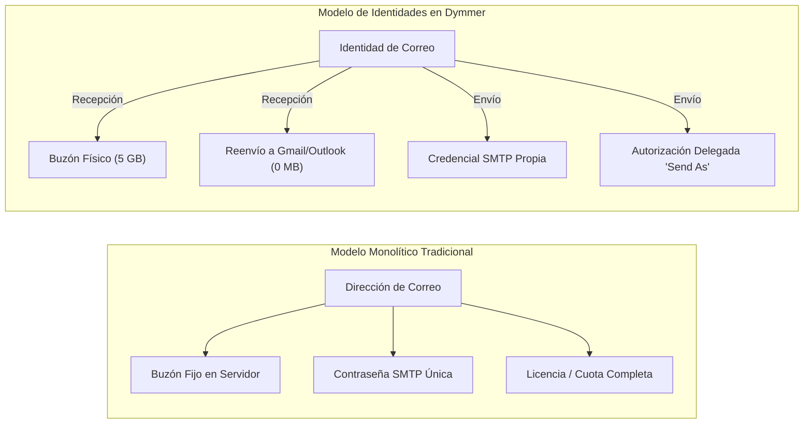
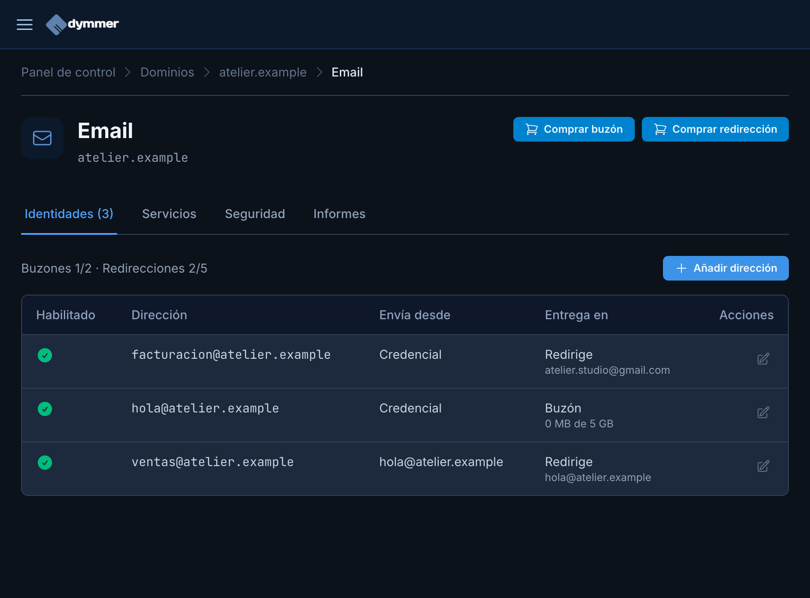
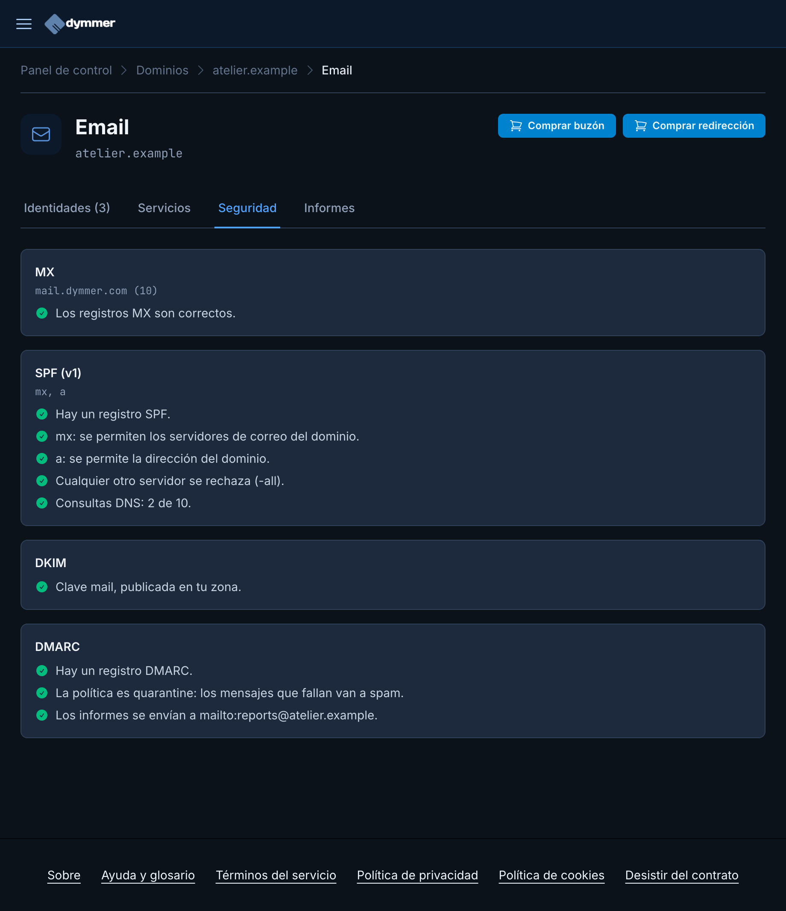

id: identidades-de-correo-frente-a-buzones-tradicionales
title: Identidades de correo frente a buzones tradicionales: comparativa con Google, Microsoft, Dinahosting y Proton
subtitle: Por qué pagar licencias por usuario o atarse a buzones monolíticos es un modelo obsoleto para dominios modernos.
date: 2026-11-19
author: manuel
category: Email & DNS
tags: Email, Identities, Mailbox, Google Workspace, Microsoft 365, Dinahosting, Proton, Security, Self-hosting
language: es
alternate: email-identities-vs-traditional-mailboxes
summary: Comparativa a fondo entre el sistema de identidades modulares de Dymmer y los proveedores tradicionales (Google Workspace, Microsoft 365, Dinahosting y Proton Mail): precios por volumen, seguridad, soberanía y self-hosting.

Durante más de dos décadas, gestionar el correo electrónico de un dominio ha seguido una regla fija: por cada dirección corporativa que necesitas, contratas un **buzón monolítico** o pagas una **licencia por asiento**.

Si tu empresa tiene tres empleados pero necesita direcciones para `contacto@`, `soporte@`, `facturacion@` y `hola@`, el modelo tradicional te coloca ante un dilema frustrante: o pagas licencias completas adicionales en suites ofimáticas que disparan la factura mensual, o recurres a apaños rígidos de alias y grupos compartidos que dificultan responder con remitentes legítimos o sincronizar el correo con tu cliente preferido.

En **Dymmer** hemos replanteado esta arquitectura desde los cimientos mediante el concepto de **Identidad de Correo (`MailIdentity`)**. Una dirección de correo ya no tiene por qué ser una caja cerrada e indivisible: puedes separar cómo recibe, cómo envía y quién está autorizado a firmar en su nombre, combinando buzones físicos con almacenamiento medido, reenvíos transparentes y autorizaciones delegadas (*Send As*).

A continuación analizamos cómo funciona este sistema frente a las cuatro alternativas más utilizadas del mercado: **Dinahosting**, **Google Workspace**, **Microsoft 365** y **Proton Mail**.

---

## 1. El problema del buzón tradicional: rigidez y el «impuesto por asiento»

En la mayoría de proveedores, una cuenta de correo es un paquete cerrado que empaqueta tres elementos inseparables:

1. **Un buzón de almacenamiento físico** (un espacio en disco donde se guardan los mensajes por IMAP/POP3).
2. **Una credencial de autenticación** (un usuario y una contraseña SMTP).
3. **Una factura individual** (una cuota fija por usuario o por paquete de hosting).

Este esquema presenta tres grandes problemas en proyectos reales:

* **Pagar almacenamiento que nadie utiliza:** Una dirección como `legal@midominio.com` o `facturacion@midominio.com` puede recibir apenas 10 mensajes al mes. Pagar 7 € al mes por 30 GB o 50 GB de espacio en esa cuenta es un desperdicio constante.
* **Falta de flexibilidad para delegar envíos:** Si el responsable de ventas necesita responder correos desde `ventas@` y desde su cuenta personal `carlos@`, los paneles tradicionales obligan a crear dos buzones independientes, cambiar de sesión continuamente o configurar grupos complejos en paneles de administración farragosos.
* **Escalada de precios lineal o por saltos:** Al contratar Google Workspace (~7 €/mes por usuario) o Microsoft 365 (~4 € a 7 €/mes por usuario), pasar de 2 a 10 buzones multiplica el coste por cinco sin ninguna ventaja por volumen.

---

## 2. La arquitectura de Identidades de Correo en Dymmer

Una **Identidad de correo** en Dymmer representa una dirección dentro de tu dominio, pero desacopla por completo la recepción, el almacenamiento y el envío.

### Recepción modular: Buzón o Reenvío

Al crear una identidad, defines exactamente cómo debe procesar los mensajes entrantes:

* **Buzón gestionado (`Mailbox`):** Vinculado a un almacenamiento (`mail_storages`) con cuota física (por ejemplo, 5 GB), accesible mediante IMAP y POP3 estándar con cifrado TLS.
* **Reenvío directo (`Forwarding`):** Redirige los correos entrantes de forma inmediata a una o varias direcciones externas (por ejemplo, tu cuenta habitual de Gmail, Apple Mail o el buzón corporativo de tu equipo) sin consumir cuota de almacenamiento ni requerir mantenimiento de buzón.

### Envío flexible y autorización delegada (*Send As*)

Para el envío saliente, Dymmer introduce una capacidad clave para empresas y profesionales: **la autorización cruzada de identidades**.

* Una identidad puede contar con su **propia contraseña SMTP** para conectarse directamente desde cualquier cliente.
* O puede **autorizar a otra identidad verificada** de tu cuenta a enviar en su nombre.

Por ejemplo, si gestionas `admin@midominio.com` y creas las identidades `ventas@` e `info@`, no necesitas configurar tres cuentas de correo distintas ni compartir contraseñas. Puedes autorizar a la credencial de `admin@` a firmar y enviar como `ventas@midominio.com`. El servidor SMTP de Dymmer valida la autorización y aplica la firma criptográfica **DKIM** correspondiente al dominio, garantizando entregabilidad total y alineación DMARC.

---

## 3. Comparativa rápida: Dymmer frente a Dinahosting, Google, Microsoft y Proton

Para entender con claridad las diferencias entre las opciones más representativas del mercado, hemos contrastado sus características técnicas, capacidades de identidad, seguridad y precios reales para equipos pequeños y medianos:

| Característica | **Dymmer** | **Dinahosting** | **Google Workspace** | **Microsoft 365** | **Proton Mail** |
| :--- | :---: | :---: | :---: | :---: | :---: |
| **Identidad modular (buzón o reenvío independiente)** | **✓** | ✗ *(1)* | ✗ *(1)* | ✗ *(1)* | ✗ *(1)* |
| **Delegar envío ("Send As") sin pagar buzón extra** | **✓** | ✗ | ✗ *(2)* | ✗ *(2)* | ✗ |
| **Reenvío a Gmail/Outlook sin coste de almacén** | **✓** | **✓** | ✗ *(3)* | ✗ *(3)* | ✗ |
| **SPF, DKIM y DMARC automáticos en Anycast DNS** | **✓** | ~ *(4)* | ✗ *(5)* | ✗ *(5)* | ✗ *(5)* |
| **IMAP / POP3 / SMTP directo (sin daemons locales)** | **✓** | **✓** | **✓** | **✓** | ✗ *(6)* |
| **Soporte para Self-Hosting (tu propio servidor)** | **✓** *(7)* | ✗ | ✗ | ✗ | ✗ |
| **Privacidad: sin minería ni escaneo de datos para IA** | **✓** | **✓** | ✗ *(8)* | ✗ *(8)* | **✓** |
| **Soberanía de datos UE / Suiza (no US CLOUD Act)** | **✓** *(9)* | **✓** *(9)* | ✗ *(10)* | ✗ *(10)* | **✓** *(11)* |
| **Cifrado Zero-Knowledge de buzón por defecto** | ✗ | ✗ | ✗ | ✗ | **✓** *(12)* |

### Notas de la comparativa:
* *(1)* **Buzones monolíticos:** Cada dirección creada computa como cuenta completa o consume un cupo rígido del plan contratado.
* *(2)* **Envío como alias:** Google y Microsoft permiten alias de recepción, pero la respuesta externa como remitente independiente suele requerir grupos o licencias separadas.
* *(3)* **Reenvío externo:** Requieren tener al menos un usuario activo de pago en la suite para canalizar el correo del dominio.
* *(4)* **DNS en Dinahosting:** La configuración automática solo se aplica si utilizas sus propios servidores DNS autoritativos; si usas DNS externos, debes configurar los registros manualmente.
* *(5)* **Configuración manual:** Exige generar selectores criptográficos y copiar claves públicas TXT/CNAME a mano en el proveedor de DNS.
* *(6)* **Proton Bridge:** Para conectar clientes estándar de escritorio (Thunderbird, Apple Mail, Outlook), Proton obliga a mantener abierta en segundo plano su app local *Bridge*.
* *(7)* **Self-Hosting en Dymmer:** Puedes alojar buzones en la infraestructura gestionada de Dymmer o vincular tus propios servidores mediante `dym daemon`, gestionando identidades, DNS y autenticación desde el mismo panel central.
* *(8)* **Minería e IA:** Google y Microsoft procesan contenidos y metadatos para servicios de telemetría y asistentes de IA integrados (Gemini y Copilot) bajo sus condiciones corporativas.
* *(9)* **Soberanía europea:** Infraestructura y centros de datos dentro de la Unión Europea bajo estricto cumplimiento GDPR, sin exposición al US CLOUD Act.
* *(10)* **US CLOUD Act:** Empresas estadounidenses sujetas a requerimientos judiciales extraterritoriales del gobierno federal de EE. UU.
* *(11)* **Jurisdicción suiza:** Proton opera bajo la legislación de privacidad de la Confederación Suiza.
* *(12)* **Cifrado Zero-Knowledge:** Los mensajes en Proton están cifrados en reposo con claves que solo el usuario conserva (a costa de perder compatibilidad IMAP nativa sin su software intermedio).

---

## 4. La visión del coste por volumen: 1, 5 y 10 buzones

El desglose económico refleja con total claridad por qué el modelo tradicional de precios lineales resulta ineficiente para la mayoría de empresas y profesionales:

* **Para 1 buzón:** Dinahosting (con su precio de renovación a 30 €/año) y Dymmer (14,99 €/año) ofrecen una barrera de entrada muy asequible para arrancar un proyecto frente a los más de 80 € anuales de Google Workspace o Proton.
* **Para 5 buzones:** El coste en Google Workspace asciende a **408 €/año** y en Proton a **419 €/año**. En Dymmer, gracias a un esquema de coste marginal decreciente (14,99 € el primer buzón, 7,49 € el segundo, 3,75 € el tercero, 1,99 € el cuarto y 0,99 € el quinto), el coste total anual es de tan solo **29,21 €/año** (~2,43 €/mes).
* **Para 10 buzones:** La brecha se vuelve abismal. Mientras que 10 usuarios en Google Workspace o Proton superan los **800 € anuales** (~68 €/mes), en Dymmer los 10 buzones suman **34,16 € anuales** (~2,85 €/mes en total).

### Tabla de costes anuales según el volumen de buzones

| Proveedor | 1 buzón / año | 5 buzones / año | 10 buzones / año | Coste mensual para 10 buzones |
| :--- | :---: | :---: | :---: | :---: |
| **Dymmer** | **14,99 €** | **29,21 €** | **34,16 €** | **~2,85 € / mes** |
| **Dinahosting** *(1)* | 30,00 € | 30,00 € | 30,00 € | ~2,50 € / mes |
| **Microsoft 365 (Exchange P1)** *(2)* | ~44,40 € | **222,00 €** | **444,00 €** | **~37,00 € / mes** |
| **Google Workspace (Starter)** | ~81,60 € | **408,00 €** | **816,00 €** | **~68,00 € / mes** |
| **Proton Mail (Essentials)** | ~83,88 € | **419,40 €** | **838,80 €** | **~69,90 € / mes** |

* *(1)* Dinahosting tiene una oferta de 15 € el primer año y renueva a 30 €/año (pack de 50 GB a repartir en hasta 10 buzones).
* *(2)* Tarifa de Microsoft calculada con *Exchange Online Plan 1* (~3,70 €/mes/usuario). Si se elige *Business Basic* (con Teams, SharePoint y OneDrive), el coste asciende a 78 €/año por usuario (780 €/año para 10 buzones).

Y lo que es aún más relevante: si tu equipo solo necesita **2 buzones reales con almacenamiento** y **8 direcciones de reenvío** (`info@`, `prensa@`, `admin@`, etc.), en Dymmer el coste se reduce a 22,48 € al año, mientras que en los proveedores basados en asientos seguirías pagando licencias completas.

---

## 5. Seguridad y criptografía DNS sin configuración manual

Uno de los mayores puntos de dolor al configurar el correo en Google Workspace, Microsoft 365 o Proton es la puesta a punto de los registros criptográficos de autenticación:

1. **SPF (`v=spf1`):** Definir qué servidores tienen autorización para emitir correo en nombre de tu dominio.
2. **DKIM:** Generar pares de claves asimétricas (usualmente RSA de 2048 bits), publicar la clave pública en un registro TXT o CNAME con un selector específico y sincronizar la clave privada en el agente de transporte.
3. **DMARC:** Publicar la política de alineación (`p=none`, `p=quarantine` o `p=reject`) para indicar a los receptores qué hacer ante correos que no superen SPF o DKIM.

Cuando el proveedor de correo y el proveedor de DNS están separados, el usuario debe copiar a mano largas cadenas criptográficas entre dos interfaces distintas. Un solo carácter cortado o un selector mal configurado provoca que los correos terminen directamente en la carpeta de spam de Gmail, Yahoo o Outlook.

En **Dymmer**, la gestión DNS Anycast y el servicio de correo forman parte del mismo plano de control. Al registrar o vincular un dominio y crear tus identidades de correo, **SPF, DKIM y DMARC se generan, firman y publican automáticamente** en los servidores DNS con redundancia global, sin intervención manual y con alineación estricta desde el primer minuto.

---

## 6. Privacidad, soberanía europea y el US CLOUD Act

La seguridad de las comunicaciones no solo depende del cifrado en tránsito (TLS), sino también de la **jurisdicción legal** a la que están sometidos los servidores donde se almacenan tus mensajes:

* **Proveedores estadounidenses (Google Workspace y Microsoft 365):** Aunque dispongan de centros de datos en territorio europeo, ambas compañías están sujetas a la legislación federal de Estados Unidos mediante el **US CLOUD Act** (*Clarifying Lawful Overseas Use of Data Act*). Esta normativa permite a los tribunales estadounidenses exigir el acceso a datos corporativos almacenados en el extranjero sin requerir una orden judicial emitida en el país donde residen los servidores. Además, ambas compañías analizan patrones y contenidos para alimentar telemetría y servicios de inteligencia artificial.
* **Proveedores europeos (Dymmer y Dinahosting):** La infraestructura está ubicada físicamente en la Unión Europea, regulada exclusivamente bajo el **Reglamento General de Protección de Datos (GDPR)** y la directiva europea de privacidad, con plenas garantías de inmunidad frente a requerimientos extraterritoriales. En Dymmer, los correos son estrictamente privados: no se indexan ni se analizan para perfiles publicitarios ni para entrenar modelos de IA.
* **Proton Mail:** Con sede en Suiza, opera bajo la estricta Ley Federal de Protección de Datos de la Confederación Suiza y ofrece **cifrado de buzón *zero-knowledge*** por defecto (los mensajes se almacenan cifrados con una clave que solo el usuario conoce). Esta ventaja en privacidad tiene un coste evidente en usabilidad: para sincronizar tu correo corporativo con clientes como Thunderbird, Apple Mail o Microsoft Outlook, Proton no soporta IMAP directo y obliga a instalar en tu ordenador una aplicación auxiliar (*Proton Mail Bridge*) que actúa de intermediaria local.

---

## 7. La alternativa del Self-Hosting: tus propios servidores con control unificado

Existe otro factor diferencial que rara vez se menciona al comparar soluciones de email: **la posibilidad de alojar tu propio servidor de correo**.

Google Workspace, Microsoft 365, Dinahosting y Proton Mail son plataformas cerradas en formato SaaS: estás obligado a utilizar su infraestructura de almacenamiento y sus servidores de entrega sin posibilidad de elegir dónde corre tu backend.

En **Dymmer**, la arquitectura es híbrida por diseño:

1. **Modo gestionado (*Hosted*):** Dymmer aloja tus buzones en infraestructura de alto rendimiento optimizada para entrega, reputación de IP y almacenamiento seguro.
2. **Modo propio (*Self-Hosted*):** Puedes vincular tus propios servidores dedicados o VPSs (mediante el daemon de código abierto `dym daemon` o conexión SSH) y utilizarlos como nodos de correo, manteniendo la gestión centralizada de identidades, la firma DKIM y los registros DNS Anycast desde la consola de Dymmer.

Esta libertad permite a empresas tecnológicas, agencias y administradores de sistemas empezar en modo gestionado sin mantenimiento de servidores y migrar de forma transparente a su propio hardware cuando el volumen de almacenamiento lo requiera, sin cambiar de panel ni reconfigurar sus dominios.

---

## 8. ¿Qué solución encaja mejor con tu proyecto?

* **Elige Google Workspace o Microsoft 365** si tu organización depende de forma crítica de sus ecosistemas ofimáticos integrados (Google Docs/Drive/Meet o Word/Excel/Teams) y tienes presupuesto corporativo para asumir entre 400 € y 800 € anuales por cada 10 empleados en licencias de software.
* **Elige Proton Mail** si tu prioridad absoluta es el cifrado *zero-knowledge* punto a punto por motivos de secreto profesional estricto (periodismo de investigación, asesoría jurídica confidencial o sector salud), y tu equipo está dispuesto a asumir la dependencia de su aplicación móvil y el uso de *Proton Bridge* en el escritorio.
* **Elige Dinahosting** si buscas un paquete de hosting tradicional español todo en uno con buzones básicos incluidos y soporte telefónico local para un volumen reducido de cuentas.
* **Elige Dymmer** si eres desarrollador, fundador, agencia o empresa moderna y buscas:
  * Desacoplar identidades de recepción y envío para no pagar licencias de asiento por direcciones secundarias o de equipo.
  * Delegar el envío (*Send As*) entre cuentas verificadas con firma DKIM automática.
  * Costes marginales decrecientes que permiten gestionar 10 buzones por menos de 35 € al año.
  * Autenticación criptográfica (SPF, DKIM, DMARC) 100% automatizada en Anycast DNS.
  * Total compatibilidad con cualquier cliente de correo existente (Gmail web, iOS Mail, Android, Apple Mail, Thunderbird u Outlook) sin daemons locales ni software propietario.
  * Libertad para usar infraestructura gestionada europea o conectar tus propios servidores *self-hosted*.
