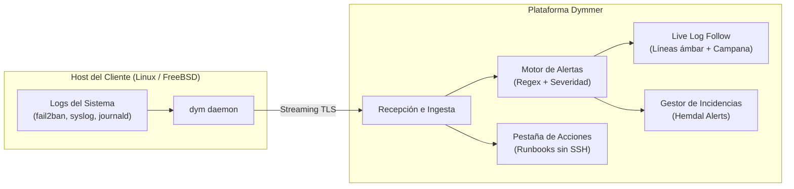

id: observabilidad-y-operaciones-de-servidor-en-vivo
title: Observabilidad y operaciones de servidor en vivo: logs del sistema, alertas regex y acciones sin SSH
subtitle: Cómo monitorizar fail2ban, el journal de systemd o la actividad de paquetes en tiempo real, detectar anomalías con alertas regex y ejecutar runbooks operativos desde Dymmer.
date: 2026-11-28
author: manuel
category: Hosts & SSH
tags: Hosts, Logs, Observability, Alerts, Regex, Server Management, dym, DevOps
language: es
alternate: live-server-observability-and-operations
summary: Descubre cómo Dymmer transforma la administración de servidores con observabilidad a nivel de host: streaming en vivo de logs del sistema (fail2ban, syslog, dpkg), alertas inteligentes con expresiones regulares y resaltado visual ámbar, y runbooks de acciones declarativas con dym daemon sin abrir sesiones SSH interactivas.

Administrar un parque de servidores —ya sean máquinas virtuales en la nube, servidores dedicados o instancias bare-metal— suele poner a los equipos técnicos frente a un dilema clásico de observabilidad y mantenimiento:

1. **La sobrecarga de las pilas centralizadas:** Montar y mantener clústeres de recolección de logs (como Elasticsearch/Logstash/Kibana o Grafana Loki/Prometheus) para un puñado de servidores añade una capa de complejidad, consumo de memoria y costes de infraestructura que a menudo supera el valor de lo que se desea monitorizar.
2. **El riesgo y la lentitud del "SSH manual":** La alternativa tradicional es conectarse por SSH, abrir múltiples ventanas de terminal con `tail -f /var/log/syslog` o `journalctl -u nginx -f`, ejecutar comandos de diagnóstico a mano y depender de la memoria de cada operador para recordar las contraseñas, rutas y sintaxis de reinicio de cada servicio.

En las recientes actualizaciones de **Dymmer** hemos dado un salto cualitativo en la gestión de infraestructura: **el Host es ahora una entidad de primera clase con su propia observabilidad y panel de operaciones**.

Ya no necesitas vincular un log o una acción a un proyecto de software específico para poder vigilarlo. Ahora puedes monitorizar registros del sistema operativo (`fail2ban`, `dpkg`, `auth.log`, `journald`), definir **alertas con expresiones regulares y filtros de severidad**, ver las líneas críticas **resaltadas en ámbar en el streaming en vivo**, y ejecutar **acciones operativas seguras** mediante el daemon ligero `dym`.

---

## 1. El Host como entidad autónoma: logs del sistema desacoplados

En arquitecturas PaaS convencionales, toda la telemetría gira alrededor del "código de la aplicación". Sin embargo, los incidentes operativos más destructivos en producción rara vez empiezan en el código de tu web:

* Un ataque de fuerza bruta por SSH que satura conexiones antes de que actúe el cortafuegos.
* Un proceso que agota la memoria RAM y provoca la intervención del *OOM Killer* (*Out Of Memory*) del kernel de Linux.
* Un disco que se llena inesperadamente por rotaciones fallidas o temporales abandonados.
* Servicios de seguridad como `fail2ban` o `crowdsec` bloqueando IPs o sufriendo desconexiones.

Con la nueva pestaña de **Logs** a nivel de Host en Dymmer, cualquier archivo de log del sistema o unidad del journal puede ser registrado directamente en el servidor. El daemon `dym` se encarga de transmitirlo de forma segura mediante conexiones cifradas hacia Dymmer.



---

## 2. Alertas inteligentes: Expresiones Regulares y Severidad Mínima

Un log sin filtros es simplemente ruido. Si recibes 5.000 líneas por minuto, nadie puede leerlas en una terminal. Y si recibes una notificación por cada línea que llega, la fatiga de alertas hace que ignores los problemas reales.

En Dymmer hemos introducido un mecanismo de evaluación en dos fases:

1. **El filtro base del log:** Limpia el ruido estático para que solo las líneas relevantes se almacenen y procesen.
2. **La regla de coincidencia de la alerta (`match`):** Una expresión regular (evaluada sin distinguir mayúsculas de minúsculas) que busca patrones específicos en el texto del mensaje.
3. **Severidad mínima (para Systemd Journal):** En fuentes compatibles con journald, puedes exigir que la alerta solo se dispare a partir de un nivel de severidad determinado (por ejemplo, `WARN`, `ERROR` o `CRIT`).

### Casos de uso prácticos con expresiones regulares:

| Evento que deseas vigilar | Expresión regular (`match`) | Archivo de log típico | Acción recomendada |
| --- | --- | --- | --- |
| **Baneos activos de Fail2ban** | `Ban \d+\.\d+\.\d+\.\d+` | `/var/log/fail2ban.log` | Notificar al equipo de seguridad de ataques coordinados. |
| **Kernel OOM Killer** | `Out of memory: Kill process` | `/var/log/kern.log` o journal | Investigar fugas de memoria o ampliar recursos del host. |
| **Fallos de autenticación SSH** | `Failed password for (invalid user )?\w+` | `/var/log/auth.log` | Comprobar origen del tráfico y vigilar intentos de intrusión. |
| **Reinicios o caídas de servicios** | `service.*(failed\|crashed\|exited)` | `journalctl` | Ejecutar acción de reinicio o volcado de diagnósticos. |
| **Actualizaciones o fallos de paquetes** | `status (half-installed\|failed)` | `/var/log/dpkg.log` | Evitar estados corruptos en gestores de paquetes. |

---

## 3. Streaming en vivo (*Live Log Follow*) con resaltado ámbar

Una de las experiencias más potentes de Dymmer es el visor **Log Follow**. Al acceder al seguimiento en vivo de un log del host, Dymmer mantiene una conexión en tiempo real con el servidor mediante WebSockets en LiveView.

Cuando una línea entrante coincide con la expresión regular de una de tus alertas activas:

1. **Resaltado visual inmediato:** La línea recibe un fondo ámbar distintivo (`bg-amber-500/15 border-l-2 border-amber-400`).
2. **Acceso directo al incidente:** En el margen izquierdo de la línea aparece el icono interactivo de la campana (`hero-bell-alert`), con un enlace directo a la ficha de la alerta (`/alerts/:id`).
3. **Contexto completo:** Puedes ver exactamente qué estaba ocurriendo en el servidor los segundos previos y posteriores al evento, eliminando la necesidad de correlacionar marcas de tiempo a ciegas.

```text
[14:22:05] INFO  fail2ban.filter : [sshd] Found 198.51.100.24 - 2026-11-28 14:22:05
[14:22:08] INFO  fail2ban.filter : [sshd] Found 198.51.100.24 - 2026-11-28 14:22:08
🔔 [14:22:10] NOTICE fail2ban.actions: [sshd] Ban 198.51.100.24   <-- Resaltada en ámbar
[14:22:12] INFO  fail2ban.actions: [sshd] 198.51.100.24 ban synced to nftables
```

---

## 4. Acciones del Host: Runbooks operativos sin sesiones SSH

Detectar un problema en los logs es solo la mitad del trabajo; la otra mitad es resolverlo. 

Normalmente, tras recibir una alerta, el administrador debe abrir un terminal, buscar las credenciales de acceso, autenticarse por SSH y escribir los comandos adecuados. Si la persona de guardia no tiene acceso directo o está en movilidad, la resolución se retrasa innecesariamente.

Con las **Acciones de Host** de Dymmer, puedes declarar tareas operativas directamente en el archivo de configuración del daemon `dym` en el servidor:

```toml
# Configuración en el host (/etc/dym/dym.toml)
[actions.restart_firewall]
command = "systemctl restart nftables"
description = "Recargar reglas del cortafuegos y limpiar tablas temporales"

[actions.check_disk_usage]
command = "df -h && du -sh /var/log/* | sort -hr | head -n 5"
description = "Diagnosticar consumo de espacio en particiones y logs"

[actions.unban_ip]
command = "fail2ban-client unban --all"
description = "Desbloquear temporalmente todas las IPs en jaulas de fail2ban"
```

### ¿Por qué este modelo es más seguro que el SSH tradicional?

1. **Principio de mínimo privilegio:** Dymmer **no envía comandos arbitrarios** al servidor. La interfaz web únicamente envía al daemon el nombre de la acción registrada (`"restart_firewall"`). Es el propio daemon local el que ejecuta el comando predefinido en su configuración interna.
2. **Control de acceso basado en roles (RBAC):** Puedes autorizar a operadores o miembros de tu equipo a pulsar el botón de una acción desde el panel de Dymmer sin darles acceso a la consola SSH ni permisos de superusuario (`sudo`).
3. **Trazabilidad y resultados en tiempo real:** Cuando una acción se ejecuta, su salida (`stdout` y `stderr`), código de salida y duración se retransmiten en vivo por el canal `host_actions:<id>` y quedan registrados para auditoría.

---

## 5. El ecosistema completo de Dymmer para infraestructura

La combinación de **Logs en vivo**, **Alertas regex**, **Acciones de host** y acceso seguro con [Dym Bridge](/es/posts/gestionar-un-host-y-acceder-con-dym-bridge/) proporciona una plataforma integral para operar servidores modernos:

* **Para incidencias rápidas:** Consulta el visor en vivo, identifica la línea marcada con la campana y ejecuta el runbook de solución con un solo clic.
* **Para mantenimiento profundo:** Abre archivos de configuración de forma aislada a través de SFTP con Dym Bridge sin repartir claves privadas.
* **Para tranquilidad:** Deja que el motor de alertas supervise la salud del sistema 24/7 y te avise únicamente cuando un patrón crítico aparezca en los registros.

El control de tu infraestructura ya no exige elegir entre herramientas monolíticas sobredimensionadas o el caos de terminales manuales. Con Dymmer, tus servidores son observables, seguros y operativos desde una única interfaz intuitiva.
