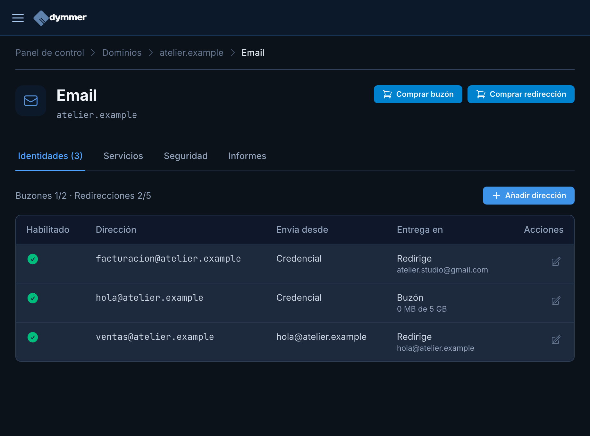
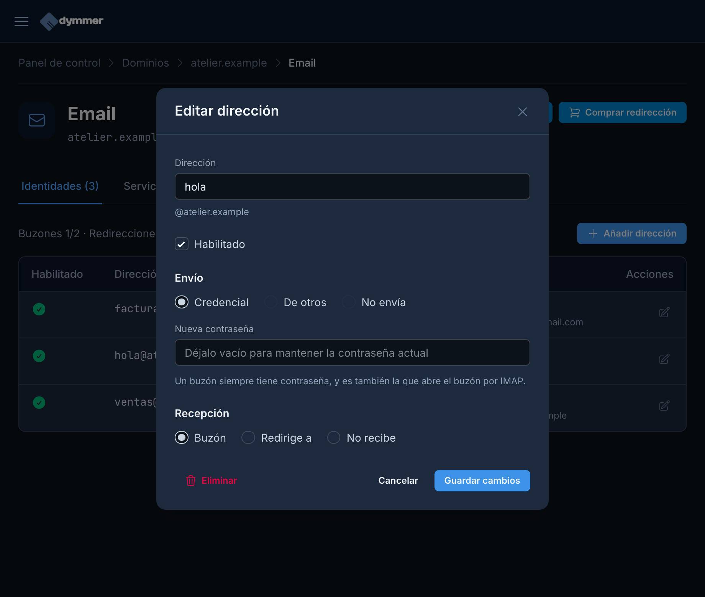
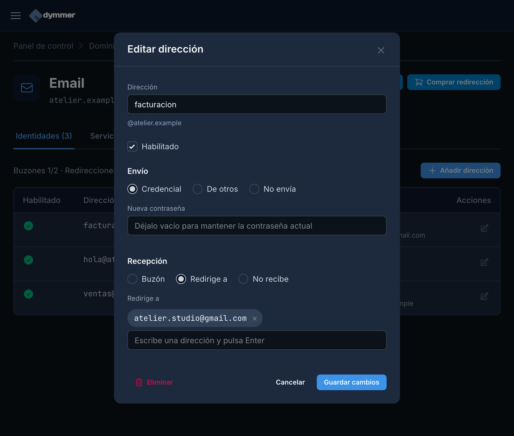
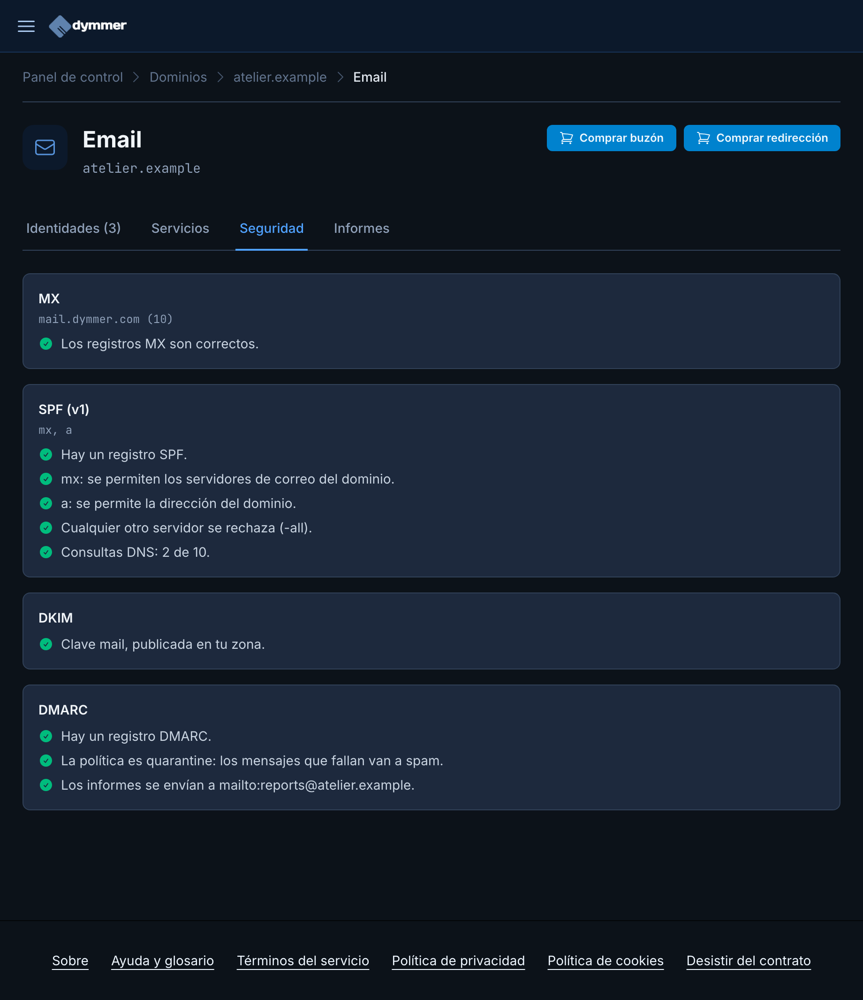
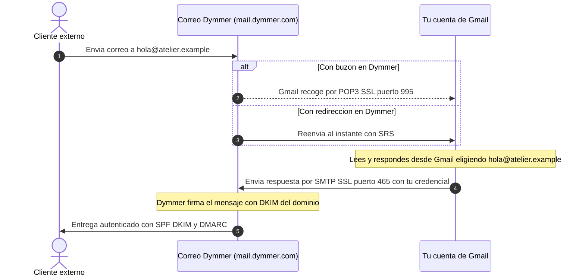
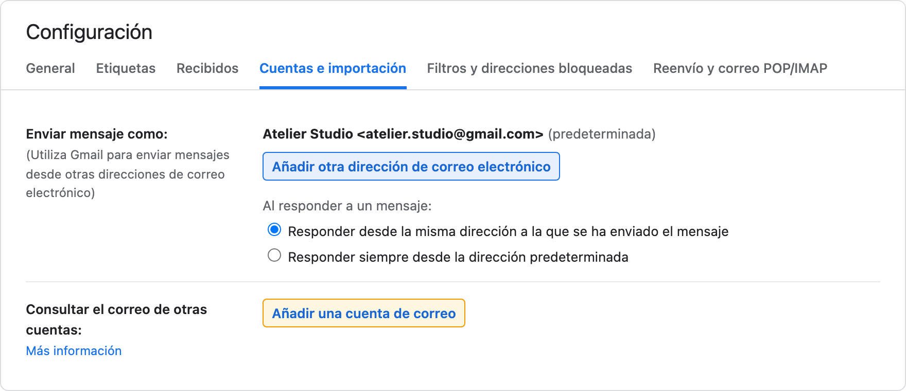
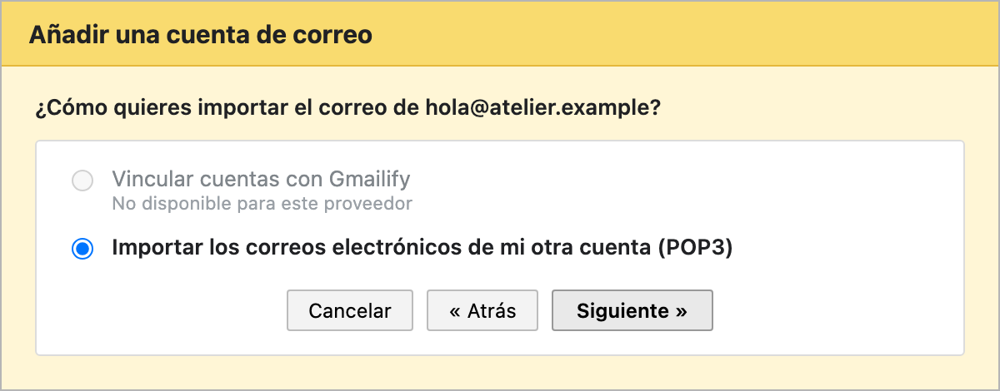
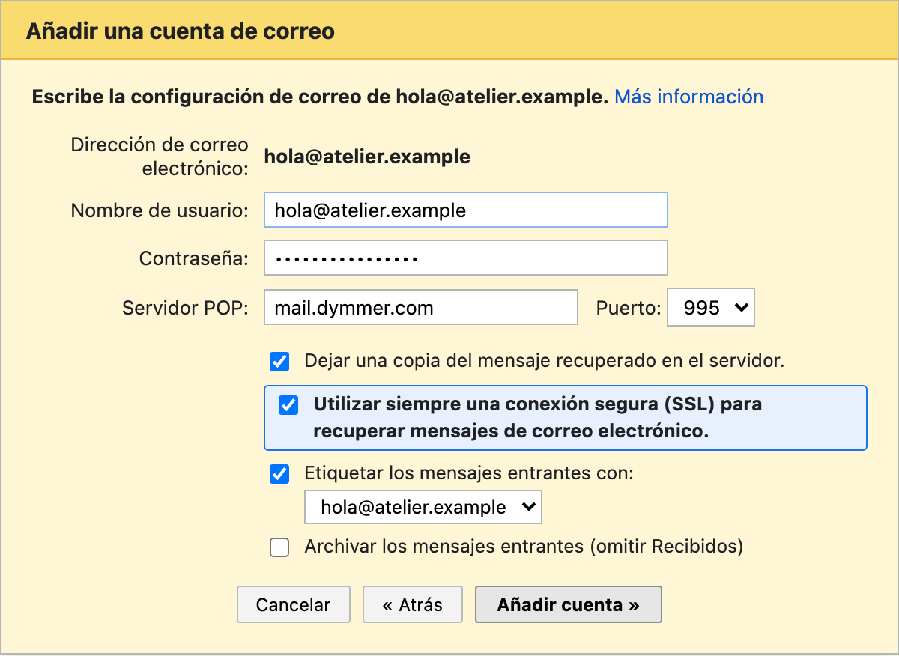
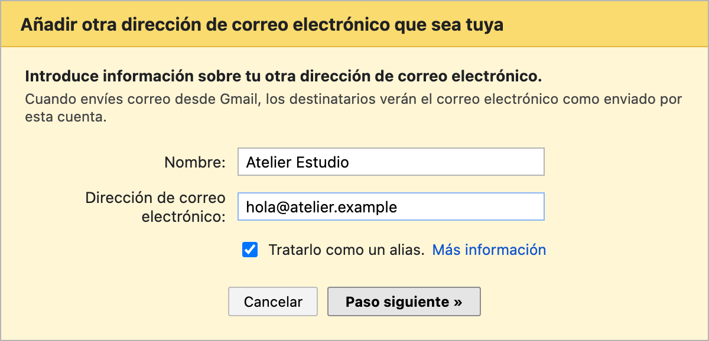
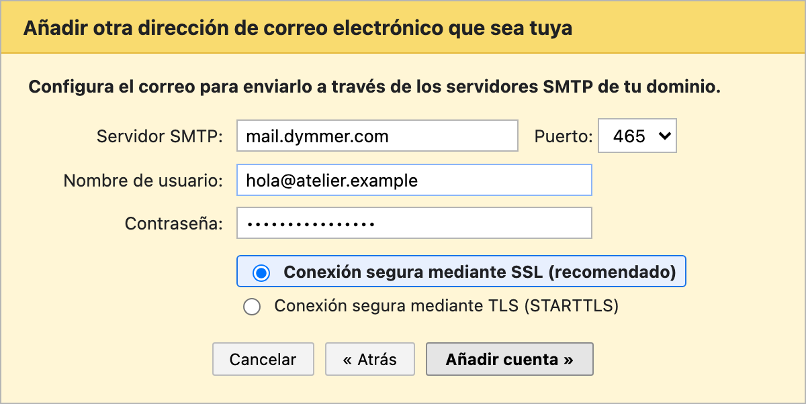

id: usa-gmail-como-cliente-de-correo
title: Usa Gmail como cliente de correo para tu dominio propio
subtitle: Cómo recibir y enviar correos con @tudominio.com desde Gmail usando POP3, redirecciones y SMTP.
date: 2026-11-11
author: manuel
category: Email & DNS
tags: Email, Gmail, POP3, SMTP, Custom Domain, Dymmer
language: es
alternate: use-gmail-as-email-client
summary: Aprende a configurar tu correo corporativo de Dymmer dentro de Gmail para leer y responder mensajes como @tudominio.com sin cambiar de bandeja de entrada, usando buzones POP3 con SSL o redirecciones + SMTP.

Tener una dirección profesional como `hola@tudominio.com` transmite mucha más confianza que escribir desde una cuenta gratuita genérica. Sin embargo, cambiar tus hábitos diarios para abrir otro webmail o gestionar varias bandejas distintas suele acabar en mensajes sin leer y respuestas lentas.

La buena noticia es que **no necesitas abandonar Gmail** para usar tu correo con dominio propio. Puedes centralizar todos los mensajes entrantes en tu cuenta personal de Gmail y responder directamente con tu dirección corporativa, manteniendo intactas las firmas **DKIM**, **SPF** y **DMARC** de tu dominio.

En esta guía veremos cómo preparar primero las direcciones en **Dymmer** (con nuestro dominio ficticio de demostración `atelier.example`) y después cómo conectar **Gmail** paso a paso tanto para recibir como para enviar mensajes.

*(Las capturas corresponden a una instancia real de desarrollo de Dymmer con datos ficticios bajo el sufijo reservado `.example` según [RFC 2606](https://www.rfc-editor.org/rfc/rfc2606); sustituye `atelier.example` y `atelier.studio@gmail.com` por tu dominio y tu cuenta real).*

---

## 1. Elige cómo quieres recibir el correo: buzón completo o redirección

Antes de tocar nada en Gmail conviene decidir cómo quieres guardar tus correos en Dymmer. Tienes dos formas de hacerlo, y ambas son compatibles con usar Gmail como cliente:

| Enfoque | Qué creas en Dymmer | Ventajas principales | Cuándo elegirlo |
| --- | --- | --- | --- |
| **Buzón + POP3 en Gmail** | Dirección con recepción **Buzón** y envío **Credencial** | Conserva copia en el servidor de Dymmer si quieres usar webmail o IMAP en el móvil o Thunderbird. | Cuando necesitas almacenamiento propio en tu dominio o acceso desde varios clientes. |
| **Redirección + SMTP en Gmail** | Dirección con recepción **Redirige a** tu `@gmail.com` y envío **Credencial** (o **De otros**) | El correo llega al instante en cuanto entra (sin esperar a que Gmail consulte por POP3) y no ocupa cuota de buzón. | Cuando Gmail va a ser tu único lugar de lectura y archivo. |

En **Dymmer**, la capacidad de enviar por SMTP (**Envío**) es independiente de cómo recibas el correo (**Recepción**). Esto significa que puedes crear una redirección gratuita hacia tu `@gmail.com` y darle igualmente su propia contraseña SMTP para responder desde Gmail como `facturacion@atelier.example`.

---

## 2. Configura tus direcciones en Dymmer

Si acabas de registrar o migrar tu dominio, asegúrate primero de tener su zona DNS y servidor de correo activos (puedes repasar los primeros pasos en la [guía inicial tras comprar un dominio](/es/posts/he-comprado-un-dominio-y-ahora-que/)).

Dentro de tu panel de **Dymmer**, entra en **Dominios**, abre tu dominio y pulsa el botón **Email** en la parte superior derecha. Llegarás a la pestaña de direcciones, donde verás los contadores de buzones y redirecciones disponibles junto al botón **Añadir dirección**:

En nuestra demostración de `atelier.example` hemos preparado los tres escenarios más habituales:

1. **`hola@atelier.example`**: buzón completo con contraseña propia (ideal para conectarlo por **POP3 + SMTP** en Gmail o IMAP desde cualquier otro dispositivo).
2. **`facturacion@atelier.example`**: redirección directa a `atelier.studio@gmail.com` con credencial SMTP propia (llega al instante a Gmail y puede responder como `facturacion@atelier.example`).
3. **`ventas@atelier.example`**: redirección hacia `hola@atelier.example` con envío autorizado **De otros** (`hola@atelier.example`), para centralizar departamentos sin multiplicar contraseñas.

### Paso A: Crear un buzón con credencial (para POP3 y SMTP)

Pulsa **Añadir dirección** (o el icono de lápiz para editar una existente). Completa los tres bloques:

- **Dirección:** el nombre antes de la arroba (por ejemplo, `hola`).
- **Envío:** selecciona **Credencial** y escribe una contraseña segura y exclusiva para el correo. Esta misma contraseña servirá tanto para descargar por POP3/IMAP como para autenticar el envío por SMTP desde Gmail.
- **Recepción:** selecciona **Buzón**.

Pulsa **Guardar cambios**. La cuenta queda activa en el servidor de correo en cuestión de minutos (normalmente menos de 5 minutos en sincronizarse).

### Paso B: Alternativa ligera con redirección y envío SMTP

Si prefieres que el correo llegue inmediatamente a Gmail sin ocupar un buzón, cambia **Recepción** a **Redirige a**, escribe tu dirección `@gmail.com` y pulsa **Intro** para añadirla. Mantén **Envío → Credencial** con una contraseña si también vas a querer responder desde Gmail con esa dirección:

### Paso C: Comprueba que SPF, DKIM y DMARC están correctos

Antes de pasar a Gmail, abre la pestaña **Seguridad** dentro de **Email**. Verifica que los tres pilares de autenticación aparezcan validados en verde:

Sin **DKIM** ni **SPF**, o con una política **DMARC** mal alineada, tus correos enviados desde Gmail podrían ser rechazados por otros proveedores. Si ves algún aviso pendiente en esta pantalla, revisa nuestra [guía técnica de SPF, DKIM y DMARC](/es/posts/como-evitar-que-el-correo-caiga-en-spam/).

---

## 3. Datos de conexión del servidor de correo de Dymmer

Ten a mano esta tabla antes de abrir los ajustes de Gmail. El nombre del servidor en el correo gestionado de Dymmer es **`mail.dymmer.com`** (o el nombre que aparezca en el registro `MX` de tu dominio si utilizas otro servidor de correo autorizado en tu cuenta, como `cedar.altenwald.com`):

| Servicio | Protocolo | Servidor | Puerto | Cifrado | Nombre de usuario |
| --- | --- | --- | --- | --- | --- |
| **Correo entrante (Gmail)** | **POP3** | `mail.dymmer.com` | **`995`** | **SSL obligatorio** | Dirección completa (`hola@atelier.example`) |
| **Correo saliente (Gmail)** | **SMTP** | `mail.dymmer.com` | **`465`** *(o `587`)* | **SSL** (`465`) / **TLS** (`587`) | Dirección completa con credencial |
| **Otros clientes (móvil/PC)** | **IMAP** | `mail.dymmer.com` | `993` | SSL/TLS | Dirección completa (`hola@atelier.example`) |

**Dos reglas que evitan el 90 % de los errores:**
1. El **Nombre de usuario** es siempre la **dirección de correo completa** (`hola@atelier.example`), nunca solo `hola`.
2. Marca siempre **SSL** con el **puerto 995** en POP3. Aunque algunas capturas antiguas muestran el puerto `110` sin SSL, los servidores de Dymmer exigen cifrado y rechazan la autenticación en texto plano.

---

## 4. Cómo funciona el flujo completo con Gmail

Cuando conectas ambos extremos —recepción y **«Enviar mensaje como»**—, el recorrido de tus correos queda así:

Fíjate en el paso final: como Gmail se autentica contra **Dymmer por SMTP** para enviar la respuesta, el mensaje sale realmente desde los servidores autorizados de tu dominio y firmado con tu **DKIM**, exactamente igual que si hubieras usado un cliente de escritorio.

---

## 5. Añade tu cuenta en Gmail para recibir correos (POP3)

*(Si en Dymmer elegiste **Redirige a** en lugar de **Buzón**, sáltate esta sección y pasa directamente al punto 6 para configurar el envío).*

1. Abre **Gmail** en el navegador desde un ordenador *(la versión web de escritorio es necesaria para añadir cuentas externas; después los correos aparecerán también en la app móvil)*.
2. Haz clic en el icono de la **rueda dentada (Configuración)** arriba a la derecha y pulsa **Ver todos los ajustes**.
3. Entra en la pestaña **Cuentas e importación**.
4. Busca el apartado **Consultar el correo de otras cuentas** y haz clic en **Añadir una cuenta de correo**:

5. En la ventana emergente, escribe tu dirección completa (ej. `hola@atelier.example`) y pulsa **Siguiente**.
6. Selecciona **Importar los correos electrónicos de mi otra cuenta (POP3)** y pulsa **Siguiente**:

7. Rellena los campos de conexión:
   - **Nombre de usuario:** `hola@atelier.example`
   - **Contraseña:** la contraseña que definiste en Dymmer
   - **Servidor POP:** `mail.dymmer.com`
   - **Puerto:** **`995`**
8. Revisa las cuatro casillas inferiores antes de guardar:
   - **Utilizar siempre una conexión segura (SSL) para recuperar mensajes de correo electrónico:** **Actívala siempre**. Es obligatoria para el puerto `995`.
   - **Dejar una copia del mensaje recuperado en el servidor:** **Actívala** si quieres que los correos sigan existiendo en el buzón de Dymmer (para consultarlos desde otro ordenador, móvil IMAP o webmail). Si la dejas desmarcada, Gmail borrará cada mensaje del servidor tras descargarlo.
   - **Etiquetar los mensajes entrantes:** muy recomendable marcarla (por defecto con el nombre `hola@atelier.example`) para identificar visualmente qué correos llegan a tu dominio.
   - **Archivar los mensajes entrantes (omitir Recibidos):** déjala desmarcada si quieres ver estos correos en tu bandeja principal *Recibidos*.

9. Pulsa **Añadir cuenta**.

En cuanto Gmail valide el acceso POP3 comenzará a descargar los mensajes existentes en el buzón y comprobará si hay correo nuevo periódicamente.

---

## 6. Configura «Enviar mensaje como» en Gmail (SMTP)

Sin este paso, cuando respondas a un cliente desde Gmail el remitente seguirá siendo tu dirección `@gmail.com`. Configurarlo lleva menos de dos minutos:

1. Si terminaste el paso anterior, Gmail te preguntará directamente: *«¿Deseas también poder enviar correo electrónico como hola@atelier.example?»*. Selecciona **Sí** y pulsa **Siguiente**.
   - *Si vienes desde cero o configuraste una redirección en Dymmer*: ve a **Configuración → Ver todos los ajustes → Cuentas e importación**, busca **Enviar mensaje como** y pulsa **Añadir otra dirección de correo electrónico**.
2. Escribe el **Nombre** que verán tus destinatarios (por ejemplo, `Atelier Estudio` o tu nombre) y confirma la dirección (`hola@atelier.example`).
3. Sobre la casilla **Tratarlo como un alias**:
   - Déjala marcada si quieres que los mensajes enviados aparezcan como parte del mismo buzón unificado y Gmail seleccione automáticamente la dirección adecuada al responder.
   - Desmárcala si quieres gestionar esa identidad de forma totalmente separada. En ambos casos, en la tabla de **Enviar mensaje como** conviene dejar marcada abajo la opción **Responder desde la misma dirección a la que se ha enviado el mensaje**.

4. Pulsa **Paso siguiente** y rellena los datos del servidor SMTP de salida:
   - **Servidor SMTP:** `mail.dymmer.com`
   - **Puerto:** **`465`** con **Conexión segura mediante SSL (recomendado)** *(o `587` con **TLS**)*
   - **Nombre de usuario:** `hola@atelier.example` *(si vas a enviar como un alias configurado con **De otros**, introduce aquí la dirección con credencial autorizada, como `hola@atelier.example`, y su contraseña)*
   - **Contraseña:** la contraseña asignada a esa credencial en Dymmer.

5. Pulsa **Añadir cuenta**.
6. Gmail enviará un **código de verificación** por correo a `hola@atelier.example`. Como ya configuraste la redirección o la descarga POP3, ese mensaje entrará en tu bandeja de Gmail. Copia el código (o haz clic en el enlace de confirmación) y pégalo en el asistente.

A partir de ese momento verás un desplegable en el campo **De** cada vez que redactes un correo en Gmail, y las respuestas a correos recibidos en tu dominio saldrán automáticamente con tu dirección `@tudominio.com`.

---

## 7. Consejos prácticos y resolución de problemas frecuentes

Si algo falla durante la prueba, repasa esta lista rápida de comprobación:

- **Error de autenticación en POP3 o SMTP:** comprueba que el nombre de usuario incluye `@tudominio.com` completo y que no hayas dejado espacios al copiar la contraseña. Si editaste la dirección en Dymmer hace un momento, recuerda que los cambios tardan hasta **5 minutos** en propagarse a los servidores de correo.
- **Error de conexión o certificado en POP3:** verifica que el puerto sea **`995`** (no `110`) y que esté marcada la casilla **Utilizar siempre una conexión segura (SSL)**.
- **Los correos tardan varios minutos en aparecer por POP3:** es un comportamiento normal de Gmail al consultar servidores externos por POP3 (el intervalo depende de la frecuencia con la que recibes correo en esa cuenta). Si necesitas entrega instantánea, cambia en Dymmer la recepción del buzón a **Redirige a** tu `@gmail.com` manteniendo tu credencial SMTP para enviar, o pulsa **Comprobar si tengo correo ahora** en *Cuentas e importación*.
- **Un alias extra compartido (`ventas@`, `soporte@`):** si quieres enviar también como otra dirección secundaria sin recordar más contraseñas, usa en Dymmer **Envío → De otros** apuntando a tu cuenta principal con credencial (`hola@atelier.example`), y repite el paso 6 introduciendo la dirección secundaria en Gmail pero autenticando el SMTP con tu credencial principal.
- **Tus correos enviados caen en spam:** revisa la pestaña **Seguridad** dentro de **Email** en Dymmer para confirmar que `SPF`, `DKIM` y `DMARC` están bien configurados, y sigue las recomendaciones de nuestra [guía contra el spam](/es/posts/como-evitar-que-el-correo-caiga-en-spam/).
